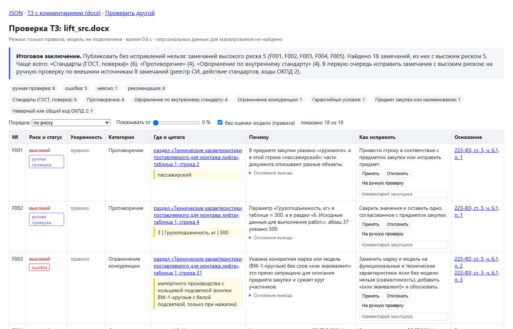
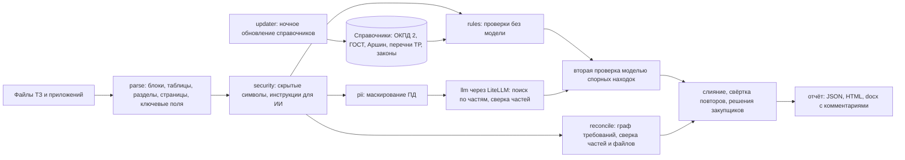

# Проверка ТЗ на закупку по 223-ФЗ

Команда ДождИИ, хакатон МФТИ hack80, задача «Интеллектуальная проверка технического задания на закупку».

**Главное**
- Из 105 правок экспертов-закупщиков система находит 97 по месту и 84 строго (то же место, та же категория, цитата про это место).
- В итоговых ТЗ, которые эксперты уже исправили, она нашла 3 оставшиеся ошибки (модель кнопок BW-1 без «или эквивалент» и два ГОСТ, заменённых по каталогу Росстандарта).
- Проверена на 30 чужих ТЗ из ЕИС (30 заказчиков, 16 предметных областей), каждое замечание размечено вручную.
- Без модели и без сети документ проверяется за 0,1-8 с.
- Docker одной командой, весь демо-сценарий одним скриптом.

Система принимает техническое задание (docx, doc, rtf, odt, pdf, сканы pdf и картинки, xlsx, txt; основное ТЗ и приложения вместе) и выдаёт отчёт для сотрудника закупок: список проблем с цитатой и местом в документе, категорию, объяснение, исправление, нормативное основание и итоговое заключение. Работает без модели на правилах и справочниках; с языковой моделью (Qwen3.8-27B через LiteLLM) перепроверяет спорные находки и добавляет свои замечания отдельным блоком на ручную проверку. Персональные данные маскируются до отправки текста в модель. По умолчанию проверка не обращается в сеть, справочники берутся из локальных копий, модель не подключена.

## Быстрый старт

Требования: Docker 24+ с Compose v2.24+, 4 ГБ RAM, 2 ГБ на диске под образ (5,3 ГБ с OCR и эмбеддингами). Интернет нужен только при сборке.

```bash
git clone https://github.com/kitkey/mipt-hack-tz.git && cd mipt-hack-tz
cp .env.example .env              # по умолчанию без модели: правила и справочники
docker compose up -d --build      # веб-интерфейс: http://localhost:8000
docker compose down               # остановка
```

Полный образ со сканами и гибридным поиском норм: `WITH_OCR=1 WITH_RAG=1 docker compose up -d --build`, подробности в разделах «Сканы» и «Пункты норм».

Проверка установки:

```bash
curl http://localhost:8000/health
# {"status":"ok","llm":false,"model":""}
curl -F "file=@samples/lift_src.docx" "http://localhost:8000/api/check?use_llm=false"
# JSON: "status": "ok", 18 замечаний, из них высокого риска 5
docker compose exec -e TZCHECK_REFDATA_OFFLINE=1 app python eval/eval_labels.py
# строго (категория + цитата про это место): 84/105 = 80%
```

Весь сценарий одной командой: `sh demo/run_demo.sh` (Linux, macOS, Git Bash) или `powershell -File demo/run_demo.ps1` (Windows). Скрипт поднимает сервис, проверяет два ТЗ и исправленную версию, сравнивает версии, отправляет повреждённый файл, запускает CLI в контейнере и пересчитывает качество. Результаты в `demo/out/`.

## Где смотреть по критериям

| Критерий | Где смотреть |
|---|---|
| 1. Разбор ТЗ и привязка к документу | [«Что на выходе»](#что-на-выходе): раздел, таблица, строка, страница и цитата у каждого замечания; HTML-отчёт `demo/output/02_lift_src/report.html` со ссылкой от замечания к тексту |
| 2. Выявление ошибок и рисков | [«Качество»](#качество): 105 правок, синтетические дефекты, замечания на итоговых ТЗ; `demo/output/01_metro_src/`, `04_lift_fin/` |
| 3. Классификация и объяснение | 10 категорий кейса в [«Что на выходе»](#что-на-выходе), сценарий 1 в [«Типовых сценариях»](#типовые-сценарии-с-настоящим-выводом), разметка `eval/labels.csv` |
| 4. Исправления и нормативные основания | защита от выдуманных оснований в [«Архитектуре»](#архитектура), [«Пункты норм»](#пункты-норм-rag), `demo/output/13_lift_src_rag/` |
| 5. Универсальность и надёжность | [«Как проверяли обобщение»](#как-проверяли-обобщение), сценарии 4 и 5, `demo/output/07_*`-`11_*`, `12_broken_files/` |
| 6. Развёртывание и воспроизводимость | [«Быстрый старт»](#быстрый-старт), [«Переменные окружения»](#переменные-окружения), [«Внешние сервисы»](#внешние-сервисы), [«Архитектура»](#архитектура), `demo/run_demo.sh` |

## Что на выходе

Для каждого замечания:

| Поле | Что это |
|---|---|
| `location`, `block_id`, `quote` | раздел, таблица и строка или абзац, страница для PDF, файл для комплекта; дословная цитата из ТЗ |
| `category` | одна из 10 категорий кейса: ограничение конкуренции, некорректная характеристика, противоречие, неверный код ОКПД 2, гарантия, стандарты и поверка, неполнота или комплектность, предмет закупки, лишнее в ТЗ, оформление по практике заказчика |
| `severity` | высокий, средний, низкий риск |
| `status` | `ошибка`; `неясно`; `ручная проверка` (нужна внешняя сверка: реестр СИ, действие стандарта, точный код); `рекомендация` (практика заказчика, не требование закона) |
| `explanation` | почему фрагмент проблемный, со значениями из этого ТЗ |
| `fix` | исправленная формулировка или действие |
| `norm_ids` | основание только из встроенной базы норм (`tzcheck/norms.py`, 19 норм со ссылками и редакциями) |
| `evidence` | кто нашёл (правило, модель, сверка), что сказала вторая проверка, статус ГОСТ и дата сверки, найденные типы СИ в ФГИС «Аршин», редакция закона |

Внизу отчёта паспорт проверки: версии справочников, sha256 файла, модель, режим сети. Итоговое заключение начинается с вердикта («Публиковать без исправлений нельзя: замечаний высокого риска 5 (F001…)» или «Ошибок не найдено, мест на ручную проверку: N») и сводки по категориям. С моделью и без неё заключение и счётчики над таблицей считаются только по основному списку.

Форматы: JSON, HTML-отчёт с переходом от замечания к тексту документа и кнопками решения закупщика, копия исходного docx с комментариями Word на проблемных местах (для каждого docx комплекта).

Интерфейсы: веб-форма (`/`), REST API (`/api/check`, `/api/compare`, `/api/feedback`), командная строка (`python -m tzcheck`).




## Архитектура



Поток данных: файл разбирается в блоки (абзац, строка таблицы, заголовок) с разделом, номером таблицы и строки, страницей и файлом. Правила и сверка работают по блокам и справочникам. Если модель подключена, текст после маскирования ПД уходит в неё частями по 3500 знаков вместе с уже найденным правилами; модель возвращает JSON, код проверяет, что цитата есть в блоке, а норма есть в базе. Находки модели и спорные находки правил проходят вторую проверку: подтвердить, отклонить, отдать человеку. Решения закупщика из отчёта сохраняются и влияют на следующие проверки.

| Компонент | Файл | Что делает |
|---|---|---|
| Разбор | `tzcheck/parse.py` | docx по порядку абзацев и таблиц, объединённые ячейки, разделы по нумерации; doc, rtf, odt через LibreOffice; pdf через PyMuPDF (абзацы по отступам, таблицы по линиям, склейка через разрыв страницы, номер страницы у блока); xlsx; сканы через PaddleOCR (`tzcheck/ocr.py`) |
| Правила | `tzcheck/rules.py` | марки и модели, «референс», пометки автора, нечёткие формулировки, сроки, ГОСТ и СНиП по каталогу Росстандарта, средства измерений и поверка по «Аршину», ОКПД 2 по классификатору, гарантия, комплектность, профили обязательных характеристик (`tzcheck/data/profiles.json`), противоречия таблицы и текста, предмет закупки |
| Сверка | `tzcheck/reconcile.py` | граф требований (объект, параметр, значение, единица, условие); расхождения значений, сроков, гарантии, приёмки, адресов между частями и файлами; ссылки на отсутствующие приложения и разделы; оглавление; повторённые разделы |
| ОКПД 2 | `tzcheck/okpd.py` | сверка наименования позиции с названием кода, подсказка точного кода вместо «прочих» |
| Маскирование ПД | `tzcheck/pii.py` | ФИО, телефоны, почта, СНИЛС, паспорт заменяются метками `[PERSON_1]` до модели и возвращаются в отчёт |
| Модель | `tzcheck/llm.py` | LiteLLM: один код для локального сервера и внешнего API; JSON-ответ; цитата и норма проверяются кодом |
| Справочники | `tzcheck/refdata.py`, `tzcheck/updater/` | локальные копии, кэш, ночное обновление с запасными путями |
| Конвейер | `tzcheck/pipeline.py` | порядок шагов, слияние дублей, вердикт и заключение, сравнение версий |
| Отчёт | `tzcheck/report.py` | JSON, HTML, docx с комментариями |
| Пункты норм | `tzcheck/rag/` | корпус 52 норм (223-ФЗ, 102-ФЗ, ГК ч. 2, ТР ТС 011/2011, 29 ГОСТ, 14 СП, 5 СНиП), BM25 на леммах и эмбеддинги deepvk/USER-bge-m3; к замечанию прикладывается пункт с дословной цитатой, цитата сверяется с текстом документа корпуса |
| Обратная связь | `tzcheck/feedback.py` | «Принять», «Отклонить», «На ручную проверку»; дважды отклонённое не показывается, правило с долей отклонений от 60 % (после 5 решений) уходит в ручную проверку |
| Веб и API | `tzcheck/api.py` | FastAPI: форма, API, скачивание отчётов |

**Как система не придумывает основания.** Норма в замечании указывается только идентификатором из встроенной базы (`tzcheck/norms.py`), неизвестный идентификатор код отбрасывает. Цитата замечания сверяется с исходным блоком документа, замечание без такой цитаты отбрасывается. Пункт нормы с дословной цитатой (`TZCHECK_RAG=1`) прикладывается, только если цитата есть в тексте нормы из корпуса; на 80 замечаниях, для которых нужной нормы в корпусе нет, система все 80 раз пункт не приложила. Замечание без основания в категориях «конкуренция» и «стандарты» получает статус «ручная проверка». Практика заказчика (сроки прописью, единая формулировка начала срока) подписана как практика и имеет статус «рекомендация». Итоговое заключение собирает код из замечаний основного списка и в режиме модели: свободный текст модели в него не попадает.

## Как проверяли обобщение

Правила писали по ТЗ МФТИ, поэтому отдельно собрали 30 ТЗ по 223-ФЗ из ЕИС: 30 заказчиков, 16 областей (ГСМ, мебель, страхование, охрана, разработка ПО и другие), docx и pdf. Набор поделили на dev (18 ТЗ) и test (12 ТЗ). Каждое замечание разметили вручную: верное, ложное или спорное, с причиной. На исходной версии было 12 замечаний на ТЗ, 56 % ложных, из 10 замечаний высокой важности 8 ложные. Основные причины: эвристики сверки таблиц, практика МФТИ, применённая ко всем заказчикам, и латиница с цифрой как признак модели. Правила практики МФТИ теперь включаются только для МФТИ (`tzcheck/customer.py`, `tzcheck/data/customers.json`), эвристики сверки и брендов сузили. На test после правок только по dev ложных стало 21 вместо 40. После всех правок 3,8 замечания на ТЗ и 16 % ложных; в эту цифру входят правки по наблюдениям на test, поэтому она не чистая. Полноту проверили синтетическими дефектами в ТЗ нового набора (найдено 88 из 93, было 89) и разметкой 105 замечаний эксперта на старом наборе (97 из 105 по месту, 84 из 105 строго, без изменений). Сбоев на новом наборе нет.

На всех 30 ТЗ у текущей версии из 109 замечаний верных 14, ложных 17, спорных 78. На незнакомом ТЗ отчёт в основном состоит из вопросов на ручную проверку (общий код ОКПД 2, старый ГОСТ без подтверждения, марка с «или эквивалент»). Документы набора в репозиторий не входят, в них контакты сотрудников заказчиков: `python eval/generalization/download_holdout.py` скачивает их по ссылкам из `data_raw/eis_holdout/manifest.csv` и сверяет sha256. Полный отчёт: `eval/generalization/REPORT.md`.

## Типовые сценарии с настоящим выводом

Готовые отчёты лежат в `demo/output/` (собраны `python demo/build_demo.py`, режим правил). Разбор находок: `demo/README.md`.

**1. ТЗ на работы с таблицей характеристик.** Вход: `samples/lift_src.docx`. Выход: `demo/output/02_lift_src/` (JSON, HTML, docx с комментариями). 18 замечаний, высокого риска 5:

| № | Риск, статус | Категория | Цитата | Исправление |
|---|---|---|---|---|
| F001 | высокий, ручная проверка | Противоречие | «пассажирский» в таблице при предмете «грузового лифта» | привести строку к предмету закупки |
| F002 | высокий, ручная проверка | Противоречие | «Грузоподъемность, кг: 300» при другом значении в тексте | оставить одно значение |
| F003 | высокий, ошибка | Ограничение конкуренции | «кнопки BW-1-круглые» без «или эквивалент» | заменить модель характеристиками |
| F004, F005 | высокий, ошибка | Стандарты | «ГОСТ Р 28911-2015», «ГОСТ Р 34441-2018»: таких ГОСТ Р нет, межгосударственные стандарты с этими номерами заменены | ГОСТ 28911-2021, ГОСТ 34441-2024 |
| F009 | средний, ошибка | Стандарты | «ГОСТ 53782-2010» без «Р» | ГОСТ Р 53782-2010 |
| F011 | средний, ручная проверка | Предмет закупки | «Спецификация на выполнение ремонтных работ» при предмете «замена» | назвать часть по предмету |
| F014 | низкий, рекомендация | Оформление | «105 календарных дней» | «105 (сто пять) календарных дней» |

Одна запись JSON целиком, с пунктом нормы (`demo/output/13_lift_src_rag/`, тот же документ с `TZCHECK_RAG=1`):

```json
{
 "id": "F003",
 "location": "раздел «Технические характеристики поставляемого для монтажа лифта», таблица 1, строка 31",
 "quote": "импортного производства с кольцевой подсветкой (кнопки BW-1-круглые с белой подсветкой, только при нажатии)",
 "category": "Ограничение конкуренции",
 "severity": "high",
 "status": "ошибка",
 "explanation": "Указана конкретная марка или модель (BW-1-круглые) без слов «или эквивалент»: это прямо запрещено для описания предмета закупки и сужает круг участников.",
 "fix": "Заменить марку и модель на функциональные и технические характеристики; если без модели нельзя (совместимость), добавить «(или эквивалент)» и обосновать.",
 "norm_ids": ["223-FZ-3-6.1-2", "223-FZ-3-6.1-3"],
 "evidence": {
  "найдено": "rule:brand",
  "цитата найдена в тексте": true,
  "пункт нормы": "223-ФЗ, Статья 3, ч. 6.1 «Принципы и основные положения закупки товаров, работ, услуг»",
  "цитата нормы": "2) в описание предмета закупки не должны включаться требования или указания в отношении товарных знаков, знаков обслуживания, фирменных наименований, ...",
  "нормы": ["223-ФЗ, ст. 3, ч. 6.1, п. 2 (редакция: действует с 01.01.2025, сверено с actual.pravo.gov.ru 13.11.2026)"]
 }
}
```

**2. ТЗ на поставку оборудования с моделями.** Вход: `samples/metro_src.docx`. Выход: `demo/output/01_metro_src/`. 92 замечания: «Референс: ТР 5006М или эквивалент» и марки RIGOL, Fluke, NI USB-6002 (ограничение конкуренции, 17), позиции без диапазона и погрешности (неполнота, 36), «при отнесении к СИ» (стандарты и поверка), общий код 26.51.66.190 у комплектов с подсказкой точного кода (ОКПД 2), пометки «вместо …» (лишнее в ТЗ).

**3. Повторная проверка после исправления.** Вход: `samples/metro_src.docx` и `samples/metro_fin.docx`. Выход: `demo/output/06_compare_metro/`. «Исправлено 90, осталось 2, новых 6». На итоговом ТЗ лифта 7 замечаний, 3 из них высокого риска: модель кнопок BW-1 без «или эквивалент» и два ГОСТ, заменённых по каталогу Росстандарта, закупщики в итоговой версии оставили.

**4. Чужое ТЗ из ЕИС.** Вход: ТЗ на поставку сервера (МГУ). Выход: `demo/output/07_eis_server_msu/`. 4 замечания на ручную проверку («совместимость с ЦПУ Intel или AMD» с отсылкой к исключению для совместимости, «совместимость с существующей инфраструктурой» без интерфейса, «комплект для монтажа» без состава, нет кода ОКПД 2). Обозначения AVX-512 и PCI Express марками не считаются. Ещё 4 ТЗ других областей (ремонт, клининг, медицинское оборудование, лифт с приложениями) в `demo/output/08_*`-`11_*`, ПД сотрудников заказчиков в них заменены метками.

**5. Повреждённый файл.** Вход: пустой файл, текст с расширением docx, обрезанный pdf (`12_broken_files`). Выход: `"status": "error"` и причина («файл пустой», «файл повреждён или это не docx»), API отвечает 400, сервис продолжает работать.

**6. Проверка с локальной моделью.** Вход: `samples/lift_fin.docx`, итоговое ТЗ лифта. Выход: `demo/output/18_lift_fin_llm_linear/` (JSON, HTML, docx с комментариями), команда `python demo/run_llm_cases.py` при поднятом сервере Qwen3.8-27B. 602 с на документ. Основной список тот же, что без модели: 7 замечаний правил, вердикт и заключение по ним. Модель не согласилась с правилом об общей ссылке на «действующие ГОСТ, СНиП…» и дала ему 10 %: замечание осталось с пометкой «модель не согласна с правилом, решает закупщик». СП 31-110-2003 она отправила на ручную проверку с оценкой 30 %. Ниже отдельный блок из 25 замечаний модели на ручную проверку, в вердикт они не входят:

| № | Место | Цитата | Замечание модели | Уверенность |
|---|---|---|---|---|
| M002 | таблица 1, строка 29 | «Тип» | у системы управления не указано значение | 95 % |
| M003 | раздел «Технические характеристики…», абзац 41 | «Габаритные размеры указаны ориентировочные и будут уточнены…» | размеры не зафиксированы, возможны разногласия при приёмке | 90 % |
| M001 | раздел 6, абзац 39 | «выпуска не ранее 2026 года» | год выпуска назван ограничением конкуренции | 95 % |
| M009 | таблица 1, строка 15 | «rAL7035» | RAL назван нестандартным обозначением | 80 % |

M002 и M003 по делу, правила их не ловят. M001 и M009 шум: требование к году выпуска нового лифта допустимо, RAL 7035 общепринятый каталог цветов. При этом уверенность у всех четырёх 80-95 %, поэтому каждое замечание блока закупщик принимает или отклоняет сам.

Итоговое заключение в режиме модели собирает тот же код, что и без неё, по 7 замечаниям основного списка. Модель пишет к основному списку короткое пояснение, в отчёте оно стоит подписанной строкой в блоке модели и в заключение не входит. В этом прогоне пояснение ошибается: кнопки BW-1 названы моделью лифта, упомянуты пометки про бюджет, которых в ТЗ нет. Счётчики статусов и категорий над таблицей считают только основной список, как и строка «показано 7 из 7»; у блока модели свои счётчики в заголовке.

Ещё сценарии с готовыми отчётами в `demo/README.md`: комплект из основного ТЗ и трёх приложений со ссылкой на отсутствующее «Приложение 6» (`11_eis_lift_with_appendices`), пункт нормы с цитатой (`13_lift_src_rag`), скан без текстового слоя (`14_lift_scan_ocr`), скрытая инструкция для ИИ (`15_injection`), прогоны с моделью в двух оркестрациях (`16_*`-`19_*`).

## Качество

Все цифры получены в режиме правил без модели, справочники из локальных копий (`TZCHECK_REFDATA_OFFLINE=1`). Повторить: команды в последнем столбце.

| Что меряем | Как | Результат | Команда |
|---|---|---|---|
| Правки закупщиков | 105 правок из двух пар «исходное / итоговое» ТЗ (лифт 13, метрология 92), разметка по 10 категориям в `eval/labels.csv`. Строго: замечание в том же абзаце или строке таблицы, той же категории, цитата про это место | строго 84/105 (80 %), по месту 97/105, с верной категорией 92/105 | `python eval/eval_labels.py` |
| Замечания на итоговых ТЗ | число замечаний на ТЗ после правок экспертов | лифт 7, из них высокого риска 3; все три это ошибки, которые эксперты оставили в итоговой версии (модель кнопок BW-1 без «или эквивалент» и два ГОСТ, заменённых по каталогу Росстандарта); метрология 8, высоких 0 | то же |
| Синтетические дефекты | в исправленные ТЗ по одному вставляются марка, референс, «по возможности», пометка, документация на английском, срок без даты, несуществующий код, код другого товара, удалённая гарантия, инструкция для ИИ, скрытый символ | 21/22 | `python eval/synth_defects.py` |
| Сверка частей | 60 вставок 12 видов (значение, диапазон, количество, сроки, гарантия, приёмка, комплектность, единицы, приложение, содержание, дубли разделов) в 5 документов, пары разнесены между основным файлом и приложением | 60/60; на исправленных ТЗ 0 ложных; на ЕИС 2 замечания о 5 отсутствующих приложениях, оба верные | `python eval/reconcile/evaluate_extended.py`, `score_manual.py` |
| Чужие ТЗ | 9 ТЗ из ЕИС (сервер, ремонт, лаборатории, медизделия, лифт), разметки нет, вручную просмотрены все замечания со статусом «ошибка» и высоким риском | 64 замечания, из них «ошибка» 1, высокий риск 1 | корпус не в репозитории (контакты сотрудников заказчиков), отчёты 5 ТЗ с маскированием ПД в `demo/output/07_*`-`11_*` |
| PDF против docx | 4 пары docx и PDF из кейса; CER по всему тексту, совпадение замечаний по категории и цитате | CER 0,06-1,09 %; замечаний совпало 18/18, 91/92, 7/7, 8/8 | `python eval/ocr_compare/benchmark_text.py` |
| Сканы | те же PDF без текстового слоя, 300 dpi, чистые и с искажениями (поворот 1-3°, шум, JPEG, печать) | совпало с docx: lift_src 15/18, metro_src 78/92; коды ОКПД 2 28/28 | `python eval/ocr_compare/run_ocr.py` |
| Пункты норм | 421 вопрос: 322 из замечаний правил (242 с ответом, 80 без), 99 из правок закупщиков (77 с ответом, 22 без) | замечания правил: верный пункт 242/242, отказ 80/80; правки: верный пункт 12/77, неверный 1 | `python eval/rag/run_eval.py`, `prod_eval.py` |
| Автотесты | разбор, правила, сверка, отчёты, PDF, OCR, пункты норм, маскирование, обратная связь, уверенность, блок модели с заглушкой | 106 прошли, 1 пропущен без PaddleOCR | `pytest tests/ -q` |
| Обобщение | 30 ТЗ из ЕИС других заказчиков и областей, каждое замечание размечено вручную; правки по 18 ТЗ, замер на 12 отложенных | на отложенных ложных 21 вместо 40; на всех 30 замечаний на ТЗ 3,8 вместо 12,0, ложных 16 % вместо 56 % | раздел «Как проверяли обобщение» |
| Время | один документ, режим правил | 0,1-8 с | |

По категориям (строго / всего): неполнота 22/30, конкуренция 15/18, стандарты 11/16, ОКПД 2 11/11, характеристики 9/10, лишнее 6/8, оформление 3/3, предмет 1/3, противоречия 3/3, гарантия 3/3. Место 5 правок в исходных документах не находится, они остаются в знаменателе.

С моделью строгий счёт на тех же 105 правках был ниже на 3 (79 против 82 на снимке кода до проверки обобщения), потому что перепроверка моделью снимала верные находки правил. Поэтому удалять находки правил модели запрещено.

## Локальная модель

Основа отчёта правила, они дают вердикт за секунды. Модель Qwen3.8-27B (открытые веса, через LiteLLM) включается переменными окружения для второго прохода. Она перепроверяет спорные замечания правил и добавляет свои отдельным блоком «Замечания модели: проверить вручную». У этого блока номера M001, M002, статус «ручная проверка», в JSON `section: "llm_review"`, в docx комментарий с пометкой «Модель, проверить вручную». В вердикт блок не входит. Удалять замечания правил модели запрещено. Если она не согласна, замечание остаётся с пометкой «модель не согласна с правилом, решает закупщик». На двух ТЗ кейса модель качество по разметке не подняла. Её польза в замечаниях, которых нет в правилах (пустое поле «Тип», ориентировочные габариты), но рядом с ними идёт шум.

```bash
# .env
TZCHECK_LLM_MODEL=openai/qwen3.8-27b
TZCHECK_LLM_API_BASE=http://host.docker.internal:8091/v1
TZCHECK_LLM_API_KEY=local
TZCHECK_LLM_WORKERS=1           # сервер однопоточный: параллельные запросы встают в очередь и упираются в таймаут
TZCHECK_LLM_TIMEOUT=900         # на один запрос
TZCHECK_LLM_DOC_TIMEOUT=1800    # на документ; после него отчёт правил выдаётся без оставшихся вызовов модели
```

```bash
docker compose up -d --force-recreate app
curl http://localhost:8000/health      # "llm": true
curl -F "file=@samples/lift_fin.docx" "http://localhost:8000/api/check?use_llm=true"
```

Сервер модели внешний, подойдёт любой OpenAI-совместимый, например Strata или llama.cpp (`llama-server -m Qwen3.8-27B-UD-Q2_K_XL.gguf -ngl 99 -c 16384 --port 8091`).

Итоговый прогон на видеокарте 12 ГБ (`demo/output/16_*`-`19_*`, `python demo/run_llm_cases.py`):

| Документ, оркестрация | Время | Основной список (высокий риск) | Блок модели (высокий риск) | Правил, с которыми модель не согласна |
|---|---:|---:|---:|---:|
| lift_src, linear | 378 с | 18 (5) | 20 (12) | 2 |
| lift_src, graph | 667 с | 18 (5) | 18 (10) | 2 |
| lift_fin, linear | 602 с | 7 (3) | 25 (4) | 1 |
| lift_fin, graph | 682 с | 7 (3) | 29 (13) | 1 |

Основной список с моделью совпадает с отчётом одних правил.

**Уверенность.** Модель в каждом ответе возвращает число 0-100, в HTML оно стоит в колонке «Уверенность» с сортировкой и ползунком «показывать от N %», в JSON в полях `confidence_pct` и `confidence_basis`. У замечаний правил без модели вместо числа пометка «правило». Уверенность не откалибрована. На исправленном lift_fin медиана 85-90 %, выше, чем на исходном lift_src (80-85 %). Она годится для сортировки и фильтра внутри отчёта, читать её как долю верных замечаний нельзя. Режим `graph` на LangGraph (`--orchestrator graph`, `TZCHECK_ORCHESTRATOR=graph`) отправляет замечания с уверенностью ниже `TZCHECK_CONF_LOW` (60) на повторную проверку моделью.

A/B на 105 правках, скорость движков и вероятности решений: `eval/models_ab/README.md`. Уверенность и граф оркестрации: `eval/confidence/REPORT.md`.

## Сканы (OCR)

PDF без текстового слоя и картинки (PNG, JPG, TIFF, BMP) распознаёт PaddleOCR PP-OCRv5 (детектор `PP-OCRv5_mobile_det`, распознавание `eslav_PP-OCRv5_mobile_rec`, русский язык). Перед правилами снимается наклон страницы, таблицы находятся по линиям сетки и раскладываются по ячейкам, текст вне таблиц собирается в абзацы, латинские буквы-двойники в русских словах меняются на кириллицу. К каждой распознанной странице в отчёт идёт предупреждение «текст распознан OCR (PaddleOCR): цифры и коды сверить с оригиналом».

```bash
WITH_OCR=1 docker compose up -d --build     # paddlepaddle 3.1.1, paddleocr 3.4.0, OpenCV; модели около 100 МБ скачиваются при сборке
curl -F "file=@scan.pdf" "http://localhost:8000/api/check?use_llm=false"
```

Если при сборке сети не было, модели скачаются при первом скане в том `models`. В образе без OCR скан не падает: API отвечает 400 «в PDF не найден текст: похоже на скан без текстового слоя…» с подсказкой, как включить распознавание. Первый скан после запуска идёт около минуты (загрузка Paddle), дальше 2-10 с на страницу на CPU.

Качество по страницам: эталон каждой страницы взят из текстового слоя того же PDF, 29 страниц, CPU.

| Страницы | CER | Слова | Числа | ОКПД 2 | Медиана, с/стр. |
|---|---:|---:|---:|---:|---:|
| 150 dpi, чистые | 1,06 % | 97,9 % | 98,1 % | 100 % | 6,0 |
| 150 dpi, искажённые | 1,77 % | 96,5 % | 96,9 % | 100 % | 5,6 |
| 300 dpi, чистые | 2,40 % | 94,5 % | 96,0 % | 100 % | 9,0 |
| 300 dpi, искажённые | 2,09 % | 95,9 % | 95,9 % | 100 % | 8,6 |

Скан целиком через проверку: lift_src совпадает с docx в 15 замечаниях из 18, metro_src в 78 из 92. Пункты списка внутри ячейки правила делят по маркерам и переводам строк, «Си» после OCR находится так же, как «СИ». Остаток на metro_src: OCR путает «DHO804» и «DH0804» и склеивает строки соседних позиций. Сканы синтетические: страницы своих PDF с наложенными искажениями. Методика: `eval/ocr_compare/`.

## Пункты норм (RAG)

С `TZCHECK_RAG=1` к замечанию прикладывается пункт нормы с дословной цитатой. Порядок выбора: статья из `norm_ids` замечания (с частью и подпунктом); стандарт, названный в цитате; иначе поиск по всему корпусу, только для конкуренции, стандартов и гарантии, с пометкой «проверить применимость» и ручной проверкой. Цитата сверяется с текстом документа корпуса; если её там нет, пункт не прикладывается.

Корпус `data/norm_corpus/`: 52 документа, 13 775 фрагментов (12 989 пунктов и 786 таблиц). В репозитории документы лежат сжатыми (`*.json.gz`, 2,4 МБ). Индекс BM25 собирается шагом Docker-сборки за 10-20 с; без Docker при первой проверке с `TZCHECK_RAG=1` или командой `TZCHECK_REFDATA_OFFLINE=1 python -m tzcheck.rag build`.

На 421 вопросе без подсказки статьи (`eval/rag/run_eval.py`) гибрид BM25 + USER-bge-m3 ставит верный пункт в первые пять в 34,5 % случаев, BM25 в 23,5 %, эмбеддинги в 21,0 %. Таблица методов: `eval/rag/REPORT.md`.

В конвейере проверки (`eval/rag/prod_eval.py`): на замечаниях правил верный пункт 242 из 242 и верный отказ 80 из 80 во всех режимах. На правках закупщиков гибрид приложил верный пункт к 12 из 77 замечаний и неверный к одному, BM25 к 2 из 77.

Вопрос без ответа, когда нужной нормы в корпусе нет, поиск отличить не умеет: сбалансированная точность отказа по оценке лучшего фрагмента 0,50-0,52 у всех методов, на уровне случайного угадывания. Поэтому пункт из поиска по всему корпусу всегда идёт на ручную проверку.

Гибрид требует образ с `WITH_RAG=1` (torch CPU, sentence-transformers) и векторы. Без них поиск сам переходит на BM25, а поиск по всему корпусу выключается.

```bash
WITH_RAG=1 docker compose up -d --build
docker compose --profile rag run --rm rag-vectors     # модель 1,4 ГБ с Hugging Face и векторы в том models; на CPU десятки минут
TZCHECK_RAG=1 docker compose up -d --force-recreate app
```

Векторы привязаны к sha256 индекса: после пересборки индекса старые векторы не загружаются. На GPU без Docker: `python -m tzcheck.rag.models build --model deepvk/USER-bge-m3 --device cuda`, около 190 с.

## Справочники и их обновление

Правила сверяются с локальными копиями в `tzcheck/data/`. Сервис `updater` в Docker обновляет их каждую ночь в 04:30 по Москве (`TZCHECK_UPDATE_AT`), по воскресеньям полный обход каталогов. Сервисы `app` и `updater` делят том `refdata`; новые файлы приложение подхватывает без перезапуска. Если источник недоступен, остаётся прежняя копия.

| Справочник | Файл | Откуда, по порядку |
|---|---|---|
| ОКПД 2 | `okpd2.json.gz` | Росстат → classifikators.ru (заменяет файл Росстата, только если тому больше 90 дней) → прежняя копия |
| Законы: 223-ФЗ, 44-ФЗ, 102-ФЗ, 184-ФЗ, 135-ФЗ, 162-ФЗ, ГК ч. 1 и 2 | `laws.json` | API actual.pravo.gov.ru → то же через браузер → КонсультантПлюс |
| Перечни стандартов к техрегламентам ЕАЭС | `eaeu.json.gz` | protect.gost.ru/TrList → портал ЕЭК |
| Статусы ГОСТ, ГОСТ Р, ПНСТ, СП | `gost.json.gz` | API каталога rst.gov.ru → то же через браузер → protect.gost.ru |
| Утверждённые типы СИ | `arshin.json.gz` | открытый API ФГИС «Аршин» → то же через браузер |
| КТРУ | `ktru.json.gz` | RSS и карточки zakupki.gov.ru → то же через браузер |

Рядом с каждым файлом `<имя>_meta.json`: источник, сработавший путь, время, версия, число записей, sha256. Разница с прошлой копией пишется в `updates/ГГГГ-ММ-ДД_<источник>.json`, сводка в `updates/LATEST.md`.

```bash
docker compose run --rm updater python -m tzcheck.updater                # разовое обновление всех источников
docker compose run --rm updater python -m tzcheck.updater --only gost    # выбранные: gost, okpd2, arshin, eaeu, laws, ktru
docker compose run --rm updater python -m tzcheck.updater --offline      # пересобрать из сохранённых ответов
docker compose logs updater                                              # время следующего запуска
```

Коды выхода: 0 все источники обновлены или без изменений, 1 хотя бы один оставлен прежним, 3 уже идёт другой запуск. Сайты rst.gov.ru, rosstat.gov.ru, pravo.gov.ru и zakupki.gov.ru часть запросов из-за рубежа обрывают: обновление запускают с российского IP или через прокси (`HTTPS_PROXY`). Сертификаты НУЦ Минцифры лежат в `tzcheck/data/certs/` и подключаются сами. Запасные пути через браузер работают в образе с `WITH_BROWSER=1`.

## Внешние сервисы

| Кто | Куда | Что уходит | Как отключить |
|---|---|---|---|
| `app` при `TZCHECK_REFDATA_OFFLINE=0` | rst.gov.ru, ФГИС «Аршин» | обозначение ГОСТ или наименование прибора, которых нет в локальной копии | `TZCHECK_REFDATA_OFFLINE=1` (по умолчанию) |
| `app` с моделью | адрес из `TZCHECK_LLM_API_BASE` | текст ТЗ после маскирования ПД | пустой `TZCHECK_LLM_MODEL` (по умолчанию) |
| `updater` | источники справочников из таблицы выше | только запросы каталогов | `docker compose stop updater` |
| сборка с `WITH_OCR=1`, сервис `rag-vectors` | модели PaddleOCR, Hugging Face | только скачивание моделей | не собирать с OCR, не запускать `rag-vectors` |

По умолчанию все строки таблицы выключены, и проверка ТЗ в сеть не обращается.

## Переменные окружения

| Переменная | По умолчанию | Что задаёт |
|---|---|---|
| `TZCHECK_LLM_MODEL` | пусто | модель в формате LiteLLM; пусто = только правила |
| `TZCHECK_LLM_API_BASE` | пусто | адрес OpenAI-совместимого сервера |
| `TZCHECK_LLM_API_KEY` | пусто | ключ, если нужен |
| `TZCHECK_LLM_WORKERS` | 1 | параллельные запросы к модели; локальный сервер однопоточный, при 2 и больше запросы встают в очередь и упираются в таймаут |
| `TZCHECK_LLM_TIMEOUT` | 900 | таймаут одного запроса, с |
| `TZCHECK_LLM_DOC_TIMEOUT` | 1800 | бюджет модели на документ, с; после него оставшиеся вызовы пропускаются с предупреждением, отчёт правил выдаётся |
| `TZCHECK_LLM_JSON_MODE` | 1 | просить у модели JSON-режим |
| `TZCHECK_LLM_MAX_TOKENS` | 24000 | лимит ответа модели |
| `TZCHECK_REFDATA_OFFLINE` | 1 в Docker | 1 = справочники только из локальных копий и кэша |
| `TZCHECK_OCR` | auto | распознавание сканов: `auto` если PaddleOCR установлен, `1` обязательно, `0` выключено; в Docker задан `auto` в docker-compose.yml |
| `TZCHECK_OCR_DET`, `TZCHECK_OCR_DEVICE`, `TZCHECK_OCR_DPI` | mobile, cpu, 200 | детектор (`mobile` или `server`), устройство, разрешение рендера скана |
| `TZCHECK_OCR_THREADS`, `TZCHECK_OCR_MKLDNN`, `TZCHECK_OCR_ISOLATE` | 8, 1, 1 | потоки CPU, MKLDNN, распознавание в отдельном процессе с перезапуском после сбоя |
| `PADDLE_PDX_CACHE_HOME` | `/models/paddlex` | модели PaddleOCR |
| `TZCHECK_RAG` | 0 | пункты норм к замечаниям |
| `TZCHECK_RAG_MODE` | hybrid | `bm25`, `dense`, `hybrid` или `rerank` |
| `TZCHECK_RAG_OPEN` | auto | поиск по всему корпусу: `auto` только в гибриде, `1` всегда, `0` никогда |
| `TZCHECK_RAG_EMBED_MODEL`, `TZCHECK_RAG_DEVICE` | deepvk/USER-bge-m3, cpu | модель эмбеддингов и устройство |
| `TZCHECK_RAG_VECTOR_DIR` | `/models/rag-vectors` | векторы корпуса |
| `HF_HOME`, `HF_HUB_OFFLINE` | `/models/hf`, 1 | кэш моделей Hugging Face; 1 = не ходить в сеть при проверке |
| `TZCHECK_ORCHESTRATOR` | linear | `linear` или `graph` (LangGraph, повторная проверка замечаний с низкой уверенностью) |
| `TZCHECK_CONF_LOW` | 60 | ниже этой уверенности замечание уходит на повторную проверку в режиме `graph` |
| `TZCHECK_CONF_MIN` | 0 | порог показа в HTML по умолчанию, ползунок меняет его на странице |
| `TZCHECK_CUSTOMER` | пусто | профиль заказчика из `tzcheck/data/customers.json`; пусто = по признакам в тексте, `none` = без правил внутренней практики |
| `TZCHECK_DATA_DIR` | `tzcheck/data`, в Docker `/refdata` | каталог справочников, общий для app и updater |
| `TZCHECK_STORE` | `/data/runs` | загруженные файлы, отчёты и решения закупщиков |
| `TZCHECK_UPDATE_AT` | 04:30 | время ночного обновления справочников |
| `APP_PORT` | 8000 | порт веб-интерфейса |
| `WITH_OCR`, `WITH_RAG`, `WITH_BROWSER` | 0 | аргументы сборки: PaddleOCR; torch CPU и sentence-transformers для гибрида; Playwright и Chromium для запасных путей обновления |

## Запуск без Docker

Python 3.12, для doc и rtf LibreOffice (`soffice` в PATH).

```bash
python -m venv .venv && . .venv/bin/activate        # Windows: .venv\Scripts\activate
pip install -r requirements.txt
python -m tzcheck samples/lift_src.docx -o out                  # отчёты в out/
python -m tzcheck main.docx appendix.docx -o out                # комплект: первый файл основной
uvicorn tzcheck.api:app --port 8000                             # веб
TZCHECK_REFDATA_OFFLINE=1 python eval/eval_labels.py            # качество на 105 правках
TZCHECK_REFDATA_OFFLINE=1 pytest tests/ -q                      # автотесты
python -m tzcheck.updater                                       # обновить справочники
pip install -r requirements-ocr.txt                             # сканы
pip install -r requirements-rag.txt                             # гибридный поиск норм
TZCHECK_REFDATA_OFFLINE=1 python -m tzcheck.rag build           # индекс BM25 корпуса норм
TZCHECK_RAG=1 python -m tzcheck samples/lift_src.docx -o out    # отчёт с пунктами норм
```

## API

```bash
curl -F "file=@main.docx" -F "attachments=@app1.docx" "http://localhost:8000/api/check?use_llm=false"
curl -F "old=@v1.docx" -F "new=@v2.docx" "http://localhost:8000/api/compare"
curl -H "Content-Type: application/json" -d '{"run_id":"…","finding_id":"F001","decision":"reject","comment":"…"}' http://localhost:8000/api/feedback
curl http://localhost:8000/api/feedback/stats
```

## Ограничения

- Режим правил держится на словарях, профилях характеристик и справочниках. На незнакомом виде товара он ловит марки, коды, стандарты, сроки и противоречия, но обязательные характеристики знает только для 32 типов товаров (в основном измерительные приборы и лифты).
- Полная разметка 105 правок есть для двух ТЗ кейса. На 30 ТЗ других заказчиков размечены ложные и спорные замечания, полноту на них не мерили: синтетические дефекты вставляли в исправленные ТЗ кейса.
- На исправленных ТЗ модель добавляет 25-29 своих замечаний, часть из них шум; они идут отдельным блоком на ручную проверку. Проверка с моделью на видеокарте 12 ГБ занимает 6-11 минут на документ, с потолком загрузки GPU 65 % 15-27 минут.
- Тип СИ в «Аршине» ищется по наименованию позиции: совпадение подсказывает, что прибор относится к СИ, но не заменяет проверку конкретной модели.
- PDF: расхождение текста с docx 0,06-1,09 %; на metro_src рамка с текстом в docx сделана таблицей, а в PDF это абзац, отсюда одно лишнее и одно пропущенное замечание. Комментарии Word создаются только для docx; для остальных форматов HTML и JSON.
- Сканы проверены на синтетических искажениях своих же PDF, реальных сканов с плохой печатью и таблицами без сетки в наборе нет. Таблица без линий сетки распознаётся как текст.
- В корпусе норм 52 документа: нормы вне корпуса система не процитирует. Пункт выбирается по статье из `norm_ids`, и подпункт внутри статьи не всегда тот: у замечания о начале гарантии (F008 в `13_lift_src_rag`) приходит ГК РФ ст. 471 п. 4 о товаре, переданном взамен, а по смыслу нужен п. 1 или п. 2. Для 90 % фрагментов стандартов статус в справочнике не найден, они идут как «не проверен».
- Справочники ГОСТ в копии содержат статусы стандартов из ТЗ кейса и корпуса (213 записей); полный обход каталога выполняет ночной `updater --full`.

## Развитие

1. Пилот на одном отделе закупок. Решения «принять», «отклонить», «на ручную проверку» из отчёта уже сохраняются и копятся как разметка.
2. Калибровка уверенности по накопленным решениям. Вероятности токенов локального сервера уже сверены с llama.cpp.
3. Неполнота через КТРУ, с обязательными характеристиками по коду ОКПД 2 вместо 32 ручных профилей. Обновлятор КТРУ уже собирает.
4. Модель извлекает структуру позиции (товар, параметр, значение, единица), решение выносят правила. Граф требований для этого есть в `tzcheck/reconcile.py`.
5. Комплект закупки целиком (ТЗ, проект договора, извещение) и профиль заказчика с положением о закупке как отдельным набором норм. Сверка файлов и профили заказчиков уже работают.

Вероятности решений через `/v1/systemone` (`tzcheck/decide.py`) проверены на 10 случаях и в конвейер не подключены, разбор в `eval/models_ab/README.md`.
