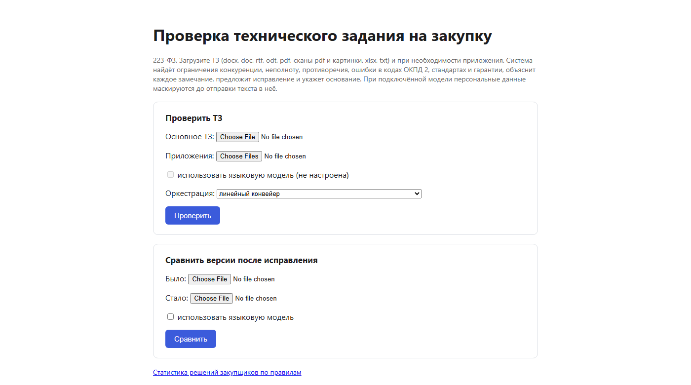
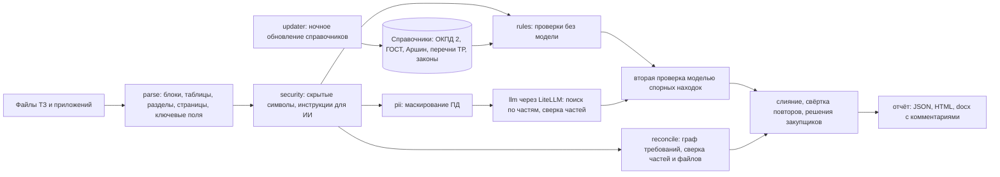

# Проверка ТЗ на закупку по 223-ФЗ

Команда ДождИИ, хакатон МФТИ hack80, задача «Интеллектуальная проверка технического задания на закупку».

**Главное**
- Из 105 правок экспертов-закупщиков система находит 97 по месту и 84 строго (то же место, та же категория, цитата про это место).
- В итоговых ТЗ, которые эксперты уже исправили, она нашла 3 оставшиеся ошибки (модель кнопок BW-1 без «или эквивалент» и два ГОСТ, заменённых по каталогу Росстандарта).
- Проверена на 30 чужих ТЗ из ЕИС (30 заказчиков, 16 предметных областей), каждое замечание размечено вручную.
- Без модели и без сети документ проверяется за 0,1-8 с.
- Docker одной командой, весь демо-сценарий одним скриптом.

Система принимает техническое задание (docx, doc, rtf, odt, pdf, сканы pdf и картинки, xlsx, txt; основное ТЗ и приложения вместе) и выдаёт отчёт для сотрудника закупок: список проблем с цитатой и местом в документе, категорию, объяснение, исправление, нормативное основание и итоговое заключение. Работает без модели на правилах и справочниках; с языковой моделью (Qwen3.8-27B через LiteLLM) перепроверяет спорные находки и добавляет свои замечания отдельным блоком на ручную проверку. Персональные данные маскируются до отправки текста в модель. По умолчанию проверка не обращается в сеть, справочники берутся из локальных копий, модель не подключена.

## Быстрый старт

Требования: Docker 24+ с Compose v2.24+, 4 ГБ RAM, 2 ГБ на диске под образ (5,3 ГБ с OCR и эмбеддингами). Интернет нужен только при сборке.

```bash
git clone https://github.com/kitkey/mipt-hack-tz.git && cd mipt-hack-tz
cp .env.example .env              # по умолчанию без модели: правила и справочники
docker compose up -d --build      # веб-интерфейс: http://localhost:8000
docker compose down               # остановка
```

Полный образ со сканами и эмбеддингами для гибридного поиска норм (`TZCHECK_RAG_MODE=hybrid`): `WITH_OCR=1 WITH_RAG=1 docker compose up -d --build`, подробности в разделах «Сканы» и «Пункты норм».

Проверка установки:

```bash
curl http://localhost:8000/health
# {"status":"ok","llm":false,"model":""}
curl -F "file=@samples/lift_src.docx" "http://localhost:8000/api/check?use_llm=false"
# JSON: "status": "ok", 18 замечаний, из них высокого риска 5
docker compose exec -e TZCHECK_REFDATA_OFFLINE=1 app python eval/eval_labels.py
# строго (категория + цитата про это место): 84/105 = 80%
```

Весь сценарий одной командой: `sh demo/run_demo.sh` (Linux, macOS, Git Bash) или `powershell -File demo/run_demo.ps1` (Windows). Скрипт поднимает сервис, проверяет два ТЗ и исправленную версию, сравнивает версии, отправляет повреждённый файл, запускает CLI в контейнере и пересчитывает качество. Результаты в `demo/out/`.

## Где смотреть по критериям

| Критерий | Где смотреть |
|---|---|
| 1. Разбор ТЗ и привязка к документу | [«Что на выходе»](#что-на-выходе): раздел, таблица, строка, страница и цитата у каждого замечания; HTML-отчёт `demo/output/02_lift_src/report.html` со ссылкой от замечания к тексту |
| 2. Выявление ошибок и рисков | [«Качество»](#качество): 105 правок, синтетические дефекты, замечания на итоговых ТЗ; `demo/output/01_metro_src/`, `04_lift_fin/` |
| 3. Классификация и объяснение | 10 категорий кейса в [«Что на выходе»](#что-на-выходе), сценарий 1 в [«Типовых сценариях»](#типовые-сценарии-с-настоящим-выводом), разметка `eval/labels.csv` |
| 4. Исправления и нормативные основания | защита от выдуманных оснований в [«Архитектуре»](#архитектура), [«Пункты норм»](#пункты-норм-rag), `demo/output/13_lift_src_rag/` |
| 5. Универсальность и надёжность | [«Как проверяли обобщение»](#как-проверяли-обобщение), сценарии 4 и 5, `demo/output/07_*`-`11_*`, `12_broken_files/` |
| 6. Развёртывание и воспроизводимость | [«Быстрый старт»](#быстрый-старт), [«Переменные окружения»](#переменные-окружения), [«Внешние сервисы»](#внешние-сервисы), [«Архитектура»](#архитектура), `demo/run_demo.sh` |

## Что на выходе

Для каждого замечания:

| Поле | Что это |
|---|---|
| `location`, `block_id`, `quote` | раздел, таблица и строка или абзац, страница для PDF, файл для комплекта; дословная цитата из ТЗ |
| `category` | одна из 10 категорий кейса: ограничение конкуренции, некорректная характеристика, противоречие, неверный код ОКПД 2, гарантия, стандарты и поверка, неполнота или комплектность, предмет закупки, лишнее в ТЗ, оформление по практике заказчика |
| `severity` | высокий, средний, низкий риск |
| `status` | `ошибка`; `неясно`; `ручная проверка` (нужна внешняя сверка: реестр СИ, действие стандарта, точный код); `рекомендация` (практика заказчика, не требование закона) |
| `explanation` | почему фрагмент проблемный, со значениями из этого ТЗ |
| `fix` | исправленная формулировка или действие |
| `norm_ids` | основание только из встроенной базы норм (`tzcheck/norms.py`, 19 норм со ссылками и редакциями) |
| `evidence` | кто нашёл (правило, модель, сверка), что сказала вторая проверка, статус ГОСТ и дата сверки, найденные типы СИ в ФГИС «Аршин», редакция закона |

Внизу отчёта паспорт проверки: версии справочников, sha256 файла, модель, режим сети. Итоговое заключение начинается с вердикта («Публиковать без исправлений нельзя: замечаний высокого риска 5 (F001…)» или «Ошибок не найдено, мест на ручную проверку: N») и сводки по категориям. С моделью и без неё заключение и счётчики над таблицей считаются только по основному списку.

Форматы: JSON, HTML-отчёт с переходом от замечания к тексту документа и кнопками решения закупщика, копия исходного docx с комментариями Word на проблемных местах (для каждого docx комплекта).

Интерфейсы: веб-форма (`/`), REST API (`/api/check`, `/api/compare`, `/api/feedback`), командная строка (`python -m tzcheck`).




## Архитектура



Поток данных: файл разбирается в блоки (абзац, строка таблицы, заголовок) с разделом, номером таблицы и строки, страницей и файлом. Правила и сверка работают по блокам и справочникам. Если модель подключена, текст после маскирования ПД уходит в неё частями по 3500 знаков вместе с уже найденным правилами; модель возвращает JSON, код проверяет, что цитата есть в блоке, а норма есть в базе. Находки модели и спорные находки правил проходят вторую проверку: подтвердить, отклонить, отдать человеку. Решения закупщика из отчёта сохраняются и влияют на следующие проверки.

| Компонент | Файл | Что делает |
|---|---|---|
| Разбор | `tzcheck/parse.py` | docx по порядку абзацев и таблиц, объединённые ячейки, разделы по нумерации; doc, rtf, odt через LibreOffice; pdf через PyMuPDF (абзацы по отступам, таблицы по линиям, склейка через разрыв страницы, номер страницы у блока); xlsx; сканы через PaddleOCR (`tzcheck/ocr.py`) |
| Правила | `tzcheck/rules.py` | марки и модели, «референс», пометки автора, нечёткие формулировки, сроки, ГОСТ и СНиП по каталогу Росстандарта, средства измерений и поверка по «Аршину», ОКПД 2 по классификатору, гарантия, комплектность, профили обязательных характеристик (`tzcheck/data/profiles.json`), противоречия таблицы и текста, предмет закупки |
| Сверка | `tzcheck/reconcile.py` | граф требований (объект, параметр, значение, единица, условие); расхождения значений, сроков, гарантии, приёмки, адресов между частями и файлами; ссылки на отсутствующие приложения и разделы; оглавление; повторённые разделы |
| ОКПД 2 | `tzcheck/okpd.py` | сверка наименования позиции с названием кода, подсказка точного кода вместо «прочих» |
| Маскирование ПД | `tzcheck/pii.py` | ФИО, телефоны, почта, СНИЛС, паспорт заменяются метками `[PERSON_1]` до модели и возвращаются в отчёт; для внешней модели после регулярок работает модель NER, без неё внешняя модель не вызывается (раздел «Маскирование ПД») |
| Модель | `tzcheck/llm.py` | LiteLLM: один код для локального сервера и внешнего API; JSON-ответ; цитата и норма проверяются кодом |
| Справочники | `tzcheck/refdata.py`, `tzcheck/updater/` | локальные копии, кэш, ночное обновление с запасными путями |
| Конвейер | `tzcheck/pipeline.py` | порядок шагов, слияние дублей, вердикт и заключение, сравнение версий |
| Отчёт | `tzcheck/report.py` | JSON, HTML, docx с комментариями |
| Пункты норм | `tzcheck/rag/` | корпус 53 норм (223-ФЗ, 102-ФЗ, ГК ч. 2, ТР ТС 011/2011, 29 ГОСТ, 15 СП, 5 СНиП), BM25 на леммах (гибрид с эмбеддингами deepvk/USER-bge-m3 по `TZCHECK_RAG_MODE=hybrid`); кандидата без известного документа проверяет модель (`tzcheck/rag/verify.py`); к замечанию прикладывается пункт с дословной цитатой, цитата сверяется с текстом документа корпуса |
| Обратная связь | `tzcheck/feedback.py` | «Принять», «Отклонить», «На ручную проверку»; дважды отклонённое не показывается, правило с долей отклонений от 60 % (после 5 решений) уходит в ручную проверку |
| Веб и API | `tzcheck/api.py` | FastAPI: форма, API, скачивание отчётов |

**Как система не придумывает основания.** Норма в замечании указывается только идентификатором из встроенной базы (`tzcheck/norms.py`), неизвестный идентификатор код отбрасывает. Цитата замечания сверяется с исходным блоком документа, замечание без такой цитаты отбрасывается. Пункт нормы с дословной цитатой (`TZCHECK_RAG=1`) прикладывается, только если цитата есть в тексте нормы из корпуса, а пункт из поиска по всему корпусу ещё и только после того, как модель признала его применимым. На 102 вопросах, для которых нужной нормы в корпусе нет, без модели пункт не приложен ни разу, с моделью 7 раз (раздел «Пункты норм»). Замечание без основания в категориях «конкуренция» и «стандарты» получает статус «ручная проверка». Практика заказчика (сроки прописью, единая формулировка начала срока) подписана как практика и имеет статус «рекомендация». Итоговое заключение собирает код из замечаний основного списка и в режиме модели: свободный текст модели в него не попадает.

## Как проверяли обобщение

Правила писали по ТЗ МФТИ, поэтому отдельно собрали 30 ТЗ по 223-ФЗ из ЕИС: 30 заказчиков, 16 областей (ГСМ, мебель, страхование, охрана, разработка ПО и другие), docx и pdf. Набор поделили на dev (18 ТЗ) и test (12 ТЗ). Каждое замечание разметили вручную: верное, ложное или спорное, с причиной. На исходной версии было 12 замечаний на ТЗ, 56 % ложных, из 10 замечаний высокой важности 8 ложные. Основные причины: эвристики сверки таблиц, практика МФТИ, применённая ко всем заказчикам, и латиница с цифрой как признак модели. Правила практики МФТИ теперь включаются только для МФТИ (`tzcheck/customer.py`, `tzcheck/data/customers.json`), эвристики сверки и брендов сузили. На test после правок только по dev ложных стало 21 вместо 40. После всех правок 3,8 замечания на ТЗ и 16 % ложных; в эту цифру входят правки по наблюдениям на test, поэтому она не чистая. Полноту проверили синтетическими дефектами в ТЗ нового набора (найдено 88 из 93, было 89) и разметкой 105 замечаний эксперта на старом наборе (97 из 105 по месту, 84 из 105 строго, без изменений). Сбоев на новом наборе нет.

На всех 30 ТЗ у текущей версии из 109 замечаний верных 14, ложных 17, спорных 78. На незнакомом ТЗ отчёт в основном состоит из вопросов на ручную проверку (общий код ОКПД 2, старый ГОСТ без подтверждения, марка с «или эквивалент»). Документы набора в репозиторий не входят, в них контакты сотрудников заказчиков: `python eval/generalization/download_holdout.py` скачивает их по ссылкам из `data_raw/eis_holdout/manifest.csv` и сверяет sha256. Полный отчёт: `eval/generalization/REPORT.md`.

## Типовые сценарии с настоящим выводом

Готовые отчёты лежат в `demo/output/` (собраны `python demo/build_demo.py`, режим правил). Разбор находок: `demo/README.md`.

**1. ТЗ на работы с таблицей характеристик.** Вход: `samples/lift_src.docx`. Выход: `demo/output/02_lift_src/` (JSON, HTML, docx с комментариями). 18 замечаний, высокого риска 5:

| № | Риск, статус | Категория | Цитата | Исправление |
|---|---|---|---|---|
| F001 | высокий, ручная проверка | Противоречие | «пассажирский» в таблице при предмете «грузового лифта» | привести строку к предмету закупки |
| F002 | высокий, ручная проверка | Противоречие | «Грузоподъемность, кг: 300» при другом значении в тексте | оставить одно значение |
| F003 | высокий, ошибка | Ограничение конкуренции | «кнопки BW-1-круглые» без «или эквивалент» | заменить модель характеристиками |
| F004, F005 | высокий, ошибка | Стандарты | «ГОСТ Р 28911-2015», «ГОСТ Р 34441-2018»: таких ГОСТ Р нет, межгосударственные стандарты с этими номерами заменены | ГОСТ 28911-2021, ГОСТ 34441-2024 |
| F009 | средний, ошибка | Стандарты | «ГОСТ 53782-2010» без «Р» | ГОСТ Р 53782-2010 |
| F011 | средний, ручная проверка | Предмет закупки | «Спецификация на выполнение ремонтных работ» при предмете «замена» | назвать часть по предмету |
| F014 | низкий, рекомендация | Оформление | «105 календарных дней» | «105 (сто пять) календарных дней» |

Одна запись JSON целиком, с пунктом нормы (`demo/output/13_lift_src_rag/`, тот же документ с `TZCHECK_RAG=1`):

```json
{
 "id": "F003",
 "location": "раздел «Технические характеристики поставляемого для монтажа лифта», таблица 1, строка 31",
 "quote": "импортного производства с кольцевой подсветкой (кнопки BW-1-круглые с белой подсветкой, только при нажатии)",
 "category": "Ограничение конкуренции",
 "severity": "high",
 "status": "ошибка",
 "explanation": "Указана конкретная марка или модель (BW-1-круглые) без слов «или эквивалент»: это прямо запрещено для описания предмета закупки и сужает круг участников.",
 "fix": "Заменить марку и модель на функциональные и технические характеристики; если без модели нельзя (совместимость), добавить «(или эквивалент)» и обосновать.",
 "norm_ids": ["223-FZ-3-6.1-2", "223-FZ-3-6.1-3"],
 "evidence": {
  "найдено": "rule:brand",
  "цитата найдена в тексте": true,
  "пункт нормы": "223-ФЗ, Статья 3, ч. 6.1 «Принципы и основные положения закупки товаров, работ, услуг»",
  "цитата нормы": "2) в описание предмета закупки не должны включаться требования или указания в отношении товарных знаков, знаков обслуживания, фирменных наименований, ...",
  "нормы": ["223-ФЗ, ст. 3, ч. 6.1, п. 2 (редакция: действует с 01.01.2025, сверено с actual.pravo.gov.ru 13.11.2026)"]
 }
}
```

**2. ТЗ на поставку оборудования с моделями.** Вход: `samples/metro_src.docx`. Выход: `demo/output/01_metro_src/`. 92 замечания: «Референс: ТР 5006М или эквивалент» и марки RIGOL, Fluke, NI USB-6002 (ограничение конкуренции, 17), позиции без диапазона и погрешности (неполнота, 36), «при отнесении к СИ» (стандарты и поверка), общий код 26.51.66.190 у комплектов с подсказкой точного кода (ОКПД 2), пометки «вместо …» (лишнее в ТЗ).

**3. Повторная проверка после исправления.** Вход: `samples/metro_src.docx` и `samples/metro_fin.docx`. Выход: `demo/output/06_compare_metro/`. «Исправлено 90, осталось 2, новых 6». На итоговом ТЗ лифта 7 замечаний, 3 из них высокого риска: модель кнопок BW-1 без «или эквивалент» и два ГОСТ, заменённых по каталогу Росстандарта, закупщики в итоговой версии оставили.

**4. Чужое ТЗ из ЕИС.** Вход: ТЗ на поставку сервера (МГУ). Выход: `demo/output/07_eis_server_msu/`. 4 замечания на ручную проверку («совместимость с ЦПУ Intel или AMD» с отсылкой к исключению для совместимости, «совместимость с существующей инфраструктурой» без интерфейса, «комплект для монтажа» без состава, нет кода ОКПД 2). Обозначения AVX-512 и PCI Express марками не считаются. Ещё 4 ТЗ других областей (ремонт, клининг, медицинское оборудование, лифт с приложениями) в `demo/output/08_*`-`11_*`, ПД сотрудников заказчиков в них заменены метками.

**5. Повреждённый файл.** Вход: пустой файл, текст с расширением docx, обрезанный pdf (`12_broken_files`). Выход: `"status": "error"` и причина («файл пустой», «файл повреждён или это не docx»), API отвечает 400, сервис продолжает работать.

**6. Проверка с локальной моделью.** Вход: `samples/lift_fin.docx`, итоговое ТЗ лифта. Выход: `demo/output/18_lift_fin_llm_linear/` (JSON, HTML, docx с комментариями), команда `python demo/run_llm_cases.py` при поднятом сервере Qwen3.8-27B. 602 с на документ. Основной список тот же, что без модели: 7 замечаний правил, вердикт и заключение по ним. Модель не согласилась с правилом об общей ссылке на «действующие ГОСТ, СНиП…» и дала ему 10 %: замечание осталось с пометкой «модель не согласна с правилом, решает закупщик». СП 31-110-2003 она отправила на ручную проверку с оценкой 30 %. Ниже отдельный блок из 25 замечаний модели на ручную проверку, в вердикт они не входят:

| № | Место | Цитата | Замечание модели | Уверенность |
|---|---|---|---|---|
| M002 | таблица 1, строка 29 | «Тип» | у системы управления не указано значение | 95 % |
| M003 | раздел «Технические характеристики…», абзац 41 | «Габаритные размеры указаны ориентировочные и будут уточнены…» | размеры не зафиксированы, возможны разногласия при приёмке | 90 % |
| M001 | раздел 6, абзац 39 | «выпуска не ранее 2026 года» | год выпуска назван ограничением конкуренции | 95 % |
| M009 | таблица 1, строка 15 | «rAL7035» | RAL назван нестандартным обозначением | 80 % |

M002 и M003 по делу, правила их не ловят. M001 и M009 шум: требование к году выпуска нового лифта допустимо, RAL 7035 общепринятый каталог цветов. При этом уверенность у всех четырёх 80-95 %, поэтому каждое замечание блока закупщик принимает или отклоняет сам.

Итоговое заключение в режиме модели собирает тот же код, что и без неё, по 7 замечаниям основного списка. Модель пишет к основному списку короткое пояснение, в отчёте оно стоит подписанной строкой в блоке модели и в заключение не входит. В этом прогоне пояснение ошибается: кнопки BW-1 названы моделью лифта, упомянуты пометки про бюджет, которых в ТЗ нет. Счётчики статусов и категорий над таблицей считают только основной список, как и строка «показано 7 из 7»; у блока модели свои счётчики в заголовке.

Ещё сценарии с готовыми отчётами в `demo/README.md`: комплект из основного ТЗ и трёх приложений со ссылкой на отсутствующее «Приложение 6» (`11_eis_lift_with_appendices`), пункт нормы с цитатой (`13_lift_src_rag`), скан без текстового слоя (`14_lift_scan_ocr`), скрытая инструкция для ИИ (`15_injection`), прогоны с моделью в двух оркестрациях (`16_*`-`19_*`).

## Качество

Все цифры получены в режиме правил без модели, справочники из локальных копий (`TZCHECK_REFDATA_OFFLINE=1`). Повторить: команды в последнем столбце.

| Что меряем | Как | Результат | Команда |
|---|---|---|---|
| Правки закупщиков | 105 правок из двух пар «исходное / итоговое» ТЗ (лифт 13, метрология 92), разметка по 10 категориям в `eval/labels.csv`. Строго: замечание в том же абзаце или строке таблицы, той же категории, цитата про это место | строго 84/105 (80 %), по месту 97/105, с верной категорией 92/105 | `python eval/eval_labels.py` |
| Замечания на итоговых ТЗ | число замечаний на ТЗ после правок экспертов | лифт 7, из них высокого риска 3; все три это ошибки, которые эксперты оставили в итоговой версии (модель кнопок BW-1 без «или эквивалент» и два ГОСТ, заменённых по каталогу Росстандарта); метрология 8, высоких 0 | то же |
| Синтетические дефекты | в исправленные ТЗ по одному вставляются марка, референс, «по возможности», пометка, документация на английском, срок без даты, несуществующий код, код другого товара, удалённая гарантия, инструкция для ИИ, скрытый символ | 21/22 | `python eval/synth_defects.py` |
| Сверка частей | 60 вставок 12 видов (значение, диапазон, количество, сроки, гарантия, приёмка, комплектность, единицы, приложение, содержание, дубли разделов) в 5 документов, пары разнесены между основным файлом и приложением | 60/60; на исправленных ТЗ 0 ложных; на ЕИС 2 замечания о 5 отсутствующих приложениях, оба верные | `python eval/reconcile/evaluate_extended.py`, `score_manual.py` |
| Чужие ТЗ | 9 ТЗ из ЕИС (сервер, ремонт, лаборатории, медизделия, лифт), разметки нет, вручную просмотрены все замечания со статусом «ошибка» и высоким риском | 64 замечания, из них «ошибка» 1, высокий риск 1 | корпус не в репозитории (контакты сотрудников заказчиков), отчёты 5 ТЗ с маскированием ПД в `demo/output/07_*`-`11_*` |
| PDF против docx | 4 пары docx и PDF из кейса; CER по всему тексту, совпадение замечаний по категории и цитате | CER 0,06-1,09 %; замечаний совпало 18/18, 91/92, 7/7, 8/8 | `python eval/ocr_compare/benchmark_text.py` |
| Сканы | те же PDF без текстового слоя, 300 dpi, чистые и с искажениями (поворот 1-3°, шум, JPEG, печать) | совпало с docx: lift_src 15/18, metro_src 78/92; коды ОКПД 2 28/28 | `python eval/ocr_compare/run_ocr.py` |
| Пункты норм | 421 вопрос: 322 из замечаний правил (242 с ответом, 80 без), 99 из правок закупщиков (77 с ответом, 22 без) | без модели: замечания правил 242/242 (документ известен), отказ 80/80, правки 2/77; с проверкой моделью: правила 242/242 и пункт у 3 из 80 без нормы, правки 63/77, неверный пункт 4 и пункт у 4 из 22 без нормы | `python eval/rag/verify_eval.py candidates`, `judge`, `score --mode bm25`; поиск `eval/rag/retrieval_eval.py` |
| Автотесты | разбор, правила, сверка, отчёты, PDF, OCR, пункты норм, маскирование, обратная связь, уверенность, блок модели с заглушкой | 106 прошли, 1 пропущен без PaddleOCR | `pytest tests/ -q` |
| Обобщение | 30 ТЗ из ЕИС других заказчиков и областей, каждое замечание размечено вручную; правки по 18 ТЗ, замер на 12 отложенных | на отложенных ложных 21 вместо 40; на всех 30 замечаний на ТЗ 3,8 вместо 12,0, ложных 16 % вместо 56 % | раздел «Как проверяли обобщение» |
| Время | один документ, режим правил | 0,1-8 с | |

По категориям (строго / всего): неполнота 22/30, конкуренция 15/18, стандарты 11/16, ОКПД 2 11/11, характеристики 9/10, лишнее 6/8, оформление 3/3, предмет 1/3, противоречия 3/3, гарантия 3/3. Место 5 правок в исходных документах не находится, они остаются в знаменателе.

С моделью строгий счёт на тех же 105 правках был ниже на 3 (79 против 82 на снимке кода до проверки обобщения), потому что перепроверка моделью снимала верные находки правил. Поэтому удалять находки правил модели запрещено.

## Локальная модель

Основа отчёта правила, они дают вердикт за секунды. Модель Qwen3.8-27B (открытые веса, через LiteLLM) включается переменными окружения для второго прохода. Она перепроверяет спорные замечания правил и добавляет свои отдельным блоком «Замечания модели: проверить вручную». У этого блока номера M001, M002, статус «ручная проверка», в JSON `section: "llm_review"`, в docx комментарий с пометкой «Модель, проверить вручную». В вердикт блок не входит. Удалять замечания правил модели запрещено. Если она не согласна, замечание остаётся с пометкой «модель не согласна с правилом, решает закупщик». На двух ТЗ кейса модель качество по разметке не подняла. Её польза в замечаниях, которых нет в правилах (пустое поле «Тип», ориентировочные габариты), но рядом с ними идёт шум.

```bash
# .env
TZCHECK_LLM_MODEL=openai/qwen3.8-27b
TZCHECK_LLM_API_BASE=http://host.docker.internal:8091/v1
TZCHECK_LLM_API_KEY=local
TZCHECK_LLM_WORKERS=1           # сервер однопоточный: параллельные запросы встают в очередь и упираются в таймаут
TZCHECK_LLM_TIMEOUT=900         # на один запрос
TZCHECK_LLM_DOC_TIMEOUT=1800    # на документ; после него отчёт правил выдаётся без оставшихся вызовов модели
```

```bash
docker compose up -d --force-recreate app
curl http://localhost:8000/health      # "llm": true
curl -F "file=@samples/lift_fin.docx" "http://localhost:8000/api/check?use_llm=true"
```

Сервер модели внешний, подойдёт любой OpenAI-совместимый, например Strata или llama.cpp (`llama-server -m Qwen3.8-27B-UD-Q2_K_XL.gguf -ngl 99 -c 16384 --port 8091`).

Итоговый прогон на видеокарте 12 ГБ (`demo/output/16_*`-`19_*`, `python demo/run_llm_cases.py`):

| Документ, оркестрация | Время | Основной список (высокий риск) | Блок модели (высокий риск) | Правил, с которыми модель не согласна |
|---|---:|---:|---:|---:|
| lift_src, linear | 378 с | 18 (5) | 20 (12) | 2 |
| lift_src, graph | 667 с | 18 (5) | 18 (10) | 2 |
| lift_fin, linear | 602 с | 7 (3) | 25 (4) | 1 |
| lift_fin, graph | 682 с | 7 (3) | 29 (13) | 1 |

Основной список с моделью совпадает с отчётом одних правил.

**Уверенность.** Модель в каждом ответе возвращает число 0-100, в HTML оно стоит в колонке «Уверенность» с сортировкой и ползунком «показывать от N %», в JSON в полях `confidence_pct` и `confidence_basis`. У замечаний правил без модели вместо числа пометка «правило». Уверенность не откалибрована. На исправленном lift_fin медиана 85-90 %, выше, чем на исходном lift_src (80-85 %). Она годится для сортировки и фильтра внутри отчёта, читать её как долю верных замечаний нельзя. Режим `graph` на LangGraph (`--orchestrator graph`, `TZCHECK_ORCHESTRATOR=graph`) отправляет замечания с уверенностью ниже `TZCHECK_CONF_LOW` (60) на повторную проверку моделью.

A/B на 105 правках, скорость движков и вероятности решений: `eval/models_ab/README.md`. Уверенность и граф оркестрации: `eval/confidence/REPORT.md`.

## Сканы (OCR)

PDF без текстового слоя и картинки (PNG, JPG, TIFF, BMP) распознаёт PaddleOCR PP-OCRv5 (детектор `PP-OCRv5_mobile_det`, распознавание `eslav_PP-OCRv5_mobile_rec`, русский язык). Перед правилами снимается наклон страницы, таблицы находятся по линиям сетки и раскладываются по ячейкам, текст вне таблиц собирается в абзацы, латинские буквы-двойники в русских словах меняются на кириллицу. К каждой распознанной странице в отчёт идёт предупреждение «текст распознан OCR (PaddleOCR): цифры и коды сверить с оригиналом».

```bash
WITH_OCR=1 docker compose up -d --build     # paddlepaddle 3.1.1, paddleocr 3.4.0, OpenCV; модели около 100 МБ скачиваются при сборке
curl -F "file=@scan.pdf" "http://localhost:8000/api/check?use_llm=false"
```

Если при сборке сети не было, модели скачаются при первом скане в том `models`. В образе без OCR скан не падает: API отвечает 400 «в PDF не найден текст: похоже на скан без текстового слоя…» с подсказкой, как включить распознавание. Первый скан после запуска идёт около минуты (загрузка Paddle), дальше 2-10 с на страницу на CPU.

Качество по страницам: эталон каждой страницы взят из текстового слоя того же PDF, 29 страниц, CPU.

| Страницы | CER | Слова | Числа | ОКПД 2 | Медиана, с/стр. |
|---|---:|---:|---:|---:|---:|
| 150 dpi, чистые | 1,06 % | 97,9 % | 98,1 % | 100 % | 6,0 |
| 150 dpi, искажённые | 1,77 % | 96,5 % | 96,9 % | 100 % | 5,6 |
| 300 dpi, чистые | 2,40 % | 94,5 % | 96,0 % | 100 % | 9,0 |
| 300 dpi, искажённые | 2,09 % | 95,9 % | 95,9 % | 100 % | 8,6 |

Скан целиком через проверку: lift_src совпадает с docx в 15 замечаниях из 18, metro_src в 78 из 92. Пункты списка внутри ячейки правила делят по маркерам и переводам строк, «Си» после OCR находится так же, как «СИ». Остаток на metro_src: OCR путает «DHO804» и «DH0804» и склеивает строки соседних позиций. Сканы синтетические: страницы своих PDF с наложенными искажениями. Методика: `eval/ocr_compare/`.

## Пункты норм (RAG)

К замечанию прикладывается пункт нормы с дословной цитатой из корпуса норм. В Docker включено (`TZCHECK_RAG=1`), поиск BM25 по леммам.

Как выбирается пункт:
- Замечание правила, у которого документ известен (статья в `norm_ids` с частью и подпунктом или стандарт, названный в цитате): пункт внутри этого документа выбирает код, модель не спрашивается.
- Замечание модели и замечание без известного документа, если модель включена: код собирает до 5 кандидатов (`tzcheck/rag/retrieve.py`), модель по каждому отвечает «применим», «не применим» или «не решить», для «применим» с дословной цитатой из пункта (`tzcheck/rag/verify.py`). Код прикладывает первый применимый пункт, только если цитата модели есть в тексте пункта в исходном документе корпуса (с точностью до пробелов). Если такого нет, основание не прикладывается, у замечания пишется «основание нормы: не найдено, проверить вручную».
- Без модели поиск по всему корпусу ничего не прикладывает. Если модель не ответила (ошибка вызова, бюджет времени), замечание получает пункт известного документа, как без модели.

Модель решает, применим ли пункт к замечанию, но само замечание не проверяет: к ложному замечанию модели тоже приходит применимый пункт. Блок модели и так идёт на ручную проверку.

Кандидаты: статья из `norm_ids` и пункт названного стандарта, затем две дорожки поиска: законы и техрегламенты (223-ФЗ, 102-ФЗ, ГК РФ, ТР ТС) и стандарты (ГОСТ, СП, СНиП). Запрос собирается из цитаты, объяснения, категории и предмета закупки. В запрос дорожки законов добавляется правовая тема категории словами закона, для неполноты «описание предмета закупки, функциональные, технические, качественные характеристики, количество, комплектность». Пункт, порезанный на окна, идёт модели целиком. ТЗ перед отправкой модели маскируется тем же `Scrubber`, что и остальные вызовы; тексты норм публичные и идут без маски.

Корпус `data/norm_corpus/`: 53 документа (у ГОСТ 34441-2018 два файла из разных источников), 13 775 фрагментов (12 989 пунктов и 786 таблиц). В репозитории документы лежат сжатыми (`*.json.gz`, 2,4 МБ). Тексты новых редакций от обновлятора (15 документов, 2 250 фрагментов, раздел ниже) входят в тот же индекс: вместе 16 025 фрагментов. Индекс BM25 собирается шагом Docker-сборки за 10-20 с; без Docker при первой проверке с `TZCHECK_RAG=1` или командой `TZCHECK_REFDATA_OFFLINE=1 python -m tzcheck.rag build`.

### Почему поиск промахивался

На 77 правках закупщиков с известной нормой прежний конвейер прикладывал верный пункт к 2 (поиск по всему корпусу выключен) или к 12 (включён, гибрид). Разбор: `eval/rag/miss_analysis.py`, `eval/rag/miss_analysis.json`.

| Что происходило с правкой в прежнем конвейере | Правок |
|---|---:|
| категория вне поиска по всему корпусу (неполнота, характеристика, лишнее, предмет закупки) | 40 |
| лучший фрагмент ниже порога отказа | 24 |
| первым пришёл не тот пункт | 1 |
| пункт найден (10 поиском, 2 по названному стандарту) | 12 |

| Ранг эталона у самого поиска (гибрид, прежний запрос, без порога и фильтра категорий) | Правок |
|---|---:|
| первый | 14 |
| 2-5 | 4 |
| нужный документ в первой десятке, пункт ниже | 18 |
| эталон статья закона, в первой десятке только ГОСТ и СП | 34 |
| вне первой десятки | 7 |
| нужного документа нет в корпусе | 0 |

Главная причина: запрос описывает дефект конкретного товара («у осциллографа не задана память»), а эталон общая норма (223-ФЗ ст. 3 ч. 6.1, 102-ФЗ ст. 9). Фрагментов стандартов в индексе 13,4 тысячи, законов и техрегламентов 2,6 тысячи, и по словам товара запрос ближе к стандарту на этот товар. Мешало и разбиение: длинная часть закона порезана на окна, нужный подпункт лежит не в том окне, которое нашёл поиск, а три окна одной части занимали три места из пяти. Документов не хватает только вопросам без нормы в корпусе (ОКПД 2, OIML R 76, метод Роквелла, закон о языке); для 77 правок все документы эталона в корпусе есть, корпус не дособирался.

### Поиск: hit@1 и hit@5

`eval/rag/retrieval_eval.py`: поиск без статьи из `norm_ids`, верный пункт среди первых 1 и 5 кандидатов.

| Запрос и поиск | BM25, правки (77) | BM25, правила (242) | гибрид, правки | гибрид, правила |
|---|---|---|---|---|
| прежний: цитата и объяснение, весь корпус | 6 / 9 | 51 / 72 | 14 / 18 | 46 / 87 |
| + предмет закупки | 17 / 32 | 52 / 93 | 20 / 27 | 53 / 107 |
| + две дорожки: законы и стандарты | 18 / 31 | 55 / 87 | 31 / 48 | 86 / 136 |
| + правовая тема категории (сейчас) | 61 / 74 | 105 / 222 | 65 / 74 | 114 / 208 |

У 33 из 77 правок эталон задан категорией: для неполноты и характеристик это статьи 223-ФЗ об описании предмета закупки, а тема категории в запросе почти повторяет их текст. По ним hit@1 у BM25 33 из 33, у гибрида 28 из 33. На 44 правках с эталоном по самой правке рост меньше: BM25 с 6 / 8 до 28 / 41, гибрид с 14 / 17 до 37 / 41.

Гибрид: BM25 и эмбеддинги deepvk/USER-bge-m3 через RRF, 0,2 с на вопрос на GPU; BM25 0,1 с. Реранкер bge-reranker-v2-m3 поверх гибрида (замер до склейки окон, `eval/rag/retrieval_pregroup.log`): правки 71 / 73, правила 111 / 228, 1,4 с на вопрос на GPU. Модель проверяет первые пять кандидатов, а hit@5 гибрид не поднял: у правок он тот же, у правил ниже.

### Точность приложенных пунктов

`eval/rag/verify_eval.py`, 421 вопрос (`eval/rag/questions_v3.json`): 322 из замечаний правил (242 с нормой в корпусе, 80 без), 99 из правок закупщиков (77 и 22). Пункт верный, если совпадает с эталоном; для неполноты и характеристик подходят обе статьи 223-ФЗ об описании предмета закупки (ст. 3 ч. 6.1, ст. 4 ч. 10). Модель DeepSeek v4.1 Flash без рассуждений, поиск BM25.

| Путь | Правила: верный / неверный / к вопросу без нормы | точность | Правки: верный / неверный / без нормы | точность | правок с верным пунктом |
|---|---|---|---|---|---|
| прежний: только известный документ | 242 / 0 / 0 | 1,00 | 2 / 0 / 0 | 1,00 | 3 % |
| прежний + поиск по корпусу (`TZCHECK_RAG_OPEN=1`), гибрид | 242 / 0 / 0 | 1,00 | 12 / 1 / 0 | 0,92 | 16 % |
| первый кандидат нового поиска, без модели | 242 / 0 / 63 | 0,79 | 60 / 13 / 5 | 0,77 | 78 % |
| проверка моделью всех кандидатов | 200 / 7 / 3, у 16 нет ответа модели | 0,95 | 63 / 4 / 4 | 0,89 | 82 % |
| по умолчанию: правила с известным документом без модели, остальное с моделью | 242 / 0 / 3 | 0,99 | 63 / 4 / 4 | 0,89 | 82 % |

На замечаниях правил проверка всех кандидатов хуже статьи правила: на 226 замечаниях с нормой, где модель ответила, 200 верных и 7 неверных против 226 и 0 (с гибридом 217 и 5 из 242). Модель отклонила 105 из 438 эталонных пунктов среди кандидатов. Поэтому статью правила модель не проверяет. У 16 замечаний правил с нормой ответа модели нет: кончились кредиты API; по умолчанию модель им не нужна. «Применим» с цитатой, которой нет в тексте пункта, модель ответила 8 раз, такие пункты не приложены.

С гибридом та же проверка дала на правках 67 / 1 / 4 (87 %), на правилах по умолчанию 242 / 0 / 4. Прирост 4 пункта на 77 правках в пределах разброса: на прежней версии промпта проверки гибрид дал 58 против 63 у BM25.

Цена проверки: 383 вопроса за 108 вызовов, 0,15 $ и 164 с при 4 параллельных запросах. На 8 ТЗ ЕИС 89 вызовов, 0,115 $, в среднем 0,014 $ на документ.

### Пункты норм в смысловой проверке (`TZCHECK_RAG_LLM=1`)

Модель, читая фрагмент ТЗ, получает до трёх пунктов норм по теме фрагмента (`TZCHECK_RAG_LLM_K`): пункт стандарта, названного во фрагменте, и дорожку законов. Если находка ссылается на пункт (`norm_ref`), код сверяет её цитату `norm_quote` с текстом пункта в корпусе и прикладывает пункт только при совпадении.

| Замер | Без RAG | С RAG: пункты во фрагменте и проверка пунктов |
|---|---|---|
| eval на 105 правках: по месту / с категорией / строго / точно | 97 / 93 / 84 / 82 | 97 / 92 / 85 / 83 |
| 8 ТЗ ЕИС: замечаний блока модели | 276 | 254 |
| из них с меткой прежней разметки: верно / ложно / спорно | 107: 16 / 49 / 42 | 118: 13 / 49 / 56 |
| доля ложных среди размеченных | 46 % | 42 % |
| с приложенным пунктом нормы | 0 | 166: 143 проверкой моделью, 21 по ссылке из фрагмента, 2 по статье |
| на одно ТЗ ЕИС в среднем | 0,021 $, 100 с | 0,032 $, 107 с |

Метки перенесены с размеченного прогона DeepSeek без RAG по блоку и совпадению слов цитаты; у 169 и 136 замечаний пары нет, они не размечены. Среди 75 размеченных замечаний с пунктом, проверенным моделью, 30 ложные. Прироста нет ни на eval, ни на размеченной части ЕИС, поэтому по умолчанию `TZCHECK_RAG_LLM=0`.

### Что включено по умолчанию

| Что | По умолчанию | Почему |
|---|---|---|
| пункты норм | `TZCHECK_RAG=1` в Docker | в режиме правил eval тот же (строго 84/105), пункт известного документа верен в 242 из 242, на 4 документах +11 с |
| поиск | BM25, `TZCHECK_RAG_MODE=bm25` | гибрид не поднял hit@5, после проверки +4 пункта на 77 правках в пределах разброса; без GPU модель эмбеддингов считается на CPU |
| поиск по всему корпусу | `TZCHECK_RAG_OPEN=auto`: только с проверкой моделью | без модели первый кандидат неверен у 13 из 77 правок и прикладывается к 63 из 80 замечаний без нормы; оценка лучшего фрагмента вопрос без нормы не отличает (сбалансированная точность отказа 0,50-0,52) |
| проверка моделью | `TZCHECK_RAG_VERIFY=1`, когда включена модель | правки: верный пункт у 63 из 77 вместо 2, точность 0,89 |
| пункты норм в промпте фрагмента | `TZCHECK_RAG_LLM=0` | eval +1 строгий, на ЕИС доля ложных среди размеченных 42 % против 46 %, больше половины замечаний не размечено |

Эмбеддинги через API. У OpenRouter есть `baai/bge-m3` (0,01 $ за 1 млн токенов, контекст 8 194 токена). Режима через API нет: гибрид с локальной USER-bge-m3 (bge-m3, дообученная на русском) почти не прибавил, а для API векторы корпуса и запросы пришлось бы кодировать моделью `baai/bge-m3`, и цитаты ТЗ уходили бы во внешний сервис ещё одним вызовом.

Гибрид остаётся для запуска с GPU: образ с `WITH_RAG=1` (torch, sentence-transformers), векторы корпуса и `TZCHECK_RAG_MODE=hybrid`. Без векторов или без модели поиск сам переходит на BM25.

```bash
WITH_RAG=1 docker compose up -d --build
docker compose --profile rag run --rm rag-vectors     # модель 1,4 ГБ с Hugging Face и векторы в том models; на CPU десятки минут
TZCHECK_RAG_MODE=hybrid docker compose up -d --force-recreate app   # или TZCHECK_RAG_MODE=hybrid в .env
```

Векторы привязаны к sha256 индекса. Когда обновлятор добавил тексты редакций и индекс пересобран, векторы дополняются только новыми фрагментами: у каждого вектора есть ключ фрагмента (`*.keys.json`), совпавшие берутся из прошлой сборки. Векторам, собранным до этой версии, ключей не хватает, их один раз собирают заново. На GPU без Docker: `python -m tzcheck.rag.models build --model deepvk/USER-bge-m3 --device cuda`, 15 936 фрагментов за 400 с при нагрузке 60 %.

### Сверка ТЗ с новой редакцией стандарта

Правило о заменённом стандарте сообщает не только факт замены. Если текст новой редакции получен, замечание дополняется сверкой (`tzcheck/rag/editions.py`, выключается `TZCHECK_EDITIONS=0`):

| Что | Где в замечании |
|---|---|
| откуда текст новой редакции, когда получен, статус и дата введения по каталогу Росстандарта | основание «новая редакция» |
| сколько пунктов и таблиц изменено, добавлено, исключено и какие изменились сильнее всего | «сравнение редакций» |
| по каждому требованию ТЗ на тему стандарта: пункт прежней и новой редакции, цитаты обоих, что изменилось (числа с единицами, «должен» и «может», ссылки, главный изменённый фрагмент) и вывод | «сверка требований ТЗ с новой редакцией» |
| пункты новой редакции, с которыми сверить ТЗ | «Как исправить» |

Вывод считает код: «соответствует», если пункт не изменился или числа из ТЗ есть в новой редакции; «не соответствует», если число из ТЗ было в прежней редакции, а из новой исчезло. Для «не соответствует» выпускается отдельное замечание `rule:gost-edition` с обеими цитатами. Остальное «сверить вручную»; с включённой моделью такие пункты она решает по цитатам (ТЗ маскируется), без модели они остаются закупщику. Если текста нет, в замечании так и написано: «текст ГОСТ … в открытых источниках не найден, требования ТЗ с новой редакцией сверить вручную».

Пункты двух редакций сопоставляются по сходству текста и номеру (в ГОСТ 28911-2021 разделы сдвинуты: 4.2.x стал 4.3.x). Требование ТЗ ищется только внутри этих двух документов: BM25 по основам слов, заглавия пункта и его разделов весят больше текста, пара пунктов, найденная по запросу в обеих редакциях, надёжнее лучшего пункта одной. С `TZCHECK_RAG=1` и `TZCHECK_RAG_MODE=hybrid` к BM25 добавляются эмбеддинги той же модели (RRF). Раздел ТЗ закрепляет требование за стандартом: строки раздела «Диспетчеризация» сверяются с ГОСТ 34441, а не с ГОСТ 28911. С `TZCHECK_RAG=1` к пункту нормы из заменённого стандарта прикладывается тот же пункт новой редакции.

Тексты берёт обновлятор `gost_texts`. Для каждой пары «заменён → заменяющий» из каталога Росстандарта (стандарты из ТЗ, из списка наблюдения и из корпуса норм) он скачивает новую редакцию, а прежнюю тоже, если её нет в корпусе. Источники по порядку: meganorm.ru (адрес находится по спискам «Актуализированной базы» ГОСТ, ГОСТ Р и СП, списки кэшируются на неделю), то же через браузер, docs.cntd.ru, просмотр protect.gost.ru с OCR. Текст принимается, если обозначение стоит в начале документа и в нём не меньше 2 500 знаков и 6 нумерованных пунктов; иначе источник отмечается «в открытом доступе только часть документа» и пробуется следующий. Документ разбирается на пункты и таблицы так же, как корпус, и пишется в `tzcheck/data/norm_texts/<id>.json.gz` (в Docker `/refdata/norm_texts/`) с редакцией, датой введения, статусом и адресом источника; список с результатами и ошибками в `norm_texts.json`. После записи индекс BM25 пересобирается и векторы дополняются; приложение видит новые тексты само и пересобирает индекс при следующей проверке.

```bash
python -m tzcheck.updater --only gost_texts                    # все пары; свежие (до 30 дней) не перекачиваются
python -m tzcheck.updater.gost_texts "ГОСТ 34441-2024"         # одно обозначение
python -m tzcheck.updater --only gost_texts --offline          # без сети, из сохранённых ответов
```

Сейчас получено 17 текстов, все с meganorm.ru: ГОСТ 34441-2024, 28911-2021, 33984.1-2023 и 2016, 33605-2021 и 2015, 8.417-2024 и 2002, ГОСТ Р 2.601-2019 и ГОСТ 2.601-2013, ГОСТ 33652-2019, 33652-2015 и ГОСТ Р 51631-2008, ГОСТ 34305-2017 и ГОСТ Р 52382-2010, ГОСТ Р 55964-2022, СП 54.13330.2022. В репозиторий тексты не положены: права на перепубликацию стандартов не подтверждены. Каталог `tzcheck/data/norm_texts/` в `.gitignore`, в репозитории только список источников `tzcheck/data/norm_texts.json`. После клонирования тексты скачивает команда выше; без них сверка пишет, что текста нет.

На лифте (`demo/output/02_lift_src`, `04_lift_fin`, `13_lift_src_rag`, режим правил):

| Стандарт в ТЗ | Редакции | Требование ТЗ | Пункт | Что изменилось |
|---|---|---|---|---|
| ГОСТ Р 34441-2018 (это ГОСТ 34441-2018, заменён ГОСТ 34441-2024) | пунктов 40 → 38, изменено 26, новых 2, исключено 4 | «Мнемосхема щита диспетчерского управления» | 4.3.1 | сигнал «об открытии дверей устройства для эвакуации и динамических испытаний» заменён на «об открытии двери устройства управления лифта без машинного помещения», ссылка на ГОСТ 33984.1 убрана |
| | | «Сбор и реализация сигналов ... устройств защит» | 4.1.3 | 60 минут от резервного питания теперь для двусторонней связи по 4.2.1 и 4.2.2, добавлен перечень резервных источников |
| | | «Обеспечение связи кабина-диспетчер» | 6 | «место, с которого выполняется аварийная эвакуация» стало «эвакуация пассажиров» |
| ГОСТ Р 28911-2015 (это ГОСТ 28911-2015, заменён ГОСТ 28911-2021) | пунктов 67 → 99, изменено 36, новых 48, исключено 16 | «Панель управления кабиной ... кнопки BW-1» | А.2.1 | ссылка на таблицу B приложения B заменена на таблицу Д.1 |
| | | «Сигнализация на этажах: кнопки вызова, указатель положения кабины» | 4.2.1.1 → 4.3.1.2 | ссылка на таблицу Д.1, добавлена маркировка кнопок выше и ниже основной посадочной площадки |

Все пять выводов «сверить вручную»: чисел, которые поменялись в новой редакции (например, высота устройства вызова персонала 850-1 200 мм в п. 4.2.3 ГОСТ 34441-2024), ТЗ лифта не задаёт. Замечаний «не соответствует» на лифте нет; на тестовом примере с высотой кнопок 900 мм в ТЗ и 850 мм в новой редакции оно выпускается (`tests/test_editions.py`).

Ограничения сверки:
- BM25 подбирает пункт по словам и ошибается: «Обеспечение связи кабина-диспетчер» по смыслу ближе к п. 4.2.1 и 4.2.2 (двусторонняя связь с диспетчерской), а получает п. 6 (внутренняя связь); с эмбеддингами (`TZCHECK_RAG_MODE=hybrid`) приходит п. 4.2.2. Поэтому вывод по формулировкам всегда «сверить вручную».
- «Что изменилось» показывает самый большой изменённый фрагмент и число остальных; полностью изменения видны по двум цитатам.
- protect.gost.ru показывает стандарт картинками, но API просмотрщика отдаёт пустой список страниц и обычному запросу, и браузеру; docs.cntd.ru у многих стандартов открывает только начало; поисковики автоматические запросы блокируют. Рабочий источник сейчас один: meganorm.ru, сторонний сайт. Статус и дата введения берутся из каталога Росстандарта, а не с сайта.
- Цепочка замен разворачивается по шагу за запуск: ГОСТ Р 51631-2008 заменён ГОСТ 33652-2015, тот заменён ГОСТ 33652-2019, и текст 2019 года пришёл со вторым запуском. Сверка ТЗ идёт с первой заменой из каталога (ГОСТ 33652-2015), а не с последней.

## Маскирование ПД

Перед отправкой в модель `tzcheck/pii.py` заменяет персональные данные метками `[PERSON_1]`, `[PHONE_1]`, после ответа метки возвращаются в текст. Регулярки ищут почту, телефоны с `+7` или `8`, СНИЛС, ФИО по окончаниям, паспорт после слов «паспорт» или «серия» и счёт физлица (40817, 40820, вклад 423). Расчётный счёт организации, ИНН организации и номер извещения из 10 цифр остаются в тексте. После регулярок может работать модель NER `redmadrobot-rnd/rubert-base-pii-ner` (ruBERT-base, лицензия Apache-2.0). Она ищет сущности в исходном тексте и маскирует те, что не попали в метки регулярок. Модель грузится один раз при первом вызове, блоки части уходят в неё одной пачкой. Без модели или без torch маскирование идёт одними регулярками, в лог и в предупреждения отчёта пишется «ПД маскируются только регулярками, NER недоступен».

Режим задаёт `TZCHECK_PII_NER`: `auto` (по умолчанию) включает слой, когда модель проверки внешняя, `1` включает всегда, `0` выключает. Внешней считается модель с `openrouter/` или с `TZCHECK_LLM_API_BASE` не на localhost, 127.0.0.1 и host.docker.internal; без `TZCHECK_LLM_API_BASE` LiteLLM обращается к облаку провайдера, поэтому такая модель тоже внешняя, кроме `ollama/`. С локальной Qwen текст не покидает машину, и время на NER не тратится.

По условию кейса во внешние API можно передавать только открытые данные. Маскирование этого не гарантирует: адреса не маскируются, полнота на замере 0,96. Поэтому `llm._call`, через который идут все вызовы модели по тексту ТЗ (фрагменты, вторая проверка, сверка частей, заключение, `reconcile`, `rag/verify`), проверяет `allow_external`. Внешняя модель вызывается, если слой NER включён и загрузился или документ помечен открытым: `TZCHECK_DOC_PUBLIC=1` или `public=true` в запросе, например для ТЗ, скачанного из ЕИС. Иначе модель не вызывается, в предупреждениях отчёта пишется «модель не вызвана: документ не помечен как открытый, а NER недоступен», и проверка идёт правилами. Для локальной модели ограничений нет. Профили ГОСТ (`gost_profiles`) модель собирает из текста стандарта, текст ТЗ туда не уходит, а во время проверки сборка идёт только после той же проверки.

Маскируются ФИО, телефоны, почта, номера документов (паспорт, СНИЛС, ИНН физлица из 12 цифр, ОМС, карта, права, военный билет, свидетельство о рождении). Адреса, URL и IP не маскируются: на `metro_src` модель отметила как адрес 107 фрагментов места поставки, а 27 кодов ОКПД 2 приняла за IP-адрес. Названия организаций модель отдельно не выделяет. Поверх модели стоят проверки: порог уверенности 0,5, формат номера (10-значный ИНН организации и обозначения ГОСТ не проходят), телефон без запятой и десятичной точки (цены). ФИО маскируется, если в нём два слова или рядом инициалы. Одиночная фамилия в наших ТЗ была улицей, маркой или клиникой. Имя после «им.» не маскируется.

Замер на 30 ТЗ из ЕИС, 128 упоминаний ФИО и контактов сотрудников заказчиков размечены вручную (`eval/pii/`):

| Тип | Упоминаний | Пропущено: регулярки | Пропущено: регулярки + NER | Точность: регулярки | Точность: регулярки + NER |
|---|---:|---:|---:|---:|---:|
| ФИО | 51 | 6 | 0 | 0,94 | 0,90 |
| Телефон | 57 | 45 | 5 | 1,00 | 1,00 |
| Почта | 20 | 0 | 0 | 1,00 | 1,00 |
| Всего | 128 | 51 (полнота 0,60) | 5 (полнота 0,96) | 0,97 | 0,95 |

Модель добавила ФИО в родительном падеже из преамбулы договора, подписи вида `____И.О. Фамилия`, инициалы латиницей после OCR и телефоны без кода страны. Пропуски слоя NER: третий и четвёртый номер в перечислении через точку с запятой, номер факса. Ложные ФИО обоих вариантов (4) в одном PDF с разбитым текстовым слоем. Прежняя регулярка паспорта принимала любые 10 цифр подряд, в том числе ИНН организации (5 ложных в 4 документах, итоговая точность была 0,89 и 0,90); теперь она требует слово «паспорт» или «серия» рядом. На образцах кейса (`samples/*.docx`) ПД нет, метками не заменено ничего, ГОСТ, коды ОКПД 2, марки, адреса и поля предмета закупки целы.

Случаи из ревью и проверка «не трогать» на вымышленных строках (`python eval/pii/pii_eval.py --probe`, итог в `eval/pii/summary_probe.json`):

| Случай | Регулярки | Только NER | Регулярки + NER |
|---|---|---|---|
| «Иванову И.И.», «ИВАНОВ И.И.», «Петрова Анна», «Шмидт О.Б.», «Сидоренко Пётр Ильич» | нет | ФИО | ФИО |
| телефон «(495) 123-45-67» без +7 | нет | телефон | телефон |
| паспорт после слова «паспорт» | да | нет | да |
| СНИЛС | да | да | да |
| ИНН физлица из 12 цифр | нет | ИНН | ИНН |
| счёт физлица 40817 | счёт | нет | счёт |
| адрес регистрации физлица | нет | нет | нет |
| ИНН организации, номер извещения из 10 цифр, р/с организации 40702 | не трогает | не трогает | не трогает |
| место поставки, ГОСТ, ОКПД 2, марка | не трогает | не трогает | не трогает |

Адрес физлица не маскируется ни одним слоем: модель выделяет адреса, но в ТЗ это место поставки, без которого проверка теряет смысл. Типа «банковский счёт» у модели нет, счёт физлица ловит только регулярка.

Время на документ (медиана 30 тыс. символов): регулярки 0,01 с, с NER на CPU 5,4 с (максимум 30,5 с на 240 тыс. символов), на GPU 0,26 с. Загрузка модели 18 с на CPU.

```bash
WITH_PII_NER=1 docker compose build                      # torch CPU, transformers, модель около 680 МБ в /opt/pii-ner
TZCHECK_PII_NER=1 docker compose up -d --force-recreate app   # или auto: слой сам включится для внешней модели
python eval/pii/pii_eval.py --device cuda                # замер; разметка в eval/pii/work/ вне репозитория
```

## Чеклисты ГОСТ

Для стандарта, на который ссылается ТЗ, модель один раз собирает чеклист (`tzcheck/gost_profiles.py`, поставляется в `tzcheck/data/gost_profiles/`, в Docker лежит в томе `refdata` вместе с утверждениями): что заказчик указывает при заказе, пределы с числом и единицей, документы и маркировка при поставке. У каждого пункта номер пункта стандарта, полный текст пункта и цитата.

Сборка идёт в два прохода модели. Первый выписывает пункты из текста, разбитого на пункты по нумерации. Второй сверяет каждый пункт с текстом: полный пункт, область применения, заголовки разделов над пунктом и соседние пункты. Сверка отвечает, совпадают ли параметр, оператор, число и единица, требование это, пример или справочное значение, к чему пункт относится и не отменён ли он. Код числа и единицы не разбирает.

| Статус | Что значит |
|---|---|
| `draft` | выписан моделью, сверку не прошёл; в проверку не идёт, причина хранится в профиле |
| `verified` | сверен моделью с текстом ГОСТ |
| `approved` | утвердил человек: `POST /api/gost_profiles/{slug}/approve` или `python -m tzcheck.gost_profiles approve` |

Сопоставление ТЗ с чеклистом делает ядро проверки через `items_for(position, passport)`; применимость стандарта к позиции решает модель по области применения, ответ кэшируется по (стандарт, вид изделия). Ошибкой идёт только противоречие утверждённому пункту; противоречие сверенному пункту и отсутствие параметра в ТЗ идут вопросом на проверку. Повторы внутри стандарта и между стандартами слиты эмбеддингами USER-bge-m3, спорные пары решает модель. Интерфейс для ядра: [docs/GOST_PROFILES.md](docs/GOST_PROFILES.md).

Если текста стандарта нет в корпусе или профиль не собран, в отчёте появляется отметка в разделе «не проверено». Список профилей с числом пунктов по статусам: `GET /api/gost_profiles`.

## Справочники и их обновление

Правила сверяются с локальными копиями в `tzcheck/data/`. Сервис `updater` в Docker обновляет их каждую ночь в 04:30 по Москве, по воскресеньям полный обход каталогов; время, день полного обхода и состав меняются на вкладке «Справочники» (ниже). Сервисы `app` и `updater` делят том `refdata`; новые файлы приложение подхватывает без перезапуска. Если источник недоступен, остаётся прежняя копия.

| Справочник | Файл | Откуда, по порядку |
|---|---|---|
| ОКПД 2 | `okpd2.json.gz` | Росстат → classifikators.ru (заменяет файл Росстата, только если тому больше 90 дней) → прежняя копия |
| Законы: 223-ФЗ, 44-ФЗ, 102-ФЗ, 184-ФЗ, 135-ФЗ, 162-ФЗ, ГК ч. 1 и 2 | `laws.json` | API actual.pravo.gov.ru → то же через браузер → КонсультантПлюс |
| Перечни стандартов к техрегламентам ЕАЭС | `eaeu.json.gz` | protect.gost.ru/TrList → портал ЕЭК |
| Статусы ГОСТ, ГОСТ Р, ПНСТ, СП | `gost.json.gz` | API каталога rst.gov.ru → то же через браузер → protect.gost.ru |
| Утверждённые типы СИ | `arshin.json.gz` | открытый API ФГИС «Аршин» → то же через браузер |
| КТРУ | `ktru.json.gz` | RSS и карточки zakupki.gov.ru → то же через браузер |
| Тексты новых редакций стандартов | `norm_texts.json` (список и источники), тексты в `norm_texts/` | meganorm.ru по спискам «Актуализированной базы» → то же через браузер → docs.cntd.ru (только полный текст) → protect.gost.ru (страницы картинками и OCR) |

Рядом с каждым файлом `<имя>_meta.json`: источник, сработавший путь, время, версия, число записей, sha256. Разница с прошлой копией пишется в `updates/ГГГГ-ММ-ДД_<источник>.json`, сводка в `updates/LATEST.md`.

```bash
docker compose run --rm updater python -m tzcheck.updater                # разовое обновление всех источников
docker compose run --rm updater python -m tzcheck.updater --only gost    # выбранные: gost, gost_texts, okpd2, arshin, eaeu, laws, ktru
docker compose run --rm updater python -m tzcheck.updater --offline      # пересобрать из сохранённых ответов
docker compose logs updater                                              # время следующего запуска
```

Коды выхода: 0 все источники обновлены или без изменений, 1 хотя бы один оставлен прежним, 3 уже идёт другой запуск. Сайты rst.gov.ru, rosstat.gov.ru, pravo.gov.ru и zakupki.gov.ru часть запросов из-за рубежа обрывают: обновление запускают с российского IP или через прокси (`HTTPS_PROXY`). Сертификаты НУЦ Минцифры лежат в `tzcheck/data/certs/` и подключаются сами. Запасные пути через браузер работают в образе с `WITH_BROWSER=1`.

### Вкладка «Справочники»

Веб-интерфейс, вкладка «Справочники» (`http://localhost:8000/refdata`):

- таблица всех справочников: когда источник проверяли последний раз, когда данные реально менялись, каким путём получены (API, браузер, запасной сайт), сколько записей, что добавлено, удалено и изменено в последнем запуске, итог и причина, если оставлена прежняя копия;
- каталог Росстандарта: сколько стандартов известно и покрывает ли копия весь каталог, сколько обозначений проверяется поштучно и откуда они (список наблюдения в коде, ГОСТ из проверенных ТЗ, добавленные вручную), новые стандарты из лент protect.gost.ru, разбивка по статусам, последние изменения из журнала, поиск по обозначению в локальной копии со ссылкой на карточку; стандарт, которого нет в копии, можно поставить на проверку при следующем обновлении;
- «Обновить сейчас»: все справочники или один, при желании полный обход; видно, что обновление идёт, и вывод запуска; второй запуск, пока идёт первый, не начнётся;
- расписание: включено или нет, время, день полного обхода, какие справочники; сохраняется в `control/schedule.json` и переживает перезапуск, на вкладке видно следующее обновление и принял ли updater новые настройки;
- «Как обновляется»: для каждого справочника цепочка путей по порядку, адреса запросов из кода, что уходит наружу (только обозначения стандартов, коды и даты, текст ТЗ не уходит) и где лежит результат;
- режим работы: нет ли у проверки ТЗ доступа к сети (`TZCHECK_REFDATA_OFFLINE`), на связи ли updater, есть ли у него браузерный запасной путь и прокси; журнал запусков.
- внутренний словарь фраз и брендов: читает `lexicon.jsonl` из каталога справочников (или путь из `TZCHECK_LEXICON`) и показывает кандидатов, активные и снятые записи с опорами; пока файла нет, раздел пишет «словарь пуст».


Как связаны `app` и `updater`. В Docker у `app` проверка ТЗ без сети (`TZCHECK_REFDATA_OFFLINE=1`), обновлением занимается только `updater`. Оба сервиса видят том `refdata` (`/refdata`), обмен идёт файлами в `/refdata/control/`:

| Файл | Кто пишет | Кто читает | Зачем |
|---|---|---|---|
| `schedule.json` | вкладка | updater, раз в 3 с | расписание; без файла действуют `TZCHECK_UPDATE_AT`, `TZCHECK_UPDATE_FULL_WEEKDAY`, `TZCHECK_UPDATE_ENABLED` |
| `request.json` | кнопка «Обновить сейчас» | updater забирает и удаляет | какие справочники обновить, полный ли обход |
| `scheduler.json` | updater, раз в 3 с | вкладка | пульс, следующее обновление, какие настройки он видит |
| `run.json`, `run.log`, `history.jsonl` | updater | вкладка | текущий запуск, его вывод, прошлые запуски |

Запуск внутри updater тот же `python -m tzcheck.updater`, поэтому занятый `updates/.lock` (код выхода 3) не даёт начать второй. Если updater остановлен, запрос с кнопки ждёт в `request.json` и выполнится после `docker compose up -d updater`; вкладка это показывает. Без Docker (`uvicorn tzcheck.api:app`) пульса нет, и кнопка запускает обновление в фоне самого веб-приложения; по расписанию без Docker обновляет `python -m tzcheck.updater.nightly`.

## Внешние сервисы

| Кто | Куда | Что уходит | Как отключить |
|---|---|---|---|
| `app` при `TZCHECK_REFDATA_OFFLINE=0` | rst.gov.ru, ФГИС «Аршин» | обозначение ГОСТ или наименование прибора, которых нет в локальной копии | `TZCHECK_REFDATA_OFFLINE=1` (по умолчанию) |
| `app` с моделью | адрес из `TZCHECK_LLM_API_BASE` | текст ТЗ после маскирования ПД; во внешнюю модель только при работающем слое NER или открытом документе | пустой `TZCHECK_LLM_MODEL` (по умолчанию) |
| `updater` | источники справочников из таблицы выше | только запросы каталогов | `docker compose stop updater` |
| сборка с `WITH_OCR=1`, сервис `rag-vectors` | модели PaddleOCR, Hugging Face | только скачивание моделей | не собирать с OCR, не запускать `rag-vectors` |
| сборка с `WITH_PII_NER=1` | Hugging Face (`redmadrobot-rnd/rubert-base-pii-ner`) | только скачивание модели при сборке; при проверке модель работает локально, текст документов никуда не уходит | не собирать с `WITH_PII_NER=1` |

По умолчанию все строки таблицы выключены, и проверка ТЗ в сеть не обращается.

## Переменные окружения

| Переменная | По умолчанию | Что задаёт |
|---|---|---|
| `TZCHECK_LLM_MODEL` | пусто | модель в формате LiteLLM; пусто = только правила |
| `TZCHECK_LLM_API_BASE` | пусто | адрес OpenAI-совместимого сервера |
| `TZCHECK_LLM_API_KEY` | пусто | ключ, если нужен |
| `TZCHECK_LLM_WORKERS` | 1 | параллельные запросы к модели; локальный сервер однопоточный, при 2 и больше запросы встают в очередь и упираются в таймаут |
| `TZCHECK_LLM_TIMEOUT` | 900 | таймаут одного запроса, с |
| `TZCHECK_LLM_DOC_TIMEOUT` | 1800 | бюджет модели на документ, с; после него оставшиеся вызовы пропускаются с предупреждением, отчёт правил выдаётся |
| `TZCHECK_LLM_JSON_MODE` | 1 | просить у модели JSON-режим |
| `TZCHECK_LLM_MAX_TOKENS` | 24000 | нижняя граница лимита ответа: каждый шаг берёт большее из своего лимита (2500, 2000, 800) и этого значения, поэтому при 24000 лимиты шагов не действуют |
| `TZCHECK_LLM_TEMPERATURE` | 0 | температура модели, 0 для воспроизводимости |
| `TZCHECK_MAIN_MIN_CONFIDENCE` | 90 | порог основного списка: туда идёт замечание ядра со статусом «ошибка», уверенностью второй проверки не ниже порога и не на утверждении «не указано»; остальное в раздел «На проверку» |
| `TZCHECK_LLM_REASONING` | off | рассуждения модели: `off` выключает (OpenRouter `reasoning.enabled=false`, локальный vLLM/llama.cpp `enable_thinking=false`); число задаёт бюджет токенов на рассуждение (OpenRouter `reasoning.max_tokens`); `low`/`medium`/`high` задают усилие; `on` оставляет поведение модели по умолчанию |
| `TZCHECK_REFDATA_OFFLINE` | 1 | 1 = справочники только из локальных копий и кэша (CLI, uvicorn и Docker); 0 = при пропуске в копии спросить rst.gov.ru и «Аршин» |
| `TZCHECK_OCR` | auto | распознавание сканов: `auto` если PaddleOCR установлен, `1` обязательно, `0` выключено; в Docker задан `auto` в docker-compose.yml |
| `TZCHECK_OCR_DET`, `TZCHECK_OCR_DEVICE`, `TZCHECK_OCR_DPI` | mobile, cpu, 200 | детектор (`mobile` или `server`), устройство, разрешение рендера скана |
| `TZCHECK_OCR_THREADS`, `TZCHECK_OCR_MKLDNN`, `TZCHECK_OCR_ISOLATE` | 8, 1, 1 | потоки CPU, MKLDNN, распознавание в отдельном процессе с перезапуском после сбоя |
| `PADDLE_PDX_CACHE_HOME` | `/models/paddlex` | модели PaddleOCR |
| `TZCHECK_PII_NER` | auto | auto = слой NER только для внешней модели, 1 = всегда, 0 = нет; нужен образ с `WITH_PII_NER=1` или torch и transformers |
| `TZCHECK_DOC_PUBLIC` | 0 | 1 = документы открытые (ТЗ из ЕИС), внешняя модель вызывается и без слоя NER |
| `TZCHECK_PII_NER_MODEL`, `TZCHECK_PII_NER_DEVICE`, `TZCHECK_PII_NER_MIN` | `redmadrobot-rnd/rubert-base-pii-ner` (в Docker `/opt/pii-ner`), cpu, 0.5 | модель или путь к ней, устройство, порог уверенности |
| `TZCHECK_PII_NER_CACHE` | пусто | каталог кэша Hugging Face для модели без Docker |
| `TZCHECK_RAG` | 0, в Docker 1 | пункты норм к замечаниям |
| `TZCHECK_RAG_MODE` | bm25 | `bm25`; `hybrid`, `dense` и `rerank` нужны образ `WITH_RAG=1` и векторы корпуса, без них поиск идёт BM25 |
| `TZCHECK_RAG_OPEN` | auto | поиск по всему корпусу: `auto` только с проверкой моделью, `1` и без модели (в конкуренции, стандартах и гарантии, с пометкой «проверить применимость»), `0` выключен |
| `TZCHECK_RAG_VERIFY` | 1 | с включённой моделью пункты к замечаниям модели и к замечаниям без известного документа проверяет модель; `0` пункты только по статье и обозначению |
| `TZCHECK_RAG_VERIFY_K`, `TZCHECK_RAG_VERIFY_BATCH` | 5, 4 | кандидатов на замечание; замечаний в одном запросе к модели |
| `TZCHECK_RAG_LLM`, `TZCHECK_RAG_LLM_K` | 0, 3 | пункты норм в промпте фрагмента ТЗ и их число; ссылка модели на пункт принимается, только если её цитата есть в тексте пункта |
| `TZCHECK_EDITIONS` | 1 | сверка требований ТЗ с новой редакцией заменённого стандарта |
| `TZCHECK_EDITIONS_DENSE` | auto | подбор пунктов редакций эмбеддингами: `auto` при `TZCHECK_RAG=1` и `TZCHECK_RAG_MODE=hybrid` (модель уже загружена), `1` всегда, `0` только BM25 |
| `TZCHECK_GOST_PROFILES` | `<TZCHECK_DATA_DIR>/gost_profiles` | каталог чеклистов ГОСТ и утверждений (в Docker `/refdata/gost_profiles`, том `refdata`) |
| `TZCHECK_GOST_PROFILES_ENABLED` | 1 | `0` выключает отметки о чеклистах ГОСТ и сборку недостающих |
| `TZCHECK_GOST_PROFILE_PASSES`, `TZCHECK_GOST_PROFILE_WINDOW` | 2, 7000 | сколько раз модель читает каждое окно текста и размер окна в знаках |
| `TZCHECK_GOST_PROFILE_EMBED` | deepvk/USER-bge-m3 | эмбеддинги для слияния повторов в чеклистах |
| `TZCHECK_RAG_EMBED_MODEL`, `TZCHECK_RAG_DEVICE` | deepvk/USER-bge-m3, cpu | модель эмбеддингов и устройство |
| `TZCHECK_RAG_VECTOR_DIR` | `/models/rag-vectors` | векторы корпуса |
| `HF_HOME`, `HF_HUB_OFFLINE` | `/models/hf`, 1 | кэш моделей Hugging Face; 1 = не ходить в сеть при проверке |
| `TZCHECK_ORCHESTRATOR` | linear | `linear` или `graph` (LangGraph, повторная проверка замечаний с низкой уверенностью) |
| `TZCHECK_CONF_LOW` | 60 | ниже этой уверенности замечание уходит на повторную проверку в режиме `graph` |
| `TZCHECK_CONF_MIN` | 0 | порог показа в HTML по умолчанию, ползунок меняет его на странице |
| `TZCHECK_CUSTOMER` | пусто | профиль заказчика из `tzcheck/data/customers.json`; пусто = по признакам в тексте, `none` = без правил внутренней практики |
| `TZCHECK_DATA_DIR` | `tzcheck/data`, в Docker `/refdata` | каталог справочников, общий для app и updater |
| `TZCHECK_STORE` | `/data/runs` | загруженные файлы, отчёты и решения закупщиков |
| `TZCHECK_UPDATE_AT` | 04:30 | время ночного обновления справочников |
| `TZCHECK_UPDATE_FULL_WEEKDAY` | 6 | день полного обхода: 0 понедельник ... 6 воскресенье, -1 не делать |
| `TZCHECK_UPDATE_ENABLED` | 1 | 0 = ночное обновление выключено; расписание с вкладки «Справочники» важнее этих трёх переменных |
| `TZCHECK_UPDATE_RUNNER` | app, в Docker `updater` | кто выполняет «Обновить сейчас»: `app` сам веб-процесс, `updater` сервис через `/refdata/control/` |
| `APP_PORT` | 8000 | порт веб-интерфейса |
| `WITH_OCR`, `WITH_RAG`, `WITH_PII_NER`, `WITH_BROWSER` | 0 | аргументы сборки: PaddleOCR; torch CPU и sentence-transformers для гибрида; torch CPU, transformers и модель NER для маскирования ПД; Playwright и Chromium для запасных путей обновления |

## Запуск без Docker

Python 3.12, для doc и rtf LibreOffice (`soffice` в PATH).

```bash
python -m venv .venv && . .venv/bin/activate        # Windows: .venv\Scripts\activate
pip install -r requirements.txt
python -m tzcheck samples/lift_src.docx -o out                  # отчёты в out/
python -m tzcheck main.docx appendix.docx -o out                # комплект: первый файл основной
uvicorn tzcheck.api:app --port 8000                             # веб
TZCHECK_REFDATA_OFFLINE=1 python eval/eval_labels.py            # качество на 105 правках
TZCHECK_REFDATA_OFFLINE=1 pytest tests/ -q                      # автотесты
python -m tzcheck.updater                                       # обновить справочники
pip install -r requirements-ocr.txt                             # сканы
pip install -r requirements-rag.txt                             # гибридный поиск норм
TZCHECK_REFDATA_OFFLINE=1 python -m tzcheck.rag build           # индекс BM25 корпуса норм
TZCHECK_RAG=1 python -m tzcheck samples/lift_src.docx -o out    # отчёт с пунктами норм
```

## API

```bash
curl -F "file=@main.docx" -F "attachments=@app1.docx" "http://localhost:8000/api/check?use_llm=false"
curl -F "old=@v1.docx" -F "new=@v2.docx" "http://localhost:8000/api/compare"
curl -H "Content-Type: application/json" -d '{"run_id":"…","finding_id":"F001","decision":"reject","comment":"…"}' http://localhost:8000/api/feedback
curl http://localhost:8000/api/feedback/stats
curl http://localhost:8000/api/refdata/status                                       # справочники, расписание, режим, текущий запуск
curl -H "Content-Type: application/json" -d '{"sources":["gost"]}' http://localhost:8000/api/refdata/update
curl -H "Content-Type: application/json" -d '{"enabled":true,"at":"03:00","full_weekday":6}' http://localhost:8000/api/refdata/schedule
curl "http://localhost:8000/api/refdata/gost?q=ГОСТ%20Р%2053780-2010"                # статус по локальной копии
```

## Ограничения

- Режим правил держится на словарях, профилях характеристик и справочниках. На незнакомом виде товара он ловит марки, коды, стандарты, сроки и противоречия, но обязательные характеристики знает только для 32 типов товаров (в основном измерительные приборы и лифты).
- Полная разметка 105 правок есть для двух ТЗ кейса. На 30 ТЗ других заказчиков размечены ложные и спорные замечания, полноту на них не мерили: синтетические дефекты вставляли в исправленные ТЗ кейса.
- На исправленных ТЗ модель добавляет 25-29 своих замечаний, часть из них шум; они идут отдельным блоком на ручную проверку. Проверка с моделью на видеокарте 12 ГБ занимает 6-11 минут на документ, с потолком загрузки GPU 65 % 15-27 минут.
- Тип СИ в «Аршине» ищется по наименованию позиции: совпадение подсказывает, что прибор относится к СИ, но не заменяет проверку конкретной модели.
- PDF: расхождение текста с docx 0,06-1,09 %; на metro_src рамка с текстом в docx сделана таблицей, а в PDF это абзац, отсюда одно лишнее и одно пропущенное замечание. Комментарии Word создаются только для docx; для остальных форматов HTML и JSON.
- Сканы проверены на синтетических искажениях своих же PDF, реальных сканов с плохой печатью и таблицами без сетки в наборе нет. Таблица без линий сетки распознаётся как текст.
- В корпусе норм 52 документа: нормы вне корпуса система не процитирует. Пункт выбирается по статье из `norm_ids`, и подпункт внутри статьи не всегда тот: у замечания о начале гарантии (F008 в `13_lift_src_rag`) приходит ГК РФ ст. 471 п. 4 о товаре, переданном взамен, а по смыслу нужен п. 1 или п. 2. Для 90 % фрагментов стандартов статус в справочнике не найден, они идут как «не проверен».
- Сверка с новой редакцией стандарта работает, только если текст редакции скачан (сейчас единственный рабочий источник meganorm.ru), а вывод «не соответствует» даёт только по числам; формулировки остаются на ручную сверку (раздел «Сверка ТЗ с новой редакцией стандарта»).
- Чеклисты ГОСТ собираются только для стандартов, чей текст есть в корпусе; пункты `verified` сверены моделью, но не человеком, поэтому ошибкой не идут, пока их не утвердят.
- Справочники ГОСТ в копии содержат статусы стандартов из ТЗ кейса и корпуса (213 записей); полный обход каталога выполняет ночной `updater --full`.

## Развитие

1. Пилот на одном отделе закупок. Решения «принять», «отклонить», «на ручную проверку» из отчёта уже сохраняются и копятся как разметка.
2. Калибровка уверенности по накопленным решениям. Вероятности токенов локального сервера уже сверены с llama.cpp.
3. Неполнота через КТРУ, с обязательными характеристиками по коду ОКПД 2 вместо 32 ручных профилей. Обновлятор КТРУ уже собирает.
4. Модель извлекает структуру позиции (товар, параметр, значение, единица), решение выносят правила. Граф требований для этого есть в `tzcheck/reconcile.py`.
5. Комплект закупки целиком (ТЗ, проект договора, извещение) и профиль заказчика с положением о закупке как отдельным набором норм. Сверка файлов и профили заказчиков уже работают.

Вероятности решений через `/v1/systemone` (`tzcheck/decide.py`) проверены на 10 случаях и в конвейер не подключены, разбор в `eval/models_ab/README.md`.
