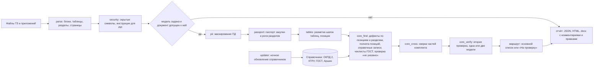
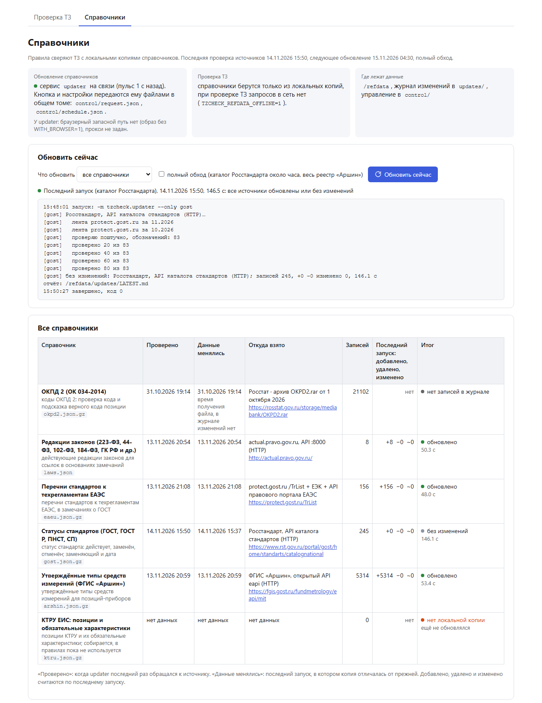

# Чекни!

Проверка ТЗ на закупку по 223-ФЗ. Пакет Python и команды называются `tzcheck` (`python -m tzcheck`, `uvicorn tzcheck.api:app`, образ `tzcheck:local`).

Команда ДождИИ, хакатон МФТИ hack80, задача «Интеллектуальная проверка технического задания на закупку».

Система принимает техническое задание (docx, doc, rtf, odt, pdf, сканы pdf и картинки, xlsx, txt; основное ТЗ и приложения вместе) и выдаёт отчёт для сотрудника закупок: список проблем с цитатой и местом в документе, категорию, объяснение, исправление, нормативное основание и итоговое заключение.

**Содержательную проверку делает языковая модель, без неё проверки требований нет.** Модель по умолчанию `openrouter/deepseek/deepseek-v4.1-flash` (DeepSeek V4.1 Flash через OpenRouter, вызов через LiteLLM), для неё нужен ключ OpenRouter. Решения «дефект или нет» принимает модель; код разбирает документ, маскирует персональные данные, проверяет, что цитата замечания есть в тексте, а норма есть во встроенной базе, подтягивает справочные записи и раскладывает замечания по разделам отчёта.

Без модели (пустой `TZCHECK_LLM_MODEL`) документ разбирается и проверяется только на скрытые символы и инструкции для ИИ. Замечаний по требованиям в таком отчёте нет, заключение: «Модель не настроена. Документ разобран и проверен на скрытые символы и инструкции для ИИ, требования не проверялись.»

## Быстрый старт

Требования: Docker 24+ с Compose v2.24+, 4 ГБ RAM, интернет при сборке и для вызовов модели.

```bash
git clone https://github.com/kitkey/mipt-hack-tz.git && cd mipt-hack-tz
```

Создайте в корне репозитория файл `.env` из шаблона `env.example` и впишите ключ OpenRouter в `TZCHECK_LLM_API_KEY`:

```bash
cp env.example .env
```

В шаблоне:

```bash
TZCHECK_LLM_MODEL=openrouter/deepseek/deepseek-v4.1-flash
TZCHECK_LLM_API_KEY=<ключ OpenRouter>
TZCHECK_VERIFY2_MODEL=openrouter/qwen/qwen3.8-27b
# образцы кейса и ТЗ из ЕИС открытые: разрешить внешнюю модель без слоя NER (раздел «Маскирование ПД»)
TZCHECK_DOC_PUBLIC=1
```

```bash
docker compose up -d --build      # веб-интерфейс: http://localhost:8000
docker compose down               # остановка
```

Что делают эти строки:
- `TZCHECK_LLM_API_KEY` код передаёт в LiteLLM; вместо него подойдёт `OPENROUTER_API_KEY`, его LiteLLM читает сам.
- `TZCHECK_VERIFY2_MODEL` включает вторую модель второй проверки: в основной список может попасть только замечание, которое подтвердили обе модели; подтвердила одна, а вторая нет, замечание уходит в «На проверку»; сняли обе, оно снимается (подробно в «Архитектуре»). Ключ общий, если обе модели у одного поставщика. Пусто = одна модель.
- Без `.env` сервис тоже поднимается, но работает без модели (см. выше).
- `TZCHECK_DOC_PUBLIC=1` нужен потому, что OpenRouter внешний сервис. Внешняя модель вызывается, только если документ помечен открытым или в образе есть слой NER для маскирования ПД (`WITH_PII_NER=1`). По умолчанию образ собирается без NER, и закрытый документ во внешнюю модель не уходит: в отчёте предупреждение «модель не вызвана: документ не помечен открытым и маскирование ПД недоступно», проверены только скрытые символы и инструкции для ИИ. Вместо общей переменной можно помечать документы по одному: переключатель «Открытый документ, например из ЕИС» в форме или `public=true` в API.

Порт на хосте задаёт `APP_PORT` (в `.env` или в окружении), по умолчанию 8000; внутри контейнера сервис всегда слушает 8000. Примеры ниже написаны для 8000.

**Повторный запуск на машине, где уже была старая версия.** Справочники лежат в именованном томе `refdata`. Docker заполняет том из образа только при первом создании, поэтому после обновления кода старый том закрывает собой справочники нового образа. Чтобы взять данные из нового образа, удалите тома перед сборкой:

```bash
docker compose down -v            # удаляет тома refdata, runs (история проверок) и models (скачанные модели OCR и эмбеддингов)
docker compose up -d --build
```

На чистой машине этот шаг не нужен.

Полный образ со сканами и эмбеддингами для гибридного поиска норм (`TZCHECK_RAG_MODE=hybrid`): `WITH_OCR=1 WITH_RAG=1 docker compose up -d --build`, подробности в разделах «Сканы» и «Пункты норм». Слой NER для маскирования ПД: `WITH_PII_NER=1`.

Проверка установки:

```bash
curl http://localhost:8000/health
# {"status":"ok","llm":true,"model":"openrouter/deepseek/deepseek-v4.1-flash"}; без модели "llm":false
curl -F "file=@samples/lift_src.docx" -F "public=1" "http://localhost:8000/api/check"
# JSON с полями status, summary, findings, steps_status
```

Проверка с моделью идёт минуты, а не секунды: модель вызывается много раз на документ. Бюджет на документ `TZCHECK_LLM_DOC_TIMEOUT` (1800 с); число параллельных запросов `TZCHECK_LLM_WORKERS` (по умолчанию 1, для API его можно поднять).

Весь сценарий одной командой: `sh demo/run_demo.sh` (Linux, macOS, Git Bash) или `powershell -File demo/run_demo.ps1` (Windows). Скрипт поднимает сервис, проверяет три ТЗ кейса (помечая их открытыми), сравнивает две версии, отправляет повреждённый файл и запускает CLI в контейнере. Результаты в `demo/out/`.

## Где смотреть по критериям

| Критерий | Где смотреть |
|---|---|
| 1. Разбор ТЗ и привязка к документу | [«Что на выходе»](#что-на-выходе): раздел, таблица, строка, страница и цитата у каждого замечания; HTML-отчёт со ссылкой от замечания к тексту |
| 2. Выявление ошибок и рисков | [«Архитектура»](#архитектура): шаги ядра, вторая проверка, маршрут в основной список |
| 3. Классификация и объяснение | 10 категорий кейса в [«Что на выходе»](#что-на-выходе), разметка `eval/labels.csv` |
| 4. Исправления и нормативные основания | защита от выдуманных оснований в [«Архитектуре»](#архитектура), [«Пункты норм»](#пункты-норм-rag) |
| 5. Универсальность и надёжность | повреждённые файлы, сканы, запрет внешней отправки, полнота проверки по шагам в [«Что на выходе»](#что-на-выходе) |
| 6. Развёртывание и воспроизводимость | [«Быстрый старт»](#быстрый-старт), [«Типовые сценарии»](#типовые-сценарии), [«Переменные окружения»](#переменные-окружения), [«Внешние сервисы»](#внешние-сервисы), `demo/run_demo.sh` |

## Что на выходе

Для каждого замечания:

| Поле | Что это |
|---|---|
| `location`, `block_id`, `quote` | раздел, таблица и строка или абзац, страница для PDF, файл для комплекта; дословная цитата из ТЗ |
| `category` | одна из 10 категорий кейса: ограничение конкуренции, некорректная характеристика, противоречие, неверный код ОКПД 2, гарантия, стандарты и поверка, неполнота или комплектность, предмет закупки, лишнее в ТЗ, оформление по практике заказчика |
| `severity` | высокий, средний, низкий риск |
| `status` | `ошибка`; `неясно`; `ручная проверка`; `рекомендация` (практика заказчика, не требование закона) |
| `section` | `main` основной список; `llm_review` раздел «На проверку». Значение `unchecked` («Не проверено») есть в формате отчёта, но текущее ядро его не выставляет |
| `explanation` | почему фрагмент проблемный, со значениями из этого ТЗ |
| `fix` | исправленная формулировка или действие |
| `replacement` | точная замена цитаты, если модель её предложила; идёт в docx с правками |
| `norm_ids` | основание только из встроенной базы норм (`tzcheck/norms.py`, 19 норм со ссылками и редакциями) |
| `confidence_pct` | уверенность модели, 0-100: оценка второй проверки, без неё оценка шага поиска |
| `evidence`, `trace` | на каком шаге найдено, что сказала вторая проверка (при двух моделях решения обеих), справочные записи, пункт нормы, почему замечание попало в свой раздел |

**Разделы отчёта** (`pipeline.route`). В основной список идёт замечание ядра, которое вторая проверка подтвердила (при `TZCHECK_VERIFY2_MODEL` подтвердили обе модели), если оно не держится на утверждении «в ТЗ не указано» и не опирается на пункт чеклиста ГОСТ, который не утвердил человек. Порог уверенности `TZCHECK_MAIN_MIN_CONFIDENCE` по умолчанию 0, то есть выключен; статус замечания на раздел не влияет. Остальные замечания идут в раздел «На проверку» с причиной в `evidence["блок отчёта"]`: понижено второй проверкой, подтверждено одной из двух моделей, второй проверки нет, вывод «не указано». Снятое второй проверкой или проверкой «не указано» в отчёт не входит: оно лежит в журнале вызовов (`rejected`), а в предупреждениях отчёта стоит его число. Вердикт, заключение и счётчики над таблицей считаются только по основному списку.

**Полнота.** У каждого шага в `steps_status` состояние: выполнен, неприменим, не выполнен, ошибка. Если вызов модели на шаге упал или кончился бюджет времени, `status` результата `incomplete`, а заключение начинается со слов «Проверка неполная» и не говорит «явных проблем не найдено». Веб-интерфейс, API и CLI такой отчёт сохраняют. CLI (`python -m tzcheck`) при `status: incomplete` пишет отчёты и предупреждение в stderr, код выхода 0; при `status: error` (документ не разобран) выходит с кодом 1 без отчётов.

**Паспорт проверки** (поле `passport` в JSON): версии и даты справочников, sha256 каждого файла, модель, справочники только из локальных копий или нет, включены ли пункты норм, версия кода, хэш промптов. Версия кода берётся из `git rev-parse HEAD`; в Docker-образ `.git` не копируется и git не ставится, поэтому там версия берётся из `TZCHECK_CODE_VERSION`, а без неё пишется «нет данных». Хэш промптов считается только по промптам модуля `tzcheck/llm.py`; промпты ядра (`core.py`, `passport.py`, `tables.py`) в него не входят. В HTML-отчёте паспорт короче: справочники, sha256 файлов, модель, режим справочников.

Форматы: JSON, HTML-отчёт с переходом от замечания к тексту документа (кнопки решения закупщика «Принять», «Отклонить», «На проверку» есть в карточках веб-интерфейса), копия исходного docx с комментариями Word на местах замечаний обоих разделов (абзацы, строки таблиц и строки вложенных таблиц; место, которое не нашлось в файле, пропускается), docx с правками в режиме рецензирования по замечаниям основного списка с `replacement`. Журнал вызовов модели (промпты с маской ПД, сырые ответы, снятые кандидаты): `GET /api/runs/{run_id}/trace`.

Интерфейсы: веб-интерфейс (`/`), REST API (раздел «API», описание для фронта в [docs/API_UI.md](docs/API_UI.md)), командная строка (`python -m tzcheck`).


## Архитектура



Поток данных: файл разбирается в блоки (абзац, строка таблицы, заголовок) с разделом, номером таблицы и строки, страницей и файлом. Если модель задана и документ допущен к ней, текст после маскирования ПД уходит в модель по шагам ядра. Модель возвращает JSON; код отбрасывает замечание, если его цитаты нет в тексте или категории нет среди выбранных проверок, и оставляет только идентификаторы норм из встроенной базы. По обозначениям, которые назвала модель (коды ОКПД 2 и КТРУ, ГОСТ, средства измерений), код подтягивает записи из локальных справочников и отдаёт их модели. Вторая проверка подтверждает, понижает или снимает каждого кандидата и ставит уверенность. Решения закупщика из отчёта сохраняются и учитываются в следующих проверках того же заказчика.

Шаги ядра, добавленные к поиску (`tzcheck/core.py`):

- **Категория** (`_category`, `_reclassified`). Ответ модели вида «Группа: категория» разбирается, категория сверяется со списком без учёта регистра. Если модель назвала только группу («Логика», «Риски»), категорию по сути замечания выбирает отдельный вызов модели; не выбрал, замечание отбрасывается с записью в журнале.
- **Полнота позиций** (`complete`, `TZCHECK_COMPLETENESS`, по умолчанию включено, `0` выключает). Отдельный проход по позициям спецификации: модель перечисляет изделия позиции и решает, хватает ли описания (значения и единицы характеристик, состав комплекта, диапазон и точность у средств измерений). Проход идёт, если среди проверок есть «Неполнота или комплектность» или «Некорректная характеристика»; замечания идут дальше общим путём.
- **Проверка «не указано»** (`absent`). Модель видит исходную часть вокруг замечания (до 2000 знаков) и места всего комплекта, найденные поиском по словам замечания. Снять замечание можно только с дословной цитатой показанного места, где сведения указаны: не короче трёх слов и не повтор цитаты самого замечания. Без такой цитаты замечание остаётся и идёт «На проверку»; ответ «мало контекста» оставляет его «На проверку» с важностью на ступень ниже. В основной список утверждение «не указано» не попадает.
- **Вторая проверка** (`verify`). С `TZCHECK_VERIFY2_MODEL` те же замечания независимо решает вторая модель, итог по двум решениям (`_two_checks`): обе подтвердили, замечание подтверждено; обе сняли, снято; подтвердила только одна, «На проверку» без понижения важности; остальные сочетания (одна понизила, другая сняла; одна сняла, у другой решения нет), «На проверку» с важностью на ступень ниже.

| Компонент | Файл | Что делает |
|---|---|---|
| Разбор | `tzcheck/parse.py` | docx по порядку абзацев и таблиц, объединённые ячейки, разделы по нумерации; doc, rtf, odt через LibreOffice; pdf через PyMuPDF; xlsx; сканы через PaddleOCR (`tzcheck/ocr.py`) |
| Ядро | `tzcheck/core.py`, `tzcheck/passport.py`, `tzcheck/tables.py`, `tzcheck/ask.py` | шаги модели: паспорт и роли разделов, таблицы и позиции, поиск дефектов, полнота позиций, «не указано» по всему комплекту, сверка частей, вторая проверка одной или двумя моделями |
| Чеклисты ГОСТ | `tzcheck/gost_check.py`, `tzcheck/gost_profiles.py` | сверка позиций с пунктами стандартов (раздел «Чеклисты ГОСТ») |
| Маскирование ПД | `tzcheck/pii.py` | ФИО, телефоны, почта, документы заменяются метками `[PERSON_1]` до модели и возвращаются в отчёт |
| Модель | `tzcheck/llm.py` | LiteLLM: один вызов `_call` для всех шагов, запрет внешней отправки закрытого документа, журнал вызовов |
| Справочники | `tzcheck/refdata.py`, `tzcheck/okpd.py`, `tzcheck/updater/` | локальные копии, кэш, ночное обновление с запасными путями |
| Конвейер | `tzcheck/pipeline.py`, `tzcheck/graph.py` | порядок шагов (обычный или на LangGraph, `TZCHECK_ORCHESTRATOR=graph`, шаги те же), маршрут по разделам, вердикт и заключение, сравнение версий |
| Отчёт | `tzcheck/report.py`, `tzcheck/revisions.py` | JSON, HTML, docx с комментариями, docx с правками |
| Пункты норм | `tzcheck/rag/` | корпус норм `data/norm_corpus/` (законы, техрегламенты, ГОСТ, СП, СНиП), BM25 на леммах, пункт нормы с цитатой из корпуса к замечанию (раздел «Пункты норм») |
| Обратная связь | `tzcheck/feedback.py` | «Принять», «Отклонить», «На проверку»; цитата, отклонённая в двух проверках того же заказчика (за вычетом проверок, где её приняли), не показывается; если правило (`rule_id`, у замечаний модели это шаг ядра, например `model.find`) отклоняли в 60 % проверок из 5 и больше, уверенность замечания снижается на 20 и в основании пишется доля отклонений. Раздел после этого всё равно решает маршрут по второй проверке |
| Веб и API | `tzcheck/api.py`, `tzcheck/api_ui.py`, `tzcheck/web/` | FastAPI: интерфейс, задачи в фоне с ходом по шагам, история, скачивание отчётов |

**Как система не придумывает основания.** Норма в замечании указывается только идентификатором из встроенной базы (`tzcheck/norms.py`), неизвестный идентификатор код отбрасывает. Замечание, цитаты которого нет в исходном тексте, отбрасывается, снятые кандидаты с причиной лежат в журнале вызовов. Пункт нормы с цитатой (`TZCHECK_RAG=1`) прикладывается, только если цитата есть в тексте нормы из корпуса. Применимость пункта модель решает не на всех путях: когда она решает и когда пункт берётся без неё, описано в разделе «Пункты норм». Итоговое заключение собирает код из замечаний основного списка; текст модели в него не попадает.

## Типовые сценарии

Входы лежат в `samples/` (образцы кейса, открытые, без персональных данных). Сервис поднят по «Быстрому старту», ключ модели вписан в `.env`. Проверка с моделью идёт минуты; число и состав замечаний от прогона к прогону меняются (раздел «Ограничения»), стабильны структура отчёта, поля и файлы на выходе.

### 1. Исходное ТЗ через веб-интерфейс

Вход: `samples/metro_src.docx`, ТЗ на поставку метрологического оборудования: таблицы позиций с кодами ОКПД 2 и характеристиками.

1. Открыть `http://localhost:8000/` (пункт меню «Проверка»).
2. Перетащить файл в поле «Документы» или выбрать его. В «Что проверять» оставить все группы.
3. Включить «Использовать модель» и «Открытый документ, например из ЕИС». Без этой отметки и без слоя NER внешняя модель не вызывается.
4. Нажать «Проверить». Откроется экран хода проверки со шагами и таймером, после него экран результата (адрес `#/run/<run_id>`).

Ожидаемый результат:

- вердикт и заключение по основному списку; если шаг модели не выполнен, плашка «Проверка неполная» с перечнем шагов;
- переключатель разделов «основной список» и «на проверку», вкладки групп «Логика», «Стандарты», «Риски», фильтр по статусу, поиск, порядок «по риску» или «по документу»;
- карточка замечания: номер (`F001` в основном списке, `M001` в «На проверку»), категория, место (раздел, таблица, строка), статус и риск, цитата, «Почему», «Как исправить», «Правка в Word» (если модель предложила замену), «Как нашли» (шаги: «Модель нашла», «Цитата в документе», «Справочники», «Пункт нормы», «Поиск по комплекту», «Вторая проверка», «Раздел отчёта», «Итог»), «Основание» (уверенность, нормы из базы, пункт нормы с цитатой), кнопки «Принять», «Отклонить», «На проверку»;
- кнопки скачивания «Правки в Word» (`metro_src.revisions.docx`: режим рецензирования по замечаниям основного списка с заменой), «Комментарии в Word» (`metro_src.comments.docx`), «Отчёт для печати» (`metro_src.report.html`); JSON лежит по адресу `/runs/<run_id>/metro_src.report.json`;
- «Журнал проверки»: состояние каждого шага и все запросы к модели с ответами.

Сохранённый прогон этого файла (DeepSeek V4.1 Flash, код до выключения практики заказчика по умолчанию, в прогоне стоял профиль `mipt`): все шаги «выполнен», в основном списке 8 замечаний, в «На проверку» 57. Примеры из основного списка:

| Категория | Место | Цитата | Суть |
|---|---|---|---|
| Неверный или общий код ОКПД 2 | раздел «Требование к срокам поставки», таблица 2, строка 9 | код 26.51.33.190 у позиции «Плита поверочная гранитная 1000 × 630 мм, класс точности 0» | общий код «Инструмент измерительный прочий», в справочнике есть 26.51.33.142 «Плиты поверочные и разметочные» |
| Неверный или общий код ОКПД 2 | там же, строка 10 | код 26.51.33.110 у позиции «Штангенрейсмас цифровой» | 26.51.33.110 это «Калибры», точный код 26.51.33.122 «Штангенрейсмасы» |
| Ограничение конкуренции | раздел «Требования к качеству товара, технические и функциональные характеристики товара», таблица 3, строка 4 | «Осциллограф RIGOL DHO804 или эквивалент» | марка и модель в описании; довод опирался на практику `mipt`, без неё (`TZCHECK_CUSTOMER` пусто) такое замечание не гарантировано |

У замечаний по ОКПД 2 в «Как нашли» есть шаг «Справочники» с записями локального справочника ОКПД 2, у замечания про марку пункт нормы «223-ФЗ, Статья 3, ч. 6.1» с цитатой из корпуса.

### 2. Проверка через API в фоне

Вход: `samples/lift_src.docx`, ТЗ на замену грузового лифта.

```bash
curl -F "file=@samples/lift_src.docx" -F "public=1" http://localhost:8000/api/jobs
# {"job_id": "<id>", "run_id": "<id>", "kind": "check", "status": "queued", "use_llm": true, ...,
#  "links": {"self": "/api/jobs/<id>", "events": "/api/jobs/<id>/events", "result": "/api/runs/<id>"}}
curl -N http://localhost:8000/api/jobs/<id>/events            # SSE: snapshot, plan, step по каждому шагу, в конце done или error
curl http://localhost:8000/api/runs/<id> -o lift_src.result.json
curl -O http://localhost:8000/runs/<id>/lift_src.report.html
curl -O http://localhost:8000/runs/<id>/lift_src.comments.docx
curl -O http://localhost:8000/runs/<id>/lift_src.revisions.docx   # если в основном списке есть замечания с заменой
curl http://localhost:8000/api/runs/<id>/trace                     # журнал вызовов модели
```

Ожидаемый результат: событие `done` с `result_url`, затем в JSON `/api/runs/<id>`:

- `status` `ok` или `incomplete` (у `incomplete` в `completeness.incomplete_steps` перечислены шаги, заключение начинается со слов «Проверка неполная»);
- `verdict`, `summary`, `steps_status` (шаги `parse`, `security`, `passport`, `tables`, `core_find`, `core_cross`, `core_verify`, `finish` с состоянием), `passport`, `warnings`;
- `findings`: у каждого `id`, `section` (`main` или `llm_review`), `category`, `severity`, `status`, `location`, `block_id`, `quote`, `explanation`, `fix`, `replacement`, `norm_ids`, `confidence_pct`, `evidence`, `trace`;
- `links`: `report_json`, `report_html`, `comments_docx`, `revisions_docx` (если файл с правками создан).

Тот же вход синхронно: `curl -F "file=@samples/lift_src.docx" -F "public=1" http://localhost:8000/api/check`, ответ того же вида (200 при `ok` и `incomplete`, 400 при ошибке разбора).

### 3. Без ключа модели

Вход: `samples/injection.docx`, итоговое ТЗ лифта со скрытой инструкцией для ИИ и символами нулевой ширины. Ключ не нужен: сервис в Docker без `.env` (или с пустым `TZCHECK_LLM_MODEL`), либо CLI без Docker.

```bash
curl -F "file=@samples/injection.docx" http://localhost:8000/api/check     # Docker, модель не задана
python -m tzcheck samples/injection.docx --no-llm -o out                    # без Docker
```

Ожидаемый результат (снят прогоном CLI): `status: ok`, режим `format`, замечаний 0, файлы `out/injection.report.json`, `out/injection.report.html`, `out/injection.comments.docx`. Заключение: «Модель не настроена. Документ разобран и проверен на скрытые символы и инструкции для ИИ, требования не проверялись.» В предупреждениях два пункта: скрытые символы Unicode в разделе 11 (требования к гарантии) и фрагмент, похожий на инструкцию для ИИ, в разделе «Предмет закупки», абзац 3. Шаги `parse`, `security`, `finish` выполнены, шаги модели «неприменим». `/health` в таком сервисе отвечает `"llm": false`.

## Модель

По умолчанию проверку ведёт DeepSeek V4.1 Flash через OpenRouter (`TZCHECK_LLM_MODEL=openrouter/deepseek/deepseek-v4.1-flash`), температура 0, рассуждения выключены (`TZCHECK_LLM_REASONING=off`). Подойдёт любая модель, которую понимает LiteLLM, в том числе локальный OpenAI-совместимый сервер:

```bash
# .env
TZCHECK_LLM_MODEL=openai/qwen3.8-27b
TZCHECK_LLM_API_BASE=http://host.docker.internal:8091/v1
TZCHECK_LLM_API_KEY=local
TZCHECK_LLM_WORKERS=1           # локальный сервер однопоточный: параллельные запросы встают в очередь и упираются в таймаут
TZCHECK_LLM_TIMEOUT=900         # на один запрос, с
TZCHECK_LLM_DOC_TIMEOUT=1800    # на документ, с; после него оставшиеся вызовы пропускаются, проверка помечается неполной
```

```bash
docker compose up -d --force-recreate app
curl http://localhost:8000/health      # "llm": true
```

Локальная модель (адрес на localhost, 127.0.0.1 или host.docker.internal) внешней не считается: текст не покидает машину, запрета на закрытые документы для неё нет.

Если модель задана, а ключа нет или он неверный, вызовы модели падают, шаги получают состояние «ошибка», а результат `status: "incomplete"`.

**Уверенность.** Вторая проверка возвращает число 0-100, в HTML оно стоит в колонке «Уверенность» с сортировкой и ползунком «Уверенность от N %», в JSON в полях `confidence_pct` и `confidence_basis`. Уверенность не откалибрована: она годится для сортировки и фильтра внутри отчёта, читать её как долю верных замечаний нельзя.

**Качество.** Замеры прежней версии (правила без модели) из README убраны: к текущей проверке они не относятся. Скрипт `eval/eval_labels.py` сопоставляет замечания с разметкой 105 правок экспертов (`eval/labels.csv`) и при заданной модели проверяет документы ею. Готовые отчёты в `demo/output/` собраны прежней версией.

## Практика заказчика из правок закупщика

Профиль заказчика в `customers.json` (поля `verify_practice` и `rules`) можно вывести из правок его закупщика. `tzcheck/learn_practice.py` сравнивает исходное и итоговое ТЗ по абзацам и ячейкам таблиц (тот же разбор, что у проверки), отправляет изменённые места с маской ПД в модель проверки и просит обобщить правки в короткие правила для других ТЗ того же заказчика: без наименований позиций, марок, организаций и цифр из этих документов. Правило или фраза с цифрами отбрасывается. У профиля остаются `id`, `name` и `markers`, прежние `verify_practice` и `rules` в модель не уходят и заменяются выученными; остальные профили файла переносятся как есть.

```bash
python -m tzcheck.learn_practice --pair samples/lift_src.docx samples/lift_fin.docx \
    --pair samples/metro_src.docx samples/metro_fin.docx --customer mipt -o customers_learned.json --public
```

Выученный файл подключается переменной `TZCHECK_CUSTOMERS` (в Docker путь внутри контейнера, например в томе `/refdata`). Практика заказчика по умолчанию выключена (`TZCHECK_CUSTOMER` пусто, `none`, `off` или `0`). `TZCHECK_CUSTOMER=mipt` задаёт профиль явно. `TZCHECK_CUSTOMER=auto` выбирает его по тексту ТЗ: профиль для запросов модели называет модель на шаге паспорта из списка профилей файла, а заказчика для решений закупщика код узнаёт по `markers` (регулярные выражения по тексту ТЗ). В проверку возвращаются решения только того же заказчика; без профиля все решения идут под пустым заказчиком.

- `--dry-run` печатает изменённые места и не вызывает модель;
- `--profiles` файл, из которого берутся `name`, `markers` и остальные профили (по умолчанию `TZCHECK_CUSTOMERS` или `tzcheck/data/customers.json`);
- `--public` ТЗ открытые: текст уходит во внешнюю модель и без слоя NER, как у документа с `public=true` в интерфейсе.

Модель та же, что у проверки (`TZCHECK_LLM_MODEL` и остальные `TZCHECK_LLM_*`); без неё команда ничего не пишет.

**Замер на кейсе.** Правила mipt в `customers.json` выведены из правок тех же двух ТЗ кейса, поэтому полнота с ними завышена. Замер оставь-один-документ: практика выучена на одной паре и проверяется на ТЗ другой (`eval/learn_practice/customers_from_lift.json` на метрологии, `customers_from_metro.json` на лифте; `TZCHECK_CUSTOMERS`, `TZCHECK_CUSTOMER=mipt`, `EVAL_DOCS`, `EVAL_SKIP_FINAL=1`). Ядро feat/roles-tables 97f64a0, DeepSeek V4.1 Flash, по два прогона; без практики (`TZCHECK_CUSTOMER=none`) на том же ядре. Блок / категория / точно:

| | лифт, 13 меток | метрология, 92 | всего, 105 |
|---|---|---|---|
| без практики, прогоны 1; 2 | 9/5/5; 6/5/5 | 81/26/13; 76/24/20 | 90/31/18; 82/29/25 |
| практика с другого ТЗ, прогоны 1; 2 | 6/6/6; 5/5/5 | 77/24/22; 78/25/23 | 83/30/28; 83/30/28 |
| правила mipt из правок этих же ТЗ (прежнее ядро) | 7/5/5 | 86/66/43 | 93/71/48 |

Практика с другого ТЗ категорию не поднимает, точных попаданий даёт 28 против 18 и 25 без практики: разница того же порядка, что разброс двух прогонов без практики (в первом из них цитаты по ГОСТ разошлись с разметкой, точно 0 из 14). Рост от правил mipt держится на классах «Ограничение конкуренции», «Неполнота или комплектность» и «Лишнее в ТЗ» метрологии: в правках лифта нет марок, комплектов и пометок автора, переносить на метрологию нечего. В лифте 13 меток, замер по нему мало что говорит. Норма `INTERNAL` в `norms.py` (сроки прописью, начало сроков одной формулировкой) входит в промпт при любой практике заказчика; на лифте с практикой метрологии класс «Оформление по внутреннему стандарту» всё равно 0 из 3. `tzcheck/data/customers_learned_both.json` выучен на обеих парах, на кейсе его полнота завышена так же, как у правил mipt.

## Сканы (OCR)

PDF без текстового слоя и картинки (PNG, JPG, TIFF, BMP) распознаёт PaddleOCR PP-OCRv5 (детектор `PP-OCRv5_mobile_det`, распознавание `eslav_PP-OCRv5_mobile_rec`, русский язык). Перед разбором снимается наклон страницы, таблицы находятся по линиям сетки и раскладываются по ячейкам, текст вне таблиц собирается в абзацы, латинские буквы-двойники в русских словах меняются на кириллицу. К каждой распознанной странице в отчёт идёт предупреждение «текст распознан OCR (PaddleOCR): цифры и коды сверить с оригиналом».

```bash
WITH_OCR=1 docker compose up -d --build     # paddlepaddle 3.1.1, paddleocr 3.4.0, OpenCV; модели около 100 МБ скачиваются при сборке
curl -F "file=@scan.pdf" -F "public=1" "http://localhost:8000/api/check"
```

Если при сборке сети не было, модели скачаются при первом скане в том `models`. В образе без OCR скан не падает: API отвечает 400 «в PDF не найден текст: похоже на скан без текстового слоя…» с подсказкой, как включить распознавание.

Качество распознавания по страницам: эталон каждой страницы взят из текстового слоя того же PDF, 29 страниц, CPU (`eval/ocr_compare/REPORT.md`).

| Страницы | CER | Слова | Числа | ОКПД 2 | Медиана, с/стр. |
|---|---:|---:|---:|---:|---:|
| 150 dpi, чистые | 1,06 % | 97,9 % | 98,1 % | 100 % | 6,0 |
| 150 dpi, искажённые | 1,77 % | 96,5 % | 96,9 % | 100 % | 5,6 |
| 300 dpi, чистые | 2,40 % | 94,5 % | 96,0 % | 100 % | 9,0 |
| 300 dpi, искажённые | 2,09 % | 95,9 % | 95,9 % | 100 % | 8,6 |

Сканы синтетические: страницы своих PDF с наложенными искажениями. Методика: `eval/ocr_compare/`.

## Пункты норм (RAG)

К замечанию прикладывается пункт нормы с дословной цитатой из корпуса норм. В Docker включено (`TZCHECK_RAG=1`), поиск BM25 по леммам.

Пункт попадает к замечанию одним из трёх путей. На всех путях цитата нормы сверяется с текстом пункта в корпусе; применимость пункта модель решает только на втором.

1. **При второй проверке** (`core._norm_fragment`). Для каждого замечания код подбирает пункт без модели: по статье из `norm_ids`, по обозначению стандарта в тексте замечания, иначе поиском по корпусу с порогом отказа. Пункт записывается в `evidence` («пункт нормы», «цитата нормы») и показывается второй проверке вместе с замечанием. Отдельного решения о применимости этого пункта нет: вторая проверка решает судьбу замечания целиком.
2. **Проверка кандидатов моделью** (`tzcheck/rag/verify.py`, `TZCHECK_RAG_VERIFY=1`). Идёт для замечаний категорий из `ENRICH_CATEGORIES` (конкуренция, стандарты и поверка, гарантия, неполнота, характеристика, предмет закупки) и для замечаний с `norm_ids`, если в `norm_ids` нет статьи закона и в тексте не назван стандарт из корпуса. Код собирает до 5 кандидатов (`tzcheck/rag/retrieve.py`, две дорожки поиска: законы и техрегламенты; стандарты, СП, СНиП). Модель по каждому кандидату отвечает «применим», «не применим» или «не решить», для «применим» с дословной цитатой из пункта. Код прикладывает первый применимый пункт, только если цитата модели есть в тексте пункта (с точностью до пробелов); в «источнике нормы» тогда пишется «применимость подтвердила модель, цитата сверена с корпусом». Иначе у замечания пишется «основание нормы: не найдено, проверить вручную», а пункт с первого пути, если он был, остаётся в `evidence`.
3. **По статье или обозначению без модели** (`rag.enrich`). Замечание ядра со статьёй закона в `norm_ids` или с названным стандартом проверку кандидатов моделью не проходит: функция `model.from_model`, по которой отбираются такие замечания, источник ядра `model:*` модельным не считает. Такое замечание получает пункт по статье или по обозначению, если его ещё нет с первого пути. Так же пункт прикладывается, если пачка проверки кандидатов не дошла до модели (бюджет, ошибка). Пункт открытого поиска без решения модели не прикладывается (`TZCHECK_RAG_OPEN=auto`).

ТЗ перед отправкой модели маскируется тем же `Scrubber`, что и остальные вызовы; тексты норм публичные и идут без маски. Модель на втором пути решает, применим ли пункт к замечанию, но само замечание не проверяет: к ложному замечанию тоже может прийти применимый пункт.

Корпус `data/norm_corpus/` лежит в репозитории сжатым (`*.json.gz`). Тексты новых редакций стандартов от обновлятора входят в тот же индекс. Индекс BM25 собирается шагом Docker-сборки; без Docker при первой проверке с `TZCHECK_RAG=1` или командой `TZCHECK_REFDATA_OFFLINE=1 python -m tzcheck.rag build`. Замеры поиска и проверки пунктов в `eval/rag/REPORT.md` сняты на вопросах прежней версии и на текущей не пересчитывались.

Гибридный поиск (BM25 и эмбеддинги deepvk/USER-bge-m3 через RRF) нужен для запуска с GPU: образ с `WITH_RAG=1` (torch, sentence-transformers), векторы корпуса и `TZCHECK_RAG_MODE=hybrid`. Без векторов или без модели эмбеддингов поиск сам переходит на BM25.

```bash
WITH_RAG=1 docker compose up -d --build
docker compose --profile rag run --rm rag-vectors     # модель с Hugging Face и векторы в том models; на CPU десятки минут
TZCHECK_RAG_MODE=hybrid docker compose up -d --force-recreate app   # или TZCHECK_RAG_MODE=hybrid в .env
```

Векторы привязаны к sha256 индекса. Когда обновлятор добавил тексты редакций и индекс пересобран, векторы дополняются только новыми фрагментами.

## Маскирование ПД

Перед отправкой в модель `tzcheck/pii.py` заменяет персональные данные метками `[PERSON_1]`, `[PHONE_1]`, после ответа метки возвращаются в текст. Регулярки ищут почту, телефоны с `+7` или `8`, СНИЛС, ФИО по окончаниям, паспорт после слов «паспорт» или «серия» и счёт физлица (40817, 40820, вклад 423). Расчётный счёт организации, ИНН организации и номер извещения из 10 цифр остаются в тексте. После регулярок может работать модель NER `redmadrobot-rnd/rubert-base-pii-ner` (ruBERT-base, лицензия Apache-2.0): она ищет сущности в исходном тексте и маскирует те, что не попали в метки регулярок. Без модели NER или без torch маскирование идёт одними регулярками; если слой NER включён (`TZCHECK_PII_NER`), но не загрузился, в предупреждения отчёта пишется «ПД маскируются только по шаблонам, ФИО могут остаться открытыми».

Режим задаёт `TZCHECK_PII_NER`: `auto` (по умолчанию) включает слой, когда модель проверки внешняя, `1` включает всегда, `0` выключает. Внешней считается модель с `openrouter/` или с `TZCHECK_LLM_API_BASE` не на localhost, 127.0.0.1 и host.docker.internal; без `TZCHECK_LLM_API_BASE` LiteLLM обращается к облаку провайдера, поэтому такая модель тоже внешняя, кроме `ollama/`.

По условию кейса во внешние API можно передавать только открытые данные. Маскирование этого не гарантирует: адреса не маскируются, полнота на замере 0,96. Поэтому `llm._call`, через который идут все вызовы модели по тексту ТЗ, проверяет `allow_external`. Внешняя модель вызывается, если слой NER включён и загрузился или документ помечен открытым: `TZCHECK_DOC_PUBLIC=1`, переключатель в форме или `public=true` в запросе, например для ТЗ, скачанного из ЕИС. Иначе модель не вызывается, в предупреждениях отчёта пишется «модель не вызвана: документ не помечен открытым и маскирование ПД недоступно», проверены только скрытые символы и инструкции для ИИ, а заключение начинается со слов «Модель не вызывалась». Для локальной модели ограничений нет. Внешней или локальной считается основная модель (`TZCHECK_LLM_MODEL`, `TZCHECK_LLM_API_BASE`): модели отдельных шагов (`TZCHECK_<ШАГ>_MODEL`, `TZCHECK_VERIFY2_MODEL`) на допуск не влияют, поэтому при локальной основной модели и внешней модели шага текст уходит во внешнюю модель без этой проверки. Профили ГОСТ (`gost_profiles`) модель собирает из текста стандарта, текст ТЗ туда не уходит.

Маскируются ФИО, телефоны, почта, номера документов (паспорт, СНИЛС, ИНН физлица из 12 цифр, ОМС, карта, права, военный билет, свидетельство о рождении). Адреса, URL и IP не маскируются: в ТЗ адрес это обычно место поставки, коды ОКПД 2 модель NER путает с IP-адресами. Поверх модели стоят проверки: порог уверенности 0,5, формат номера (10-значный ИНН организации и обозначения ГОСТ не проходят), телефон без запятой и десятичной точки (цены). ФИО маскируется, если в нём два слова или рядом инициалы. Имя после «им.» не маскируется.

Замер на 30 ТЗ из ЕИС, 128 упоминаний ФИО и контактов сотрудников заказчиков размечены вручную (`eval/pii/summary_cpu.json`):

| Тип | Упоминаний | Пропущено: регулярки | Пропущено: регулярки + NER | Точность: регулярки | Точность: регулярки + NER |
|---|---:|---:|---:|---:|---:|
| ФИО | 51 | 6 | 0 | 0,94 | 0,90 |
| Телефон | 57 | 45 | 5 | 1,00 | 1,00 |
| Почта | 20 | 0 | 0 | 1,00 | 1,00 |
| Всего | 128 | 51 (полнота 0,60) | 5 (полнота 0,96) | 0,97 | 0,95 |

Случаи из ревью и проверка «не трогать» на вымышленных строках (`python eval/pii/pii_eval.py --probe`, итог в `eval/pii/summary_probe.json`):

| Случай | Регулярки | Только NER | Регулярки + NER |
|---|---|---|---|
| «Иванову И.И.», «ИВАНОВ И.И.», «Петрова Анна», «Шмидт О.Б.», «Сидоренко Пётр Ильич» | нет | ФИО | ФИО |
| телефон «(495) 123-45-67» без +7 | нет | телефон | телефон |
| паспорт после слова «паспорт» | да | нет | да |
| СНИЛС | да | да | да |
| ИНН физлица из 12 цифр | нет | ИНН | ИНН |
| счёт физлица 40817 | счёт | нет | счёт |
| адрес регистрации физлица | нет | нет | нет |
| ИНН организации, номер извещения из 10 цифр, р/с организации 40702 | не трогает | не трогает | не трогает |
| место поставки, ГОСТ, ОКПД 2, марка | не трогает | не трогает | не трогает |

Время на документ (медиана 30 тыс. символов): регулярки 0,01 с, с NER на CPU 5,4 с (максимум 30,5 с), на GPU 0,26 с; загрузка модели NER на CPU 18 с (`eval/pii/summary_cpu_timing.json`, `summary_cuda.json`).

```bash
WITH_PII_NER=1 docker compose build                      # torch CPU, transformers, модель около 680 МБ в /opt/pii-ner
TZCHECK_PII_NER=1 docker compose up -d --force-recreate app   # или auto: слой сам включится для внешней модели
python eval/pii/pii_eval.py --device cuda                # замер; разметка в eval/pii/work/ вне репозитория
```

## Чеклисты ГОСТ

Для стандарта, на который ссылается ТЗ, модель один раз собирает чеклист (`tzcheck/gost_profiles.py`, поставляется в `tzcheck/data/gost_profiles/`, в Docker лежит в томе `refdata` вместе с утверждениями): что заказчик указывает при заказе, пределы с числом и единицей, документы и маркировка при поставке. У каждого пункта номер пункта стандарта, полный текст пункта и цитата.

Сборка идёт в два прохода модели. Первый выписывает пункты из текста, разбитого на пункты по нумерации. Второй сверяет каждый пункт с текстом: полный пункт, область применения, заголовки разделов над пунктом и соседние пункты.

| Статус | Что значит |
|---|---|
| `draft` | выписан моделью, сверку не прошёл; в проверку не идёт, причина хранится в профиле |
| `verified` | сверен моделью с текстом ГОСТ |
| `approved` | утвердил человек: `POST /api/gost_profiles/{slug}/approve` или `python -m tzcheck.gost_profiles approve` |

Ядро сверяет позиции ТЗ с чеклистом через `items_for(position, passport)`; применимость стандарта к позиции решает модель по области применения, ответ кэшируется по (стандарт, вид изделия). Ошибкой может идти только противоречие утверждённому пункту; противоречие сверенному пункту и отсутствие параметра в ТЗ идут вопросом на проверку. Интерфейс для ядра: [docs/GOST_PROFILES.md](docs/GOST_PROFILES.md).

Если текста стандарта нет в корпусе или профиль не собран, сверки с чеклистом по этому стандарту нет, и отдельной отметки в отчёте об этом нет: функция таких отметок (`gost_profiles.apply`) к конвейеру не подключена. Список профилей с числом пунктов по статусам: `GET /api/gost_profiles`.

## Справочники и их обновление

Справочные записи для ядра (коды ОКПД 2 и КТРУ, статусы ГОСТ, типы средств измерений) берутся из локальных копий в `tzcheck/data/` (в Docker том `refdata`). Сервис `updater` в Docker обновляет их каждую ночь в 04:30 по Москве, по воскресеньям полный обход каталогов; время, день полного обхода и состав меняются на вкладке «Справочники». Сервисы `app` и `updater` делят том `refdata`; новые файлы приложение подхватывает без перезапуска. Если источник недоступен, остаётся прежняя копия. После обновления кода старый том `refdata` нужно удалить (`docker compose down -v`, раздел «Быстрый старт»), иначе справочники нового образа не попадут в том.

| Справочник | Файл | Откуда, по порядку |
|---|---|---|
| ОКПД 2 | `okpd2.json.gz` | Росстат → classifikators.ru (заменяет файл Росстата, только если тому больше 90 дней) → прежняя копия |
| Законы: 223-ФЗ, 44-ФЗ, 102-ФЗ, 184-ФЗ, 135-ФЗ, 162-ФЗ, ГК ч. 1 и 2 | `laws.json` | API actual.pravo.gov.ru → то же через браузер → КонсультантПлюс |
| Перечни стандартов к техрегламентам ЕАЭС | `eaeu.json.gz` | protect.gost.ru/TrList → портал ЕЭК |
| Статусы ГОСТ, ГОСТ Р, ПНСТ, СП | `gost.json.gz` | API каталога rst.gov.ru → то же через браузер → protect.gost.ru |
| Утверждённые типы СИ | `arshin.json.gz` | открытый API ФГИС «Аршин» → то же через браузер |
| КТРУ | `ktru.json.gz` | RSS и карточки zakupki.gov.ru → то же через браузер |
| Тексты новых редакций стандартов | `norm_texts.json` (список и источники), тексты в `norm_texts/` | meganorm.ru по спискам «Актуализированной базы» → то же через браузер → docs.cntd.ru (только полный текст) → protect.gost.ru (страницы картинками и OCR) |

Рядом с каждым файлом `<имя>_meta.json`: источник, сработавший путь, время, версия, число записей, sha256. Разница с прошлой копией пишется в `updates/ГГГГ-ММ-ДД_<источник>.json`, сводка в `updates/LATEST.md`. Тексты новых редакций в репозиторий не положены (права на перепубликацию стандартов не подтверждены): после клонирования их скачивает `python -m tzcheck.updater --only gost_texts`.

```bash
docker compose run --rm updater python -m tzcheck.updater                # разовое обновление всех источников
docker compose run --rm updater python -m tzcheck.updater --only gost    # выбранные: gost, gost_texts, okpd2, arshin, eaeu, laws, ktru
docker compose run --rm updater python -m tzcheck.updater --offline      # пересобрать из сохранённых ответов
docker compose logs updater                                              # время следующего запуска
```

Коды выхода: 0 все источники обновлены или без изменений, 1 хотя бы один оставлен прежним, 3 уже идёт другой запуск. Сайты rst.gov.ru, rosstat.gov.ru, pravo.gov.ru и zakupki.gov.ru часть запросов из-за рубежа обрывают: обновление запускают с российского IP или через прокси (`HTTPS_PROXY`). Сертификаты НУЦ Минцифры лежат в `tzcheck/data/certs/` и подключаются сами. Запасные пути через браузер работают в образе с `WITH_BROWSER=1`.

### Вкладка «Справочники»

Веб-интерфейс, вкладка «Справочники» (`http://localhost:8000/refdata`):

- таблица всех справочников: когда источник проверяли последний раз, когда данные реально менялись, каким путём получены, сколько записей, что добавлено, удалено и изменено в последнем запуске, итог и причина, если оставлена прежняя копия;
- каталог Росстандарта: сколько стандартов известно, сколько обозначений проверяется поштучно и откуда они, разбивка по статусам, последние изменения, поиск по обозначению в локальной копии; стандарт, которого нет в копии, можно поставить на проверку при следующем обновлении;
- «Обновить сейчас»: все справочники или один, при желании полный обход; второй запуск, пока идёт первый, не начнётся;
- расписание: включено или нет, время, день полного обхода, какие справочники; сохраняется в `control/schedule.json` и переживает перезапуск;
- «Как обновляется»: для каждого справочника цепочка путей, адреса запросов, что уходит наружу (только обозначения стандартов, коды и даты, текст ТЗ не уходит) и где лежит результат;
- режим работы: есть ли у проверки ТЗ доступ к сети (`TZCHECK_REFDATA_OFFLINE`), на связи ли updater, есть ли у него браузерный запасной путь и прокси; журнал запусков.



Как связаны `app` и `updater`. В Docker у `app` справочники без сети (`TZCHECK_REFDATA_OFFLINE=1`), обновлением занимается только `updater`. Оба сервиса видят том `refdata` (`/refdata`), обмен идёт файлами в `/refdata/control/`:

| Файл | Кто пишет | Кто читает | Зачем |
|---|---|---|---|
| `schedule.json` | вкладка | updater, раз в 3 с | расписание; без файла действуют `TZCHECK_UPDATE_AT`, `TZCHECK_UPDATE_FULL_WEEKDAY`, `TZCHECK_UPDATE_ENABLED` |
| `request.json` | кнопка «Обновить сейчас» | updater забирает и удаляет | какие справочники обновить, полный ли обход |
| `scheduler.json` | updater, раз в 3 с | вкладка | пульс, следующее обновление, какие настройки он видит |
| `run.json`, `run.log`, `history.jsonl` | updater | вкладка | текущий запуск, его вывод, прошлые запуски |

Если updater остановлен, запрос с кнопки ждёт в `request.json` и выполнится после `docker compose up -d updater`. Без Docker (`uvicorn tzcheck.api:app`) кнопка запускает обновление в фоне самого веб-приложения; по расписанию без Docker обновляет `python -m tzcheck.updater.nightly`.

## Внешние сервисы

| Кто | Куда | Что уходит | Как отключить |
|---|---|---|---|
| `app` с моделью | OpenRouter (по умолчанию) или адрес из `TZCHECK_LLM_API_BASE` | текст ТЗ после маскирования ПД; во внешнюю модель только при работающем слое NER или открытом документе | пустой `TZCHECK_LLM_MODEL`; тогда содержательной проверки нет |
| `app` при `TZCHECK_REFDATA_OFFLINE=0` | rst.gov.ru, ФГИС «Аршин» | обозначение ГОСТ или наименование прибора, которых нет в локальной копии | `TZCHECK_REFDATA_OFFLINE=1` (по умолчанию) |
| `updater` | источники справочников из таблицы выше | только запросы каталогов | `docker compose stop updater` |
| сборка с `WITH_OCR=1`, сервис `rag-vectors` | модели PaddleOCR, Hugging Face | только скачивание моделей | не собирать с OCR, не запускать `rag-vectors` |
| сборка с `WITH_PII_NER=1` | Hugging Face (`redmadrobot-rnd/rubert-base-pii-ner`) | только скачивание модели при сборке; при проверке модель NER работает локально | не собирать с `WITH_PII_NER=1` |

## Переменные окружения

| Переменная | По умолчанию | Что задаёт |
|---|---|---|
| `TZCHECK_LLM_MODEL` | пусто | модель в формате LiteLLM, рабочее значение `openrouter/deepseek/deepseek-v4.1-flash`; пусто = только разбор и проверка безопасности, без содержательной проверки |
| `TZCHECK_LLM_API_KEY` | пусто | ключ модели (для OpenRouter ключ OpenRouter; LiteLLM читает и `OPENROUTER_API_KEY`) |
| `TZCHECK_LLM_API_BASE` | пусто | адрес OpenAI-совместимого сервера для локальной модели |
| `TZCHECK_VERIFY_MODEL` | пусто | своя модель для второй проверки замечаний (формат LiteLLM); пусто = та же, что у поиска. Так же задаётся модель любого шага ядра: `TZCHECK_<ШАГ>_MODEL` (`PASSPORT`, `TABLES`, `FIND`, `COMPLETE`, `REFS`, `GOST_CHECK`, `ABSENT`, `CROSS`, `VERIFY`) |
| `TZCHECK_VERIFY_API_BASE`, `TZCHECK_VERIFY_API_KEY` | пусто | адрес и ключ для модели второй проверки, если она стоит на другом сервере (например, локальная модель при поиске в облаке); так же `TZCHECK_<ШАГ>_API_BASE`, `TZCHECK_<ШАГ>_API_KEY` |
| `TZCHECK_VERIFY2_MODEL` | пусто | вторая модель второй проверки (адрес и ключ: `TZCHECK_VERIFY2_API_BASE`, `TZCHECK_VERIFY2_API_KEY`), в `env.example` пример `openrouter/qwen/qwen3.8-27b`. Те же замечания независимо решают две модели: подтвердили обе, замечание может идти в основной список; сняли обе, снято; подтвердила одна, «На проверку»; остальные сочетания, «На проверку» с важностью ниже. Пусто = одна вторая проверка |
| `TZCHECK_COMPLETENESS` | 1 | проход полноты по позициям спецификации (`core.complete`); `0` выключает |
| `TZCHECK_LLM_WORKERS` | 1 | параллельные запросы к модели; для API можно больше, локальный однопоточный сервер при 2 и больше упирается в таймаут |
| `TZCHECK_JOB_WORKERS` | 2 | сколько проверок из веб-интерфейса и `/api/jobs` идёт одновременно |
| `TZCHECK_LLM_TIMEOUT` | 900 | таймаут одного запроса, с |
| `TZCHECK_LLM_DOC_TIMEOUT` | 1800 | бюджет модели на документ, с; после него оставшиеся вызовы пропускаются, проверка помечается неполной |
| `TZCHECK_LLM_JSON_MODE` | 1 | просить у модели JSON-режим |
| `TZCHECK_LLM_MAX_TOKENS` | 24000 | нижняя граница лимита ответа: шаг берёт большее из своего лимита и этого значения |
| `TZCHECK_LLM_TEMPERATURE` | 0 | температура модели, 0 для воспроизводимости |
| `TZCHECK_MAIN_MIN_CONFIDENCE` | 0 | необязательный порог уверенности второй проверки для основного списка (0: выключен). В основной список идёт замечание ядра, которое вторая проверка подтвердила по тексту; пониженное ею (вывод зависит от сведений вне комплекта), подтверждённое одной из двух моделей, не проверенное, утверждение «не указано» и замечание по не утверждённому пункту чеклиста ГОСТ идут в раздел «На проверку» |
| `TZCHECK_LLM_REASONING` | off | рассуждения модели: `off` выключает (OpenRouter `reasoning.enabled=false`, локальный vLLM/llama.cpp `enable_thinking=false`); число задаёт бюджет токенов на рассуждение (OpenRouter `reasoning.max_tokens`); `low`/`medium`/`high` задают усилие; `on` оставляет поведение модели по умолчанию |
| `TZCHECK_DOC_PUBLIC` | 0 | 1 = документы открытые (ТЗ из ЕИС, образцы кейса), внешняя модель вызывается и без слоя NER |
| `TZCHECK_PII_NER` | auto | auto = слой NER только для внешней модели, 1 = всегда, 0 = нет; нужен образ с `WITH_PII_NER=1` или torch и transformers |
| `TZCHECK_PII_NER_MODEL`, `TZCHECK_PII_NER_DEVICE`, `TZCHECK_PII_NER_MIN` | `redmadrobot-rnd/rubert-base-pii-ner` (в Docker `/opt/pii-ner`), cpu, 0.5 | модель или путь к ней, устройство, порог уверенности |
| `TZCHECK_PII_NER_CACHE` | пусто | каталог кэша Hugging Face для модели без Docker |
| `TZCHECK_REFDATA_OFFLINE` | 1 | 1 = справочники только из локальных копий и кэша; 0 = при пропуске в копии спросить rst.gov.ru и «Аршин» |
| `TZCHECK_OCR` | auto | распознавание сканов: `auto` если PaddleOCR установлен, `1` обязательно, `0` выключено |
| `TZCHECK_OCR_DET`, `TZCHECK_OCR_DEVICE`, `TZCHECK_OCR_DPI` | mobile, cpu, 200 | детектор (`mobile` или `server`), устройство, разрешение рендера скана |
| `TZCHECK_OCR_THREADS`, `TZCHECK_OCR_MKLDNN`, `TZCHECK_OCR_ISOLATE` | 8, 1, 1 | потоки CPU, MKLDNN, распознавание в отдельном процессе с перезапуском после сбоя |
| `PADDLE_PDX_CACHE_HOME` | `/models/paddlex` | модели PaddleOCR |
| `TZCHECK_RAG` | 0, в Docker 1 | пункты норм к замечаниям |
| `TZCHECK_RAG_MODE` | bm25 | `bm25`; `hybrid`, `dense` и `rerank` нужны образ `WITH_RAG=1` и векторы корпуса, без них поиск идёт BM25 |
| `TZCHECK_RAG_OPEN` | auto | поиск по всему корпусу: `auto` только с проверкой моделью, `1` и без проверки, `0` выключен |
| `TZCHECK_RAG_VERIFY` | 1 | пункты к замечаниям проверяет модель; `0` пункты только по статье и обозначению |
| `TZCHECK_RAG_VERIFY_K`, `TZCHECK_RAG_VERIFY_BATCH` | 5, 4 | кандидатов на замечание; замечаний в одном запросе к модели |
| `TZCHECK_RAG_EMBED_MODEL`, `TZCHECK_RAG_DEVICE` | deepvk/USER-bge-m3, cpu | модель эмбеддингов и устройство |
| `TZCHECK_RAG_VECTOR_DIR` | `/models/rag-vectors` | векторы корпуса |
| `TZCHECK_GOST_PROFILES` | `<TZCHECK_DATA_DIR>/gost_profiles` | каталог чеклистов ГОСТ и утверждений (в Docker `/refdata/gost_profiles`, том `refdata`) |
| `TZCHECK_GOST_PROFILE_PASSES`, `TZCHECK_GOST_PROFILE_WINDOW` | 2, 7000 | сколько раз модель читает каждое окно текста и размер окна в знаках |
| `TZCHECK_GOST_PROFILE_EMBED` | deepvk/USER-bge-m3 | эмбеддинги для слияния повторов в чеклистах |
| `HF_HOME`, `HF_HUB_OFFLINE` | `/models/hf`, 1 | кэш моделей Hugging Face; 1 = не ходить в сеть при проверке |
| `TZCHECK_ORCHESTRATOR` | linear | `linear` или `graph` (те же шаги узлами LangGraph) |
| `TZCHECK_CODE_VERSION` | пусто | версия кода для паспорта проверки, если git недоступен (в Docker); без неё и без git «нет данных» |
| `TZCHECK_CONF_MIN` | 0 | порог показа в HTML по умолчанию, ползунок меняет его на странице |
| `TZCHECK_CUSTOMER` | пусто | практика заказчика из `tzcheck/data/customers.json`: пусто (а также `none`, `off`, `0`) = выключена; `auto` = профиль называет модель по тексту ТЗ, заказчика для решений закупщика код узнаёт по `markers`; id профиля (например `mipt`) = задать явно. Практика идёт в запросы поиска и второй проверки; замеры на чужих ТЗ и на кейсе ведутся без неё |
| `TZCHECK_CUSTOMERS` | `tzcheck/data/customers.json` | файл профилей заказчиков, например выученный `python -m tzcheck.learn_practice` |
| `TZCHECK_DATA_DIR` | `tzcheck/data`, в Docker `/refdata` | каталог справочников, общий для app и updater |
| `TZCHECK_STORE` | `/data/runs` | загруженные файлы, отчёты и решения закупщиков |
| `TZCHECK_HISTORY_PUBLIC` | 1 | 1 = история проверок видна всем; 0 = только запуски пользователя из параметра `user` |
| `TZCHECK_UPDATE_AT` | 04:30 | время ночного обновления справочников |
| `TZCHECK_UPDATE_FULL_WEEKDAY` | 6 | день полного обхода: 0 понедельник ... 6 воскресенье, -1 не делать |
| `TZCHECK_UPDATE_ENABLED` | 1 | 0 = ночное обновление выключено; расписание с вкладки «Справочники» важнее этих трёх переменных |
| `TZCHECK_UPDATE_RUNNER` | app, в Docker `updater` | кто выполняет «Обновить сейчас»: `app` сам веб-процесс, `updater` сервис через `/refdata/control/` |
| `APP_PORT` | 8000 | порт веб-интерфейса на хосте (в контейнере всегда 8000) |
| `WITH_OCR`, `WITH_RAG`, `WITH_PII_NER`, `WITH_BROWSER` | 0 | аргументы сборки: PaddleOCR; torch CPU и sentence-transformers для гибрида; torch CPU, transformers и модель NER для маскирования ПД; Playwright и Chromium для запасных путей обновления |

## Запуск без Docker

Python 3.12, для doc и rtf LibreOffice (`soffice` в PATH). Переменные модели те же, что в `.env` (раздел «Быстрый старт»), их нужно выставить в окружении.

```bash
python -m venv .venv && . .venv/bin/activate        # Windows: .venv\Scripts\activate
pip install -r requirements.txt
python -m tzcheck samples/lift_src.docx -o out                  # отчёты в out/
python -m tzcheck main.docx appendix.docx -o out                # комплект: первый файл основной
uvicorn tzcheck.api:app --port 8000                             # веб
python -m tzcheck.updater                                       # обновить справочники
pip install -r requirements-ocr.txt                             # сканы
pip install -r requirements-rag.txt                             # гибридный поиск норм
TZCHECK_REFDATA_OFFLINE=1 python -m tzcheck.rag build           # индекс BM25 корпуса норм
```

Автотесты не вызывают настоящую модель и не грузят NER: модель в них заменена заглушкой.

```bash
pip install -r requirements-dev.txt                             # requirements.txt + pytest
TZCHECK_REFDATA_OFFLINE=1 python -m pytest tests/ -q
```

## API

```bash
# проверка: use_llm=true по умолчанию; public=1 помечает документ открытым
curl -F "file=@main.docx" -F "attachments=@app1.docx" -F "public=1" "http://localhost:8000/api/check"
# только выбранные группы проверок и имя пользователя (кириллица и пробелы кодируются)
curl -F "file=@main.docx" -F "public=1" -F "checks=logic,risks" -F "user=Иванова А.А." "http://localhost:8000/api/check"
# проверка в фоне с ходом по шагам: задача, поток событий, результат
curl -F "file=@main.docx" -F "public=1" "http://localhost:8000/api/jobs"
curl -N "http://localhost:8000/api/jobs/<job_id>/events"
curl "http://localhost:8000/api/runs/<run_id>"
curl "http://localhost:8000/api/runs/<run_id>/trace"                               # журнал вызовов модели
curl -G --data-urlencode "user=Иванова А.А." "http://localhost:8000/api/runs"      # история одного пользователя
curl -F "old=@v1.docx" -F "new=@v2.docx" "http://localhost:8000/api/compare?use_llm=true"
curl -H "Content-Type: application/json" -d '{"run_id":"…","finding_id":"F001","decision":"reject","comment":"…"}' http://localhost:8000/api/feedback
curl http://localhost:8000/api/feedback/stats
curl http://localhost:8000/api/refdata/status                                       # справочники, расписание, режим, текущий запуск
curl -H "Content-Type: application/json" -d '{"sources":["gost"]}' http://localhost:8000/api/refdata/update
curl -H "Content-Type: application/json" -d '{"enabled":true,"at":"03:00","full_weekday":6}' http://localhost:8000/api/refdata/schedule
curl -G --data-urlencode "q=ГОСТ Р 53780-2010" "http://localhost:8000/api/refdata/gost"   # статус по локальной копии
```

`/api/compare` проверяет обе версии целиком и сравнивает замечания всех разделов по ключу «категория + первые 80 знаков цитаты»: ключ есть только в старой версии, «Исправлено» (`fixed`); в обеих, «Осталось» (`remained`); только в новой, «Новые» (`added`); `summary` вида «Исправлено N, осталось M, новых K.». Модель по умолчанию выключена (`use_llm=false`), без модели в обеих проверках замечаний нет, и сравнение пустое. Если хоть одна проверка не `ok` (в том числе `incomplete`), ответ 400. Флага `public` у сравнения нет: для внешней модели нужен `TZCHECK_DOC_PUBLIC=1` или слой NER. Запрос синхронный и ждёт обе проверки.

## Ограничения

- Без модели содержательной проверки нет. С внешней моделью закрытый документ проверяется только при слое NER (`WITH_PII_NER=1`) или пометке «открытый».
- Ответы модели не детерминированы полностью даже при температуре 0: повторная проверка того же документа может дать другой набор замечаний, особенно в разделе «На проверку».
- Уверенность второй проверки не откалибрована, поэтому порог основного списка `TZCHECK_MAIN_MIN_CONFIDENCE` по умолчанию выключен; включённый порог тоже условный.
- Сравнение версий (`/api/compare`) сопоставляет замечания по категории и первым 80 знакам цитаты: другая формулировка цитаты или разброс модели между двумя прогонами тоже попадают в «Исправлено».
- Тип СИ в «Аршине» ищется по наименованию позиции: совпадение подсказывает, что прибор относится к СИ, но не заменяет проверку конкретной модели.
- Комментарии Word создаются только для docx; для остальных форматов HTML и JSON.
- Сканы проверены на синтетических искажениях своих же PDF, реальных сканов с плохой печатью и таблицами без сетки в наборе нет. Таблица без линий сетки распознаётся как текст.
- Нормы вне корпуса система не процитирует; подпункт внутри статьи не всегда тот, что нужен по смыслу.
- Чеклисты ГОСТ собираются только для стандартов, чей текст есть в корпусе; пункты `verified` сверены моделью, но не человеком, поэтому ошибкой не идут, пока их не утвердят.
- Справочник ГОСТ в копии содержит статусы стандартов из ТЗ кейса и корпуса (213 записей); полный обход каталога выполняет ночной `updater --full`.

## Развитие

1. Пилот на одном отделе закупок. Решения «принять», «отклонить», «на ручную проверку» из отчёта уже сохраняются и копятся как разметка.
2. Калибровка уверенности и порога основного списка по накопленным решениям.
3. Неполнота через КТРУ: обязательные характеристики по коду ОКПД 2. Обновлятор КТРУ уже собирает.
4. Комплект закупки целиком (ТЗ, проект договора, извещение) и профиль заказчика с положением о закупке как отдельным набором норм.
