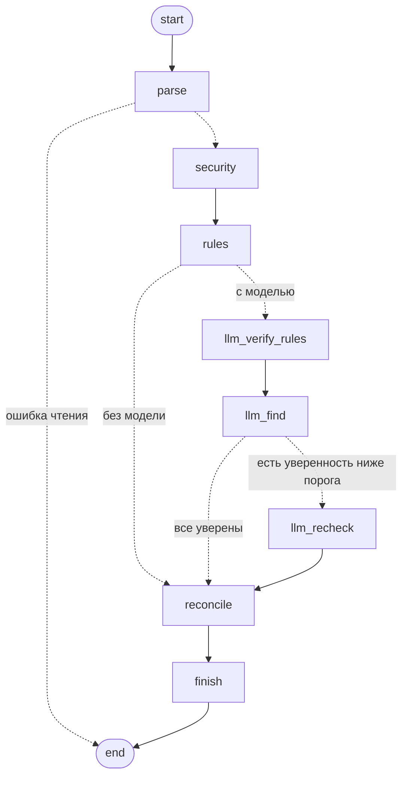

### Уверенность замечаний и режим LangGraph

Уверенность выдаёт сама модель. В JSON-ответе на поиск замечаний, на сверку частей документа и на вторую проверку замечаний правил есть поле `confidence`: целое 0-100, насколько модель уверена, что это действительно ошибка ТЗ. Код проверяет диапазон (доля 0,85 переводится в 85, число вне 0-100 и текст отбрасываются). Если модель поле не вернула, в отчёте стоит «нет оценки», цифра не подставляется. Замечания правил без модели цифры не получают, у них источник «правило». Если вторая проверка дала оценку, она заменяет оценку поиска, а прежняя остаётся в основании вывода.

В отчёте: в JSON у замечания поля `confidence_pct` (число или `null`) и `confidence_basis` (на каком шаге получена оценка или «правило»), в `stats.confidence` счётчики; в HTML колонка «Уверенность», сортировка по ней и ползунок «показывать от N %» (по умолчанию `TZCHECK_CONF_MIN`, в адресе `?min=70`), флажок для замечаний без оценки; в DOCX-комментарии строка «уверенность: 85 % (модель при второй проверке)» или «уверенность: правило».

Оркестрация в двух режимах с одним форматом вывода: `linear` (по умолчанию) и `graph` на LangGraph. Граф (`tzcheck/graph.py`) состоит из тех же шагов, что и линейный конвейер, и одного условного перехода: если после поиска и второй проверки есть замечание с уверенностью ниже `TZCHECK_CONF_LOW` (по умолчанию 60) или без оценки, оно уходит на повторную проверку моделью; отклонённое замечание модели снимается, отклонённое замечание правила остаётся с пометкой «решает закупщик». Выбор: `python -m tzcheck file.docx --orchestrator graph`, `POST /api/check?orchestrator=graph`, список «Оркестрация» в веб-форме или `TZCHECK_ORCHESTRATOR=graph`. Без модели оба режима дают одинаковые замечания на lift_src/fin и metro_src/fin (18, 7, 92, 8), 0,1-0,3 с на документ. С локальной Qwen3.8-27B (Q2, без ограничения GPU) поле `confidence` пришло во всех ответах; lift_src: linear 36 замечаний за 494 с, graph 39 за 439 с, граф перепроверил 4 замечания; lift_fin: 41 за 734 с и 33 за 741 с. Списки режимов немного расходятся из-за недетерминированности модели и повторной проверки. Цифра модели не откалибрована: на исправленном lift_fin медиана 85-90 %, на исходном lift_src 80-85 %, поэтому она годится для сортировки и отсева внутри отчёта, а не как доля верных замечаний. Подробно: `eval/confidence/REPORT.md`.

