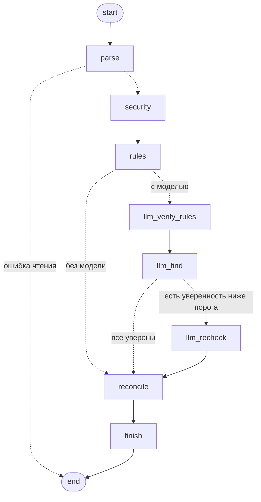

# Уверенность замечаний и режим LangGraph

## Что сделано

Уверенность выдаёт сама модель полем в JSON-ответе. Калибровки по разметке нет.

- `tzcheck/llm.py`: в схемы ответа поиска замечаний (`CHUNK_PROMPT`), сверки частей (`CROSS_PROMPT`) и второй проверки (`VERIFY_PROMPT`) добавлено `"confidence": целое 0-100, уверенность, что это действительно ошибка ТЗ: 0 = точно не ошибка, 100 = точно ошибка`. В `VERIFY_PROMPT` поле `reason` теперь «коротко, на чём основано решение». Новая функция `recheck` для повторной проверки замечаний с низкой уверенностью.
- `tzcheck/confidence.py`: разбор числа с проверкой диапазона (85, "85", "85 %", доля 0,85 → 85; 101, -5, текст, `true`, NaN → нет оценки), запись оценки в замечание, пометки «правило» и «нет оценки», пороги `TZCHECK_CONF_LOW` (повторная проверка, 60) и `TZCHECK_CONF_MIN` (порог показа в HTML, 0).
- `tzcheck/model.py`: поля `confidence_pct: int | None` и `confidence_basis: str`. Старое `confidence` (эвристика 0,5-0,9) осталось внутренним, им пользуются `verify_rules` и `feedback`.
- `tzcheck/pipeline.py`: хвост `check()` вынесен в `_finish()` (общий для обоих режимов), параметр `orchestrator`, в `_merge` оценка модели переносится на совпавшее замечание правила, в `stats.confidence` счётчики.
- `tzcheck/graph.py`: тот же конвейер узлами LangGraph и один условный переход на повторную проверку.
- `tzcheck/report.py`: колонка «Уверенность» в HTML, сортировка, ползунок порога, флажок «без оценки модели»; строка «уверенность: …» в DOCX-комментарии. JSON получает поля автоматически.
- `tzcheck/__main__.py` (`--orchestrator linear|graph`), `tzcheck/api.py` (`orchestrator` в `/api/check` и список в форме), `requirements.txt` (`langgraph>=1.2`, установлен 1.2.22).

## Откуда цифра у замечания

| Источник замечания | `confidence_pct` | `confidence_basis` |
|---|---|---|
| правило, модель не смотрела | `null` | `правило` |
| правило, спорное, прошло вторую проверку моделью | число модели | `модель при второй проверке` |
| модель нашла, вторая проверка подтвердила | число второй проверки (число поиска в `evidence`) | `модель при второй проверке` |
| граф: оценка ниже порога, повторная проверка | число повторной проверки (прежнее в `evidence`) | `модель при повторной проверке` |
| модель не вернула поле или вернула мусор | `null` или прежнее число | `…: нет оценки` |

## Граф

Схема, которую рисует сам LangGraph: `eval/confidence/graph.mmd`. Узел `llm_find` = поиск по фрагментам + сверка частей + вторая проверка находок. На повторной проверке отклонённое замечание модели снимается, отклонённое замечание правила остаётся, уходит в «ручную проверку» с пометкой «модель не согласна с правилом, решает закупщик». Повторная проверка идёт один раз, цикла нет.

## Прогон обоих режимов

`python eval/confidence/run_modes.py` (только правила), прогрев кэша одним прогоном до замеров, 12:00:

| документ | linear: замечаний / с | graph: замечаний / с | совпадают |
|---|---|---|---|
| lift_src | 18 / 0,24 | 18 / 0,25 | да |
| lift_fin | 7 / 0,25 | 7 / 0,25 | да |
| metro_src | 92 / 0,13 | 92 / 0,13 | да |
| metro_fin | 8 / 0,16 | 8 / 0,15 | да |

Без модели графовый режим проходит parse → security → rules → reconcile → finish, список замечаний совпадает поэлементно; разница во времени в пределах шума. Число замечаний ниже, чем в ранних прогонах: правила в это время сужались по итогам проверки обобщения.

`python eval/confidence/run_modes.py --stub` (заглушка модели из тестов, вторая проверка даёт 40 %, повторная 85 %): в обоих режимах один и тот же набор замечаний, граф проходит `llm_recheck`, и у замечаний модели и проверенных правил стоит 85 % вместо 40 %, прежние 40 % лежат в основании. Это и есть объяснимая разница режимов: те же замечания, уточнённая оценка у сомнительных. Результаты: `modes_rules.json`, `modes_stub.json`.

## Тесты

`tests/test_confidence.py`, 27 тестов: разбор числа (14 случаев), честная пометка без числа, у правил без модели нет цифры, в трёх промптах есть поле, оценки модели доходят до замечаний (заглушка), вторая проверка без поля, равенство режимов без модели (2 документа), граф перепроверяет низкую уверенность и пропускает высокую, `recheck` снимает отклонённое замечание модели и оставляет правило, неизвестный режим, HTML/JSON/DOCX показывают уверенность, порог показа из окружения. HTML-отчёт открыт в Chromium: сортировка «сначала высокая», ползунок и флажок работают.

Весь набор `pytest tests/ -q` в 12:00: 102 passed, 1 skipped.

## Локальная модель

Сервер `qwen3.8-27b` (Q2, Strata) на 8091, `TZCHECK_LLM_WORKERS=1`, температура 0,1.

Первая версия промпта второй проверки дала смешение: на отклонённого кандидата («Масса не более 5 кг», reject) модель ставила confidence 90, имея в виду уверенность в своём решении, а не в ошибке. Шкала переписана: «0 = точно не ошибка, 100 = точно ошибка; при reject ниже 50, при confirm выше 50», поле `confidence` стоит перед `decision`. На тех же четырёх кандидатах после правки: марка Mitutoyo confirm 95, «масса не более 5 кг» reject 10, неполный комплект confirm 85, «поверка по месту эксплуатации» reject 20. Ответ на 4 кандидата 13-18 с.

### Прогоны на lift_src и lift_fin

`python eval/confidence/run_modes.py --llm --docs lift_src lift_fin`, лог `run_llm.log`, замечания `findings_{linear,graph}_{doc}.json`, сводка `modes_llm.json`.

С потолком GPU (STRATA_GPU_DUTY=0,65, ~12-14 ток/с) первый прогон шёл с 09:52 и за 80 минут не закончил lift_src в двух режимах; остановлен в 11:12, его результатов нет (последние 40 запросов: 3036 с, около 960 токенов ответа на запрос). Сервер перезапущен без потолка, все цифры ниже без потолка, со временем прогона с потолком их не сравнивать.

| документ, режим | замечаний | время, с | оценено моделью | «правило» | нет оценки | медиана, % | ≥80 % | <50 % | повторно проверено |
|---|---|---|---|---|---|---|---|---|---|
| lift_src, linear | 36 | 494 | 26 | 10 | 0 | 80 | 14 | 4 | нет |
| lift_src, graph | 39 | 439 | 29 | 10 | 0 | 85 | 23 | 2 | 4 |
| lift_fin, linear | 41 | 734 | 36 | 5 | 0 | 85 | 27 | 1 | нет |
| lift_fin, graph | 33 | 741 | 28 | 5 | 0 | 90 | 20 | 1 | 4 |

Поле `confidence` модель вернула во всех ответах: «нет оценки» ни разу. Шаги графа: parse, security, rules, llm_verify_rules, llm_find, llm_verify_new, llm_recheck, reconcile, reconcile_llm, finish. Время графа и линейного режима одного порядка: повторная проверка 4 замечаний занимает один запрос.

Почему режимы дают разные списки. Основная причина: модель недетерминирована при температуре 0,1, поиск даёт немного разные находки (lift_src: 2 только в linear, 5 только в graph). Вторая причина: повторная проверка в графе. На lift_src она подняла два замечания правил о стандартах (СП 31-110-2003, ГОСТ Р 53780-2010) с 50 % до 90 и 95 %, а у двух замечаний (предмет «ремонтные работы», общий список ГОСТ/СНиП) модель повторно не согласилась с правилом (10 %), они остались с пометкой «решает закупщик». На lift_fin повторная проверка подняла «Подъём строительных материалов…» с 40 до 80 %, два ГОСТа оставила на 50 % («нужна ручная проверка»).

Что показывает цифра. Модель оценивает уверенно почти всё, что сама нашла: на исправленном закупщиками lift_fin медиана 85-90 %, выше, чем на исходном lift_src (80-85 %). Цифра различает замечания внутри документа (отклонённые моделью замечания правил получают 10-20 %, подтверждённые 80-95 %), но не отвечает на вопрос «сколько из замечаний с 80 % верны». Калибровку по разметке (105 правок закупщиков) не делали; это следующий шаг.
